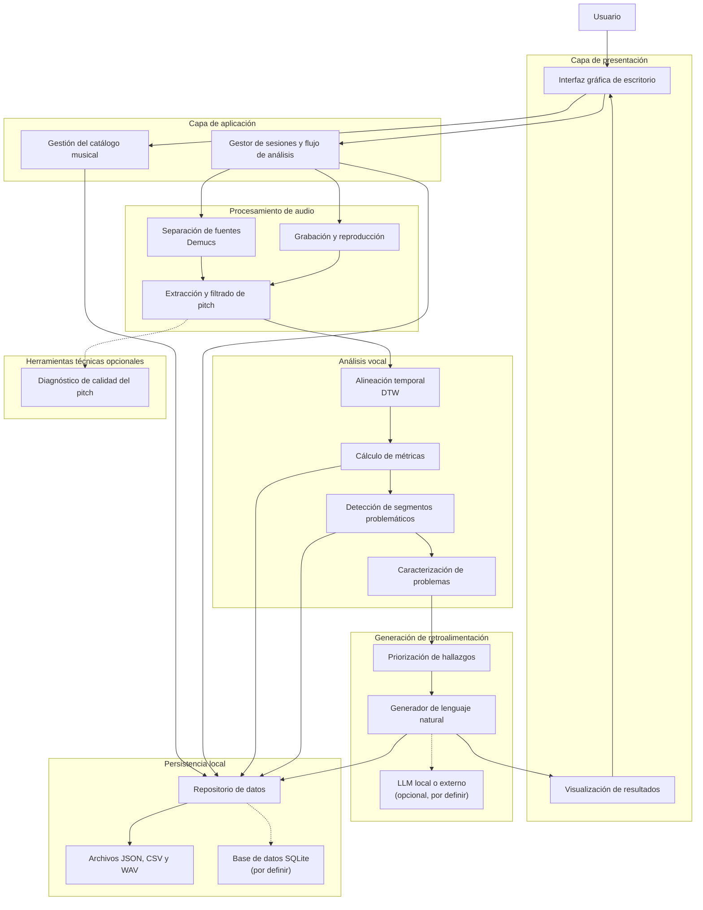
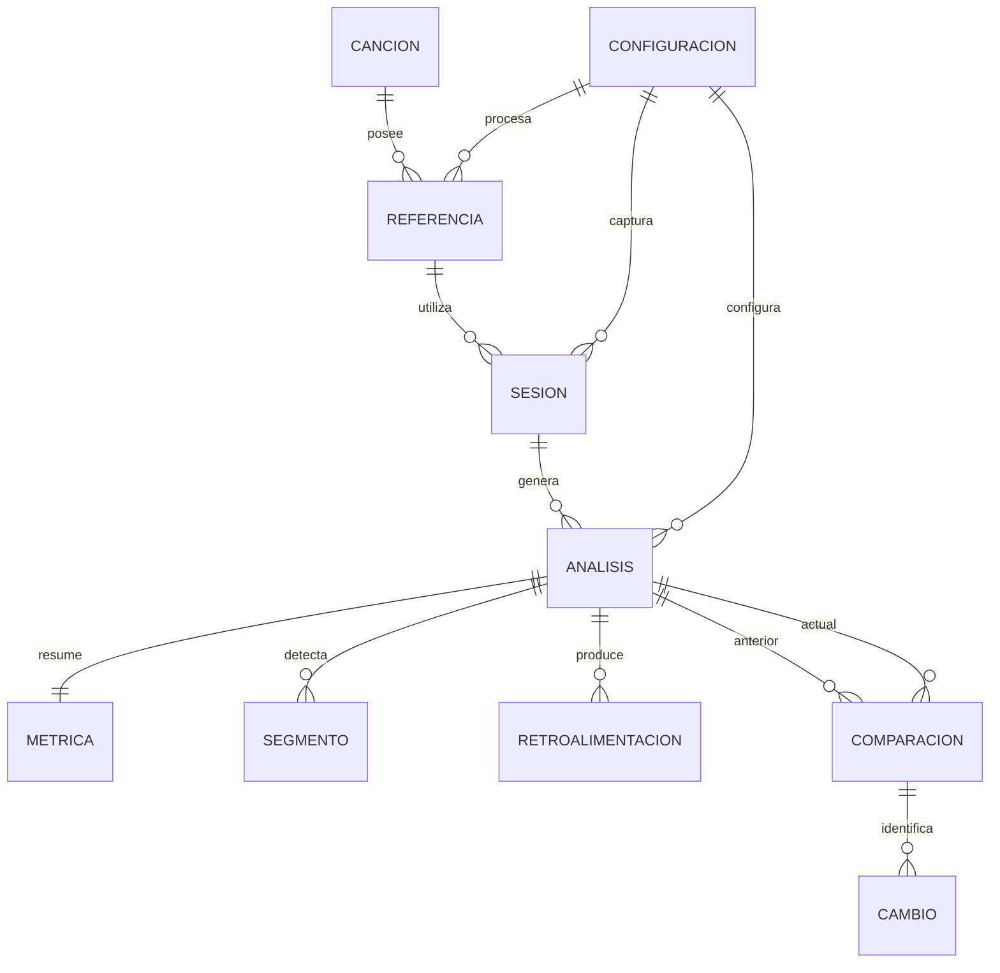

# Formular memoria paso a paso

ID: `019eb3a5-07e3-7163-a098-145f9d55e5f3`

Transcripción de mensajes conservados por Codex. Los registros JSONL adjuntos incluyen herramientas, cambios y metadatos disponibles.

## Usuario


# Files mentioned by the user:

## Carta Gantt_Núñez_Bastián_2020407001.xlsx: C:\Users\Diego Tapia\Desktop\Pene\U\13avo semestre\Formulación\Documento\Entrega 2\Carta Gantt_Núñez_Bastián_2020407001.xlsx

## Núñez_Bastián_2020407001.pdf: C:\Users\Diego Tapia\Desktop\Pene\U\13avo semestre\Formulación\Documento\Entrega 2\Núñez_Bastián_2020407001.pdf

## memoria.pdf: C:\Users\Diego Tapia\Desktop\Pene\U\13avo semestre\Formulación\Documento\Formato Memoria\memoria.pdf

## Ejemplo_Formato_HU.png: C:/Users/Diego Tapia/Desktop/Pene/U/13avo semestre/Formulación/Documento/Formato Requisitos y HUs/Ejemplo_Formato_HU.png

## Ejemplo_Formato_Requisitos.png: C:/Users/Diego Tapia/Desktop/Pene/U/13avo semestre/Formulación/Documento/Formato Requisitos y HUs/Ejemplo_Formato_Requisitos.png

## My request for Codex:
No hagas nada, solo quiero que entiendas y me ayudes a formular algunas cosas, te entregaré lo que tengo que hacer y lo comencemos a hacer poco a poco, van imagenes que sirven de formato y unos documentos ejemplo de un alumno, así como la pauta de la memoria, con las indicaciones de que debe llevar

[Imagen o adjunto: consultar registro JSONL]
[Imagen o adjunto: consultar registro JSONL]

## Codex (commentary)

Perfecto, no haré cambios ni ejecutaré nada todavía. Me quedo en modo acompañamiento/formulación: iremos armando esto por partes, usando esos documentos como referencia y las imágenes como formato para requisitos e historias de usuario.

## Codex (final_answer)

Entendido. Cuando quieras, mándame la primera parte de lo que tienes que hacer o el texto que quieres formular, y te ayudo a convertirlo al formato correspondiente: requisitos, historias de usuario, memoria, planificación, redacción académica, etc.

Por ahora tengo claro que los materiales de referencia son:

- Documento ejemplo del alumno.
- Carta Gantt ejemplo.
- Pauta/formato de memoria.
- Formato de Historia de Usuario.
- Formato de Especificación de Requisito.

Avanzamos poco a poco, sin tocar archivos hasta que me lo pidas explícitamente.

## Usuario


# Files mentioned by the user:

## Carta Gantt.xlsx: C:\Users\Diego Tapia\Desktop\Pene\U\13avo semestre\Formulación\Carta Gantt.xlsx

## Informe_planificación_tesis.pdf: C:\Users\Diego Tapia\Desktop\Pene\U\13avo semestre\Formulación\Informe_planificación_tesis.pdf

## My request for Codex:
te entregaré los documentos que utilicé para una entrega anterior, algunas cosas tal vez hayan cambiado pero es la planificación casi definitiva


## Codex (final_answer)

Perfecto, esos dos documentos serían la base de tu propia planificación:

- `Carta Gantt.xlsx`: planificación temporal casi definitiva.
- `Informe_planificación_tesis.pdf`: explicación/formulación previa de la tesis.

Los podemos usar como “fuente principal” y contrastarlos con la pauta/formato de memoria y el ejemplo del otro alumno. Si algunas cosas cambiaron, no hay problema: las vamos ajustando a medida que redactemos.

Cuando quieras partir, lo más útil sería que me digas una de estas cosas:

1. Qué sección necesitas trabajar primero.
2. Qué entrega específica estás preparando ahora.
3. Qué parte sientes más débil: objetivos, metodología, requisitos, historias de usuario, cronograma, alcance, etc.

Y desde ahí lo armamos con calma.

## Usuario

me gustaría trabajar en la arquitectura lógica y los requisitos


## Codex (commentary)

Buenísimo, arquitectura lógica y requisitos van muy de la mano: primero conviene entender bien el alcance funcional real del sistema y después ordenar eso en componentes. Voy a revisar tus documentos base para extraer objetivo, módulos, actores y cualquier requisito ya insinuado.

## Codex (commentary)

Ya ubiqué los archivos. Ahora voy a sacar texto del informe y, si hace falta, de la pauta/ejemplo para no inventar nombres de módulos ni prioridades a ciegas.

## Codex (commentary)

No hay runtime documental preconfigurado en esta sesión, así que probaré con las herramientas disponibles del sistema para extraer el texto del PDF. Si eso falla, uso una vía liviana alternativa.

## Codex (commentary)

Veo también el proyecto local de la app de karaoke, así que además del informe voy a mirar la estructura del código. Eso nos ayuda a que la arquitectura lógica no quede “de papel”, sino alineada con lo que realmente existe.

## Codex (commentary)

El código confirma una app de escritorio en Python/Tkinter con módulos separados para catálogo, karaoke, comparación, métricas, pitch, separación y visualización. Esa división ya nos da una arquitectura lógica bastante defendible para la memoria.

## Codex (commentary)

El extractor tropezó con los acentos de la ruta en la consola, nada grave. Lo voy a abordar por búsqueda con comodines desde Python para evitar depender de esa codificación.

## Codex (commentary)

También encontré una diferencia importante: tu informe plantea una versión más ambiciosa con patrones de error y feedback en lenguaje natural, mientras el prototipo actual ya cubre muy bien catálogo, separación, pitch, comparación, métricas y visualización. Para requisitos conviene distinguir “implementado/base” de “proyectado para la memoria”.

## Codex (final_answer)

Perfecto. Revisé tu informe, el documento de requisitos que ya existe y el código actual. No modifiqué nada.

La forma más limpia de trabajarlo sería separar dos niveles:

**Arquitectura lógica**
Tu sistema puede describirse como una aplicación de escritorio modular para análisis vocal, compuesta por:

1. **Capa de presentación**
   Interfaz gráfica en Tkinter. Permite gestionar canciones, iniciar grabaciones, visualizar notas esperadas, mostrar métricas y diagnosticar filtros.

2. **Módulo de gestión de catálogo**
   Administra canciones, metadatos, archivos originales, referencias de pitch y grabaciones asociadas.

3. **Módulo de preparación de audio**
   Usa Demucs para separar voz e instrumental. A partir de los stems genera la pista instrumental para karaoke.

4. **Módulo de extracción de pitch**
   Obtiene la frecuencia fundamental desde la voz de referencia y desde la grabación del usuario. Aplica filtros de rango vocal, energía, segmentos cortos y saltos atípicos.

5. **Módulo de grabación y reproducción**
   Reproduce la pista instrumental mientras captura la voz del usuario por micrófono.

6. **Módulo de comparación**
   Alinea la referencia y la interpretación mediante DTW, calcula diferencias de afinación en cents y descarta errores extremos.

7. **Módulo de métricas**
   Calcula error promedio, desviación estándar, tendencia general, porcentaje dentro de tolerancias y cantidad de puntos comparados.

8. **Módulo de visualización**
   Grafica la melodía esperada, la interpretación obtenida y diagnósticos de pitch crudo versus filtrado.

9. **Persistencia local**
   Guarda canciones, metadatos, archivos CSV de pitch, grabaciones WAV y resultados JSON en carpetas locales.

**Requisitos**
Podemos armar los requisitos en dos grupos:

**Funcionales principales**

- RF01: Gestionar catálogo de canciones.
- RF02: Agregar canciones desde archivos de audio locales.
- RF03: Separar voz e instrumental mediante Demucs.
- RF04: Generar pista instrumental para karaoke.
- RF05: Extraer pitch de referencia desde la voz original.
- RF06: Reproducir instrumental y grabar la voz del usuario.
- RF07: Extraer pitch desde la grabación del usuario.
- RF08: Comparar pitch del usuario contra la referencia.
- RF09: Calcular métricas de afinación.
- RF10: Visualizar comparación entre notas esperadas y obtenidas.
- RF11: Guardar grabaciones y resultados.
- RF12: Diagnosticar el comportamiento de los filtros de pitch.
- RF13: Manejar errores operativos sin cerrar la aplicación.

**No funcionales principales**

- RNF01: La interfaz debe ser comprensible para usuarios no técnicos.
- RNF02: Los procesos largos no deben bloquear la interfaz.
- RNF03: El sistema debe funcionar localmente en Windows con Python.
- RNF04: Los datos deben persistirse en archivos locales.
- RNF05: El sistema debe tolerar audios con ruido, silencios o detecciones incompletas.
- RNF06: El código debe mantener responsabilidades separadas por módulo.
- RNF07: Los resultados deben ser trazables a una canción y grabación específica.

El punto fino es decidir si en esta entrega quieres declarar como requisito también la parte más ambiciosa del informe: **detección de patrones de error y retroalimentación en lenguaje natural**. Esa parte está en la planificación, pero el prototipo actual parece estar más fuerte en afinación, métricas y visualización. Mi recomendación: incluirla como requisito/proyección si aún será implementada; si no, dejarla como alcance futuro o módulo proyectado.

## Usuario

Eventualmente me gustaría utilizar otra interfaz grafica que no sea Tkinter, necesito que sea más bonito


## Codex (final_answer)

Sí, totalmente razonable. Para la memoria puedes plantearlo sin casarte con Tkinter como interfaz definitiva.

Yo lo formularía así:

> El prototipo inicial utiliza Tkinter debido a su disponibilidad en Python y a su utilidad para validar rápidamente los flujos principales del sistema. Sin embargo, se contempla una evolución de la interfaz hacia una alternativa gráfica más moderna, con mejor presentación visual y mayor flexibilidad para la visualización de resultados, manteniendo separados los módulos de procesamiento de audio, comparación y persistencia para facilitar dicha migración.

Para arquitectura lógica, esto nos conviene mucho: dejamos la interfaz como una **capa reemplazable**.

Podrías describir la arquitectura así:

```text
Usuario
  |
  v
Capa de presentación
(Tkinter inicialmente; interfaz moderna proyectada)
  |
  v
Capa de aplicación / control de flujo
  |
  +--> Gestión de catálogo
  +--> Preparación de audio
  +--> Grabación y reproducción
  +--> Extracción de pitch
  +--> Comparación y métricas
  +--> Visualización de resultados
  +--> Persistencia local
```

Y como requisito no funcional:

**RNF - Evolutividad de la interfaz**  
El sistema debe mantener separada la lógica de procesamiento de audio respecto de la interfaz gráfica, de manera que la capa de presentación pueda ser reemplazada o rediseñada posteriormente sin modificar de forma significativa los módulos de análisis, comparación, métricas y persistencia.

También podrías dejarlo como restricción/decisión técnica:

> La interfaz inicial será desarrollada como aplicación de escritorio local. En una primera etapa se utilizará Tkinter para validar funcionalidad, mientras que la arquitectura considerará la posibilidad de migrar posteriormente a una interfaz más moderna, por ejemplo mediante frameworks como PySide/PyQt, CustomTkinter, Flet, Electron o una interfaz web local.

Mi recomendación práctica sería:

- **CustomTkinter** si quieres mejorar rápido lo visual sin cambiar demasiado.
- **PySide6 / PyQt6** si quieres una app de escritorio más seria y robusta.
- **Flet** si quieres algo moderno con Python y menos fricción.
- **Interfaz web local** si quieres máximo control visual con HTML/CSS/JS, aunque implica más estructura.

Para tu tesis, yo diría “interfaz de escritorio moderna” sin comprometer todavía una tecnología exacta, salvo que el profesor te pida especificarlo.

## Usuario

que maneras hay para entregar retroalimentación en lenguaje natural?


## Codex (final_answer)

Hay varias maneras, desde simples hasta más inteligentes. Para tu tesis conviene plantearlas como niveles de complejidad.

**1. Retroalimentación basada en reglas**
Es la opción más directa y defendible para una primera versión.

El sistema calcula métricas y, según ciertos umbrales, genera frases predefinidas.

Ejemplo:

```text
Si error_promedio > 100 cents:
"Tu interpretación presentó diferencias importantes de afinación respecto a la referencia."

Si tendencia = "agudo":
"En general, tendiste a cantar por encima de la afinación esperada."

Si porcentaje_50 > 70%:
"Mantuviste una afinación cercana a la referencia durante gran parte de la interpretación."
```

Ventaja: es fácil de implementar, explicar y validar.  
Desventaja: puede sentirse repetitivo o poco personalizado.

**2. Retroalimentación por plantillas**
Parecida a la anterior, pero con frases más flexibles. El sistema rellena textos usando métricas.

Ejemplo:

```text
"Tu error promedio fue de {error_prom} cents. Esto indica una afinación {nivel}.
Además, tu tendencia general fue cantar ligeramente {tendencia} respecto a la referencia."
```

Podrías clasificar resultados:

```text
0-50 cents: afinación muy cercana
51-100 cents: afinación aceptable
101-200 cents: afinación irregular
>200 cents: afinación distante
```

Esta opción es muy buena para tesis porque transforma datos técnicos en texto comprensible.

**3. Retroalimentación por segmentos**
En vez de analizar solo la canción completa, divides la interpretación en partes: inicio, mitad, final, frases o ventanas temporales.

Ejemplo:

```text
"Durante el inicio de la canción mantuviste una afinación estable, pero hacia el final aumentó la desviación respecto a la referencia."
```

Esto permitiría detectar patrones como:

- desafinación al final de frases;
- dificultad en notas altas;
- inestabilidad en cambios rápidos;
- tendencia constante a cantar más grave o más agudo;
- mejora o empeoramiento durante la canción.

Esta sería una evolución muy interesante para tu proyecto.

**4. Retroalimentación basada en patrones**
Aquí defines “tipos de error” musicales y acústicos.

Ejemplos:

```text
Patrón: tendencia aguda
"Tiendes a cantar por encima de la nota esperada."

Patrón: inestabilidad
"Tu afinación varía bastante en notas sostenidas."

Patrón: dificultad en notas altas
"Las mayores desviaciones aparecen en zonas agudas de la melodía."

Patrón: caída al final de frases
"En varios segmentos finales se observa una caída de afinación."
```

Esto calza muy bien con tu idea original: no solo mostrar números, sino explicar qué está pasando.

**5. Retroalimentación con modelo de lenguaje**
También podrías usar un LLM para transformar métricas y patrones detectados en una explicación más natural.

La idea no sería que el modelo “invente” el análisis, sino que redacte a partir de datos estructurados:

```json
{
  "error_promedio": 82,
  "tendencia": "grave",
  "porcentaje_50": 48,
  "patrones": ["desafinacion_en_notas_altas", "inestabilidad_en_transiciones"]
}
```

Y el modelo genera:

```text
"Tu interpretación mantuvo una afinación moderadamente cercana a la referencia, aunque se observa una tendencia a cantar más grave. Las mayores dificultades aparecen en las notas altas y en cambios rápidos de nota."
```

Ventaja: feedback más natural y variado.  
Desventaja: más difícil de validar académicamente, y conviene controlar mucho que no invente.

Mi recomendación para tu tesis: usar una combinación de **métricas + reglas + plantillas**, y dejar el uso de modelos de lenguaje como posible mejora futura o módulo opcional. Es más sólido, trazable y fácil de defender.

## Usuario

me gustaría que se reconocieran segmentos, que ocurrió en dichos segmentos, que sea un analisis al estilo que haría una IA


## Codex (final_answer)

Sí, esa idea es muy buena y además le da identidad a tu tesis: pasar de “comparé dos curvas de pitch” a “analicé una interpretación vocal por partes y generé observaciones comprensibles”.

La forma más defendible sería pensar el sistema en tres capas de análisis:

**1. Segmentación de la interpretación**
Primero el sistema divide la canción en segmentos analizables. Pueden ser:

- segmentos por tiempo fijo, por ejemplo ventanas de 5 o 10 segundos;
- segmentos por frases vocales, usando silencios o pausas en el pitch;
- segmentos por cambios melódicos, detectando zonas donde la referencia cambia mucho;
- segmentos por secciones simples: inicio, desarrollo y final.

Para una primera versión, lo más realista sería usar **silencios y continuidad del pitch**. Si hay una pausa larga, se corta el segmento. Eso se parece más a frases cantadas.

**2. Análisis de cada segmento**
Luego, para cada segmento, calculas métricas propias:

- error promedio en cents;
- tendencia: agudo, grave o estable;
- variabilidad del pitch;
- porcentaje dentro de ±50 y ±100 cents;
- cantidad de puntos válidos;
- rango de notas del segmento;
- presencia de notas altas o bajas;
- cambios rápidos de nota;
- diferencia entre inicio y final del segmento.

Con eso puedes detectar cosas como:

```text
Segmento 1: afinación estable.
Segmento 2: tendencia a cantar más grave.
Segmento 3: alta variabilidad en cambios de nota.
Segmento 4: caída de afinación al final de la frase.
Segmento 5: dificultad en notas agudas.
```

**3. Interpretación tipo IA**
Aquí viene lo interesante: el sistema no solo muestra números, sino que transforma los hallazgos en observaciones.

Ejemplo de salida:

> En los primeros segmentos la interpretación se mantuvo cercana a la referencia, con errores moderados de afinación. Sin embargo, entre los segundos 34 y 48 se observa una tendencia a cantar por debajo de la nota esperada, especialmente en notas más altas. Además, hacia el final de varias frases aparece una caída de pitch, lo que sugiere pérdida de estabilidad al sostener las notas.

Eso se siente como análisis “de IA”, pero sigue siendo explicable porque nace de métricas concretas.

Una formulación buena para la memoria sería:

> El sistema incorporará un análisis segmentado de la interpretación vocal. Para ello, la señal de pitch será dividida en segmentos temporales o frases detectadas a partir de pausas y continuidad melódica. Cada segmento será evaluado mediante métricas de afinación, estabilidad y tendencia tonal. Posteriormente, los resultados serán interpretados mediante reglas y plantillas de retroalimentación, permitiendo generar observaciones en lenguaje natural similares a las que entregaría un asistente inteligente.

También podrías definirlo como requisito:

**RF - Analizar interpretación por segmentos**  
El sistema debe dividir la interpretación vocal en segmentos relevantes y calcular métricas de afinación para cada uno, con el fin de identificar zonas específicas donde el usuario presenta estabilidad, desviaciones o dificultades.

**RF - Generar retroalimentación interpretativa**  
El sistema debe transformar los resultados del análisis global y segmentado en observaciones en lenguaje natural, indicando qué ocurrió en distintas partes de la interpretación y qué patrones de error fueron detectados.

Mi recomendación: no depender inicialmente de una IA generativa. Primero haces que tu sistema detecte patrones con reglas. Después, si quieres que el texto suene más natural, puedes usar un modelo de lenguaje solo como **redactor**, no como analista. Así puedes defender que el análisis viene de tus métricas, no de una caja negra.

## Usuario

no quiero que sea tan rigido, sino que detecte segmentos en los que ocurran problemas


## Codex (final_answer)

Sí, te entiendo: no quieres partir la canción en “bloques de 10 segundos” y forzar un comentario por cada bloque. Quieres que el sistema encuentre **zonas interesantes**, es decir, segmentos donde realmente ocurrió algo digno de comentar.

Eso es mucho mejor.

La idea sería cambiar el enfoque desde:

> “Dividir la canción en partes y analizar cada parte”

a:

> “Detectar automáticamente regiones problemáticas dentro de la interpretación”.

En la memoria podrías formularlo así:

> El sistema no realizará una segmentación rígida de la canción, sino que detectará regiones de interés dentro de la interpretación vocal. Estas regiones corresponderán a tramos donde las métricas de afinación presenten comportamientos relevantes, tales como desviaciones sostenidas, inestabilidad tonal, errores recurrentes, dificultad en notas agudas o pérdida de afinación al final de una frase. De esta forma, la retroalimentación se centrará en los momentos donde se observan problemas significativos, evitando entregar comentarios artificiales sobre segmentos sin información relevante.

Técnicamente se puede hacer así:

1. Primero alineas referencia y usuario con DTW.
2. Calculas una curva de error en cents a lo largo del tiempo.
3. Buscas tramos donde esa curva tenga comportamientos anómalos:
   - error alto sostenido;
   - tendencia constante a cantar grave o agudo;
   - mucha variabilidad;
   - caída progresiva;
   - errores concentrados en notas altas;
   - pérdida de pitch o ausencia de detección.
4. Agrupas puntos cercanos en regiones.
5. Filtras regiones muy cortas o irrelevantes.
6. Generas comentarios solo para esas regiones.

Ejemplo:

```text
Entre los segundos 42 y 51 se observa una desviación sostenida hacia notas más graves, con un error promedio de 135 cents. Esto indica que en esa parte tendiste a cantar por debajo de la referencia.

Entre los segundos 68 y 73 aparece una alta variabilidad de afinación durante una transición melódica rápida, lo que sugiere dificultad para estabilizar la nota después del cambio.
```

Esto se siente más como análisis inteligente porque el sistema no dice “segmento 1, segmento 2, segmento 3”, sino que detecta eventos relevantes.

Podríamos definir requisitos así:

**RF - Detección de regiones problemáticas**  
El sistema debe analizar la curva de error entre la interpretación del usuario y la referencia para detectar automáticamente regiones donde existan desviaciones significativas de afinación, inestabilidad tonal o pérdida de seguimiento melódico.

**RF - Caracterización de problemas detectados**  
El sistema debe clasificar cada región problemática según el tipo de comportamiento observado, tales como tendencia grave, tendencia aguda, alta variabilidad, error sostenido, dificultad en notas altas o caída de afinación.

**RF - Retroalimentación contextual**  
El sistema debe generar observaciones en lenguaje natural centradas en las regiones problemáticas detectadas, indicando en qué parte de la canción ocurrió el problema, qué tipo de desviación se observó y cómo afectó la interpretación.

Y como arquitectura lógica, agregamos un nuevo módulo:

```text
Comparación pitch referencia/usuario
        |
        v
Curva de error temporal
        |
        v
Detector de regiones problemáticas
        |
        v
Clasificador de patrones vocales
        |
        v
Generador de retroalimentación en lenguaje natural
```

Este enfoque es bastante defendible: no estás prometiendo una IA mágica, sino un sistema que **detecta eventos relevantes** y luego los explica de forma natural.

## Usuario

tambien necesitaremos establecer las distintas problematicas que podría detectar


## Codex (final_answer)

Sí. Para que el sistema pueda “parecer inteligente”, primero hay que definir un catálogo de problemáticas vocales detectables desde datos de pitch. No todas las problemáticas del canto son medibles con este enfoque, así que conviene quedarnos con las que sí se pueden justificar técnicamente.

Una buena primera lista sería esta:

**1. Desviación sostenida hacia grave**  
El usuario canta por debajo de la referencia durante un tramo continuo.

Ejemplo de feedback:

> Entre los segundos 35 y 42 se observa una tendencia a cantar más grave que la referencia.

Detectable con: error medio firmado negativo durante varios puntos consecutivos.

**2. Desviación sostenida hacia agudo**  
El usuario canta por encima de la referencia durante un tramo continuo.

Ejemplo:

> En esta parte tendiste a cantar por encima de la nota esperada.

Detectable con: error medio firmado positivo sostenido.

**3. Error alto de afinación**  
El usuario se aleja bastante de la referencia, sin importar si es hacia arriba o hacia abajo.

Ejemplo:

> En este tramo hubo una diferencia importante de afinación respecto a la melodía esperada.

Detectable con: error absoluto promedio alto, por ejemplo mayor a 100 o 150 cents.

**4. Inestabilidad tonal**  
El usuario no mantiene estable la nota, con variaciones fuertes alrededor de la referencia.

Ejemplo:

> Se observa inestabilidad al sostener la afinación, con oscilaciones frecuentes alrededor de la nota esperada.

Detectable con: alta desviación estándar del error en cents.

**5. Dificultad en notas agudas**  
Los errores aumentan cuando la referencia está en una zona alta del rango vocal.

Ejemplo:

> Las mayores desviaciones aparecen en notas agudas, lo que sugiere dificultad para alcanzar esa zona de la melodía.

Detectable con: error alto cuando la referencia supera cierto umbral de nota o percentil del rango de la canción.

**6. Dificultad en notas graves**  
El usuario presenta mayores errores en zonas bajas de la melodía.

Ejemplo:

> En las notas más graves se observa una pérdida de precisión respecto a la referencia.

Detectable con: error alto cuando la referencia está bajo cierto umbral o percentil.

**7. Caída de afinación al final de frase**  
El usuario comienza relativamente bien, pero termina el tramo más grave.

Ejemplo:

> Hacia el final de este segmento se observa una caída de afinación.

Detectable con: pendiente descendente del error o del pitch relativo al final de una región vocal.

**8. Entrada imprecisa a una nota**  
El usuario tarda en llegar a la nota esperada al inicio de un tramo.

Ejemplo:

> Al inicio de esta frase hubo una entrada imprecisa antes de estabilizar la afinación.

Detectable con: error alto al inicio del segmento, seguido de error menor.

**9. Transiciones melódicas imprecisas**  
El problema aparece durante cambios rápidos de nota.

Ejemplo:

> La mayor desviación ocurre durante una transición melódica, lo que indica dificultad para ajustar rápidamente la afinación.

Detectable con: cambios grandes en la referencia más error alto del usuario en esa zona.

**10. Pérdida de seguimiento melódico**  
El usuario se aleja de la curva esperada durante un tramo amplio.

Ejemplo:

> En esta parte la interpretación deja de seguir claramente la melodía de referencia.

Detectable con: error alto sostenido + baja cantidad de puntos dentro de tolerancia.

**11. Ausencia o baja detección de pitch**  
El sistema no detecta suficiente voz cantada en un tramo.

Ejemplo:

> En este tramo no se detectó suficiente información vocal para evaluar la afinación con seguridad.

Detectable con: pocos puntos válidos, silencios, baja energía o pitch ausente.

**12. Mejora o recuperación después de un error**  
No todo feedback debe ser negativo. También puede detectar recuperación.

Ejemplo:

> Después de una desviación inicial, la interpretación vuelve a acercarse a la referencia.

Detectable con: error alto seguido de reducción progresiva del error.

Yo lo dejaría formulado así en la memoria:

> Las problemáticas detectables se limitarán a comportamientos observables a partir de la comparación entre la curva de pitch de referencia y la curva de pitch del usuario. Entre ellas se consideran desviaciones sostenidas hacia grave o agudo, errores altos de afinación, inestabilidad tonal, dificultad en zonas agudas o graves, caídas de afinación al final de frases, entradas imprecisas, problemas en transiciones melódicas, pérdida de seguimiento melódico y ausencia de información vocal suficiente. Estas problemáticas serán identificadas mediante métricas temporales derivadas del error en cents, la variabilidad del pitch, la continuidad de la señal y la relación entre los errores y el rango melódico de la referencia.

La clave: cada problemática debe tener una **señal medible**. Así no queda como “la IA opina”, sino como “el sistema detecta patrones acústicos y los traduce a lenguaje natural”.

## Usuario

esto es trabajable desde el angulo de un llm


## Codex (final_answer)

Sí, es trabajable desde el ángulo de un LLM, pero conviene ubicar bien qué rol tendría.

Lo más sólido sería que el LLM no sea quien “escucha” ni quien decide desde cero qué ocurrió. Tu sistema de audio debería producir evidencia estructurada, y el LLM debería actuar como **intérprete/redactor** de esa evidencia.

Arquitectura sugerida:

```text
Audio de referencia + audio del usuario
        |
        v
Extracción de pitch
        |
        v
Comparación y curva de error
        |
        v
Detección de regiones problemáticas
        |
        v
Caracterización técnica de eventos
        |
        v
LLM
        |
        v
Retroalimentación en lenguaje natural
```

El LLM recibiría algo así:

```json
{
  "resumen_global": {
    "error_promedio_cents": 86.4,
    "tendencia": "grave",
    "porcentaje_50": 42.1,
    "porcentaje_100": 68.7
  },
  "eventos_detectados": [
    {
      "inicio": 32.5,
      "fin": 39.8,
      "tipo": "desviacion_sostenida_grave",
      "error_promedio": 128.2,
      "confianza": "alta"
    },
    {
      "inicio": 54.1,
      "fin": 58.3,
      "tipo": "inestabilidad_tonal",
      "desviacion": 96.5,
      "confianza": "media"
    }
  ]
}
```

Y el LLM genera:

> Tu interpretación tuvo una tendencia general a cantar ligeramente por debajo de la referencia. El tramo más relevante aparece entre los segundos 32 y 40, donde la desviación hacia grave se mantiene de forma sostenida. También se observa inestabilidad entre los segundos 54 y 58, posiblemente durante una transición melódica.

Eso sí se siente como análisis de IA, pero sigue siendo defendible porque el LLM redacta sobre datos calculados.

Yo evitaría que el LLM reciba solo “la canción” o solo gráficos y diga qué pasó, porque ahí se vuelve difícil de validar y puede inventar. Mejor:

**LLM como generador de feedback**
- Entrada: métricas, eventos, segmentos relevantes.
- Salida: explicación natural, priorizada y clara.
- Restricción: no puede mencionar problemas que no estén en los eventos detectados.
- Ventaja: feedback menos rígido, más humano y más variado.

También puedes usarlo para:

- agrupar eventos similares;
- decidir qué problemas son más importantes;
- adaptar el tono del feedback;
- resumir la interpretación completa;
- generar recomendaciones prácticas;
- explicar métricas técnicas en palabras simples.

Para la memoria podrías formularlo así:

> El sistema contempla el uso de un modelo de lenguaje como componente de generación de retroalimentación. Este modelo no realiza directamente el análisis acústico, sino que recibe una representación estructurada de los resultados obtenidos por los módulos de procesamiento de audio, comparación y detección de patrones. A partir de esta información, el modelo genera observaciones en lenguaje natural orientadas al usuario, procurando explicar qué ocurrió en la interpretación, en qué regiones apareció el problema y qué aspectos podrían mejorarse.

Y como requisito:

**RF - Generar retroalimentación mediante modelo de lenguaje**  
El sistema debe utilizar los resultados estructurados del análisis vocal, incluyendo métricas globales y regiones problemáticas detectadas, para generar una retroalimentación en lenguaje natural que describa los principales problemas observados en la interpretación.

Mi recomendación: sí, úsalo desde el ángulo LLM, pero como **capa final de explicación**, no como reemplazo del análisis DSP. Esa combinación queda mucho más potente y mucho más defendible.

## Usuario

oka, ahora con todo en consideración dame de nuevo la arquitectura lógica y los requisitos


## Codex (final_answer)

Claro. Considerando todo lo conversado, yo reformularía la arquitectura y los requisitos ya no como “app de karaoke con métricas”, sino como un **sistema de análisis vocal asistido por IA**, donde el procesamiento de audio detecta evidencias y el LLM transforma esas evidencias en retroalimentación natural.

**Arquitectura Lógica**

```text
Usuario
  |
  v
Capa de presentación
Interfaz gráfica de escritorio
(Tkinter como prototipo inicial; interfaz moderna proyectada)
  |
  v
Capa de aplicación
Controla flujos: cargar canción, cantar, analizar, mostrar resultados
  |
  +--> Gestión de catálogo y archivos
  |
  +--> Preparación de audio
  |       Separación voz/instrumental con Demucs
  |
  +--> Grabación y reproducción
  |       Reproduce instrumental y captura voz del usuario
  |
  +--> Extracción de pitch
  |       Obtiene frecuencia fundamental de referencia y usuario
  |
  +--> Comparación y alineamiento
  |       Alinea ambas curvas mediante DTW y calcula error temporal
  |
  +--> Métricas globales
  |       Error promedio, desviación, tendencia, precisión por umbral
  |
  +--> Detector de regiones problemáticas
  |       Busca tramos relevantes donde ocurren errores vocales
  |
  +--> Clasificador de problemáticas
  |       Caracteriza desviaciones, inestabilidad, notas agudas, caídas, etc.
  |
  +--> Generador de retroalimentación
  |       Usa reglas y/o LLM para redactar observaciones en lenguaje natural
  |
  +--> Visualización de resultados
  |       Gráficos de pitch, notas esperadas, notas cantadas y zonas problemáticas
  |
  v
Persistencia local
Canciones, metadatos, pitch CSV, grabaciones WAV, resultados JSON
```

Una redacción posible para la memoria:

> La arquitectura lógica del sistema se organiza en capas y módulos independientes. La capa de presentación permite la interacción del usuario con el sistema, mientras que la capa de aplicación coordina los flujos principales de carga de canciones, grabación, análisis y visualización. Los módulos de procesamiento de audio se encargan de separar voz e instrumental, extraer pitch, alinear la interpretación del usuario con la referencia y calcular métricas de desempeño. Sobre esta base se incorpora un módulo de detección de regiones problemáticas, encargado de identificar tramos relevantes donde aparecen desviaciones o comportamientos vocales significativos. Finalmente, un módulo de generación de retroalimentación transforma los resultados estructurados del análisis en observaciones en lenguaje natural, pudiendo apoyarse en un modelo de lenguaje para entregar explicaciones más claras y contextualizadas.

**Requisitos Funcionales**

**RF01 - Gestionar catálogo de canciones**  
El sistema debe permitir cargar, registrar, listar, seleccionar y eliminar canciones disponibles para análisis.

**RF02 - Agregar canción desde archivo local**  
El sistema debe permitir seleccionar un archivo de audio local, ingresar metadatos básicos como título y artista, y almacenarlo dentro del catálogo del sistema.

**RF03 - Preparar canción para karaoke**  
El sistema debe separar la pista vocal y la pista instrumental de una canción mediante una herramienta de separación de fuentes de audio.

**RF04 - Generar pista instrumental**  
El sistema debe construir una pista instrumental utilizable para la sesión de canto, excluyendo o reduciendo la voz principal de la canción original.

**RF05 - Extraer pitch de referencia**  
El sistema debe obtener una secuencia temporal de frecuencia fundamental a partir de la voz de referencia de la canción.

**RF06 - Filtrar y limpiar datos de pitch**  
El sistema debe aplicar criterios de filtrado para eliminar detecciones poco confiables, silencios, segmentos demasiado cortos o valores fuera del rango vocal esperado.

**RF07 - Visualizar melodía esperada**  
El sistema debe mostrar gráficamente la referencia melódica de la canción mediante notas o curva de pitch.

**RF08 - Iniciar sesión de canto**  
El sistema debe reproducir la pista instrumental y grabar simultáneamente la voz del usuario mediante el micrófono.

**RF09 - Detener y guardar grabación**  
El sistema debe permitir detener la grabación, guardar el audio capturado y asociarlo a la canción correspondiente.

**RF10 - Extraer pitch del usuario**  
El sistema debe obtener la secuencia temporal de pitch desde la grabación vocal realizada por el usuario.

**RF11 - Comparar interpretación con referencia**  
El sistema debe comparar la curva de pitch del usuario con la curva de referencia, considerando diferencias temporales mediante alineamiento.

**RF12 - Calcular métricas globales de afinación**  
El sistema debe calcular métricas como error promedio en cents, desviación estándar, tendencia general, porcentaje dentro de ±50 cents, porcentaje dentro de ±100 cents y cantidad de puntos comparados.

**RF13 - Detectar regiones problemáticas**  
El sistema debe analizar la curva temporal de error para identificar automáticamente tramos donde ocurran problemas significativos de afinación o seguimiento melódico.

**RF14 - Caracterizar problemáticas vocales**  
El sistema debe clasificar las regiones detectadas según el tipo de comportamiento observado, tales como desviación hacia grave, desviación hacia agudo, error sostenido, inestabilidad tonal, dificultad en notas agudas, dificultad en notas graves, caída de afinación, entrada imprecisa, transición melódica problemática o pérdida de seguimiento melódico.

**RF15 - Priorizar hallazgos relevantes**  
El sistema debe seleccionar los eventos más importantes detectados, evitando generar retroalimentación sobre segmentos sin información relevante o con baja confianza.

**RF16 - Generar retroalimentación en lenguaje natural**  
El sistema debe transformar las métricas globales y las regiones problemáticas detectadas en observaciones comprensibles para el usuario.

**RF17 - Utilizar un LLM como apoyo a la retroalimentación**  
El sistema podrá utilizar un modelo de lenguaje para redactar explicaciones más naturales a partir de datos estructurados del análisis, sin que el modelo reemplace el procesamiento acústico ni invente problemas no detectados.

**RF18 - Visualizar comparación de resultados**  
El sistema debe mostrar gráficamente la comparación entre la referencia y la interpretación del usuario, destacando diferencias relevantes cuando corresponda.

**RF19 - Guardar resultados del análisis**  
El sistema debe almacenar los resultados obtenidos, incluyendo métricas, regiones problemáticas, clasificación de eventos, retroalimentación generada y datos necesarios para revisión posterior.

**RF20 - Diagnosticar calidad del pitch detectado**  
El sistema debe permitir revisar el comportamiento del pitch crudo y filtrado para evaluar si los parámetros de detección están funcionando adecuadamente.

**RF21 - Manejar errores operativos**  
El sistema debe informar fallos de separación, grabación, lectura de archivos, extracción de pitch o comparación sin cerrar abruptamente la aplicación.

**Requisitos No Funcionales**

**RNF01 - Usabilidad**  
La interfaz debe permitir que un usuario no técnico pueda cargar una canción, cantar, revisar resultados y comprender la retroalimentación entregada.

**RNF02 - Claridad de retroalimentación**  
Los resultados deben expresarse en lenguaje comprensible, evitando depender únicamente de métricas técnicas o gráficos.

**RNF03 - Modularidad**  
La lógica de procesamiento de audio, análisis, persistencia y presentación debe estar separada para facilitar mantenimiento y evolución del sistema.

**RNF04 - Evolutividad de interfaz**  
El sistema debe permitir reemplazar la interfaz gráfica inicial por una alternativa más moderna sin modificar significativamente los módulos centrales de análisis.

**RNF05 - Rendimiento percibido**  
Los procesos largos, como separación de audio, extracción de pitch o análisis, no deben bloquear completamente la interacción con la interfaz.

**RNF06 - Persistencia local**  
El sistema debe conservar canciones, metadatos, grabaciones, referencias de pitch y resultados en archivos locales.

**RNF07 - Trazabilidad**  
Cada resultado debe quedar asociado a una canción, una grabación y una fecha de análisis.

**RNF08 - Robustez ante datos imperfectos**  
El sistema debe tolerar silencios, ruido, baja energía vocal, errores de detección de pitch o segmentos sin información suficiente.

**RNF09 - Explicabilidad**  
Las observaciones generadas deben estar respaldadas por métricas o eventos detectados, de modo que sea posible justificar por qué el sistema entregó determinada retroalimentación.

**RNF10 - Control del LLM**  
Cuando se utilice un modelo de lenguaje, este debe recibir información estructurada y limitada al análisis realizado, evitando generar afirmaciones no sustentadas por los datos.

**RNF11 - Portabilidad limitada**  
El sistema debe ejecutarse inicialmente como aplicación local de escritorio en un entorno Windows con Python y dependencias instaladas.

**RNF12 - Mantenibilidad**  
El código debe organizarse en módulos con responsabilidades claras: catálogo, separación, pitch, comparación, métricas, detección de problemáticas, generación de feedback y visualización.

**Problemáticas Detectables**

Las problemáticas iniciales que el sistema podría reconocer serían:

- desviación sostenida hacia grave;
- desviación sostenida hacia agudo;
- error alto de afinación;
- inestabilidad tonal;
- dificultad en notas agudas;
- dificultad en notas graves;
- caída de afinación al final de una frase;
- entrada imprecisa a una nota o frase;
- transición melódica problemática;
- pérdida de seguimiento melódico;
- ausencia o baja detección de pitch;
- recuperación después de un error.

La idea central quedaría así: el sistema no analiza segmentos rígidos, sino que detecta **regiones relevantes donde ocurre algo musicalmente significativo**, las caracteriza con métricas y luego genera una explicación natural para el usuario.

## Usuario

hay 2 cosas que tengo un poco de dudas, si es que debería dejar el diagnostico de la calidad del pitch y el hecho de que sea un archivo python y no un ejecutable


## Codex (final_answer)

Sí, son dos dudas bien razonables.

Sobre el **diagnóstico de calidad del pitch**, yo lo dejaría, pero no como una función central para el usuario final. Lo plantearía como una herramienta de apoyo para desarrollo, validación o evaluación del prototipo.

En vez de:

> El usuario debe poder diagnosticar la calidad del pitch.

Lo formularía así:

> El sistema podrá incorporar una funcionalidad de diagnóstico que permita visualizar y comparar el pitch crudo y filtrado, con el fin de apoyar la validación del procesamiento de audio y el ajuste de parámetros del sistema.

Así no parece que el usuario común tenga que entender filtros, RMS o pitch crudo. Queda como módulo técnico justificable para la tesis. Incluso podrías dejarlo como requisito funcional secundario u opcional:

**RF - Diagnosticar procesamiento de pitch**  
El sistema debe permitir, para fines de validación técnica, visualizar la diferencia entre el pitch crudo y el pitch filtrado, junto con indicadores como cantidad de puntos detectados, puntos conservados y porcentaje de conservación.

Y en alcance podrías decir:

> Esta funcionalidad está orientada al evaluador o desarrollador del sistema, no necesariamente al usuario final de práctica vocal.

Sobre que sea **archivo Python y no ejecutable**, no lo vería como problema grave para una tesis, pero sí conviene redactarlo como una restricción del prototipo.

Podrías ponerlo como:

> El sistema será desarrollado como una aplicación local en Python. En la etapa de prototipo, su ejecución podrá realizarse directamente desde el entorno de desarrollo o mediante un script de inicio. La generación de un instalador o ejecutable independiente queda fuera del alcance inicial del proyecto.

Eso te protege bastante. Además, si tienes `iniciar_app.bat`, puedes decir que la ejecución se simplifica mediante un script local, aunque internamente siga siendo Python.

Como requisito no funcional:

**RNF - Ejecución local del prototipo**  
El sistema debe poder ejecutarse en un entorno local con Python y las dependencias requeridas instaladas. La distribución como ejecutable independiente no será considerada obligatoria para la validación inicial del prototipo.

Y si quieres ser más elegante:

> Debido a que el foco del proyecto se encuentra en el procesamiento de audio, análisis vocal y generación de retroalimentación, la empaquetación como aplicación ejecutable no forma parte de los objetivos principales. No obstante, la arquitectura no impide que en una etapa posterior el sistema sea empaquetado mediante herramientas como PyInstaller u otras alternativas.

Mi recomendación concreta:

- **Dejar diagnóstico de pitch:** sí, pero como función técnica/de validación, no como parte principal de la experiencia del usuario.
- **No prometer ejecutable:** declara que es prototipo local en Python; ejecutable/instalador como mejora futura o fuera de alcance.

## Usuario

como se integra un llm?


## Codex (final_answer)

Un LLM se integraría como una **capa posterior al análisis acústico**. Es decir, primero tu sistema calcula datos objetivos y detecta eventos; después el LLM recibe esos datos estructurados y redacta la retroalimentación.

El flujo sería:

```text
Grabación del usuario
   |
Extracción de pitch
   |
Comparación con referencia
   |
Métricas globales + regiones problemáticas
   |
Prompt estructurado para LLM
   |
Retroalimentación en lenguaje natural
```

La entrada al LLM podría ser un JSON así:

```json
{
  "metricas_globales": {
    "error_promedio_cents": 86.4,
    "desviacion_cents": 52.1,
    "tendencia": "grave",
    "porcentaje_50": 42.1,
    "porcentaje_100": 68.7
  },
  "problemas_detectados": [
    {
      "inicio_seg": 32.5,
      "fin_seg": 39.8,
      "tipo": "desviacion_sostenida_grave",
      "error_promedio_cents": 128.2,
      "confianza": "alta"
    },
    {
      "inicio_seg": 54.1,
      "fin_seg": 58.3,
      "tipo": "inestabilidad_tonal",
      "desviacion_cents": 96.5,
      "confianza": "media"
    }
  ]
}
```

Luego el prompt le dice al modelo algo como:

```text
Eres un asistente de retroalimentación vocal.
Debes explicar los resultados de forma clara para un usuario que practica canto.
No inventes problemas que no estén en los datos.
No hagas diagnóstico médico ni afirmaciones sobre técnica vocal avanzada.
Usa solo la información entregada.
Redacta un resumen breve, luego menciona los problemas principales por tramo.
```

Y el LLM podría devolver:

> Tu interpretación tuvo una tendencia general a cantar ligeramente por debajo de la referencia. El tramo más relevante aparece entre los segundos 32 y 40, donde la desviación hacia grave se mantiene de forma sostenida. También se observa inestabilidad entre los segundos 54 y 58, lo que indica que en esa parte la afinación varió más de lo esperado.

En términos de arquitectura, agregas un módulo:

```text
Detector de problemáticas
        |
        v
Generador de prompt
        |
        v
LLM/API local o externa
        |
        v
Retroalimentación textual
```

Puede integrarse de tres maneras:

**1. API externa**
Usas una API de modelos de lenguaje. El sistema envía el JSON y recibe el texto.

Ventaja: mejor calidad de redacción.  
Desventaja: requiere internet, costo y manejo de privacidad.

**2. Modelo local**
Usas un modelo instalado en el computador, por ejemplo mediante Ollama u otra herramienta local.

Ventaja: mayor privacidad y no depende de internet.  
Desventaja: requiere más recursos y la calidad puede variar.

**3. Modo híbrido**
El sistema tiene plantillas internas como respaldo y usa LLM solo si está disponible.

Ventaja: el sistema sigue funcionando aunque el LLM falle.  
Desventaja: requiere mantener dos caminos de generación.

Para tu tesis, yo lo formularía así:

> El modelo de lenguaje se integra como un componente de generación de retroalimentación, posterior al análisis acústico. El sistema no envía audio directamente al modelo, sino una representación estructurada compuesta por métricas globales, regiones problemáticas detectadas y clasificación de eventos. Con esta información, el LLM redacta observaciones en lenguaje natural, manteniendo la trazabilidad entre los datos calculados y el feedback entregado al usuario.

Y como requisito:

**RF - Integración con modelo de lenguaje**  
El sistema debe transformar los resultados del análisis vocal en una entrada estructurada para un modelo de lenguaje, con el fin de generar retroalimentación textual clara y contextualizada.

**RNF - Control de alucinaciones**  
El sistema debe restringir la entrada del modelo a datos generados por el análisis acústico y solicitar explícitamente que la retroalimentación no incluya problemas no detectados.

## Usuario

no hay manera de integrar un llm de manera local?


## Codex (final_answer)

Sí, totalmente. De hecho, para tu caso un LLM local puede ser una muy buena opción.

La idea sería usar el LLM **sin enviar audio ni datos a internet**. Tu sistema analiza el audio en Python, genera métricas y eventos, y luego le pasa un JSON/texto estructurado a un modelo local.

La arquitectura quedaría así:

```text
Sistema Python
  |
  +--> Extracción de pitch
  +--> Comparación
  +--> Detección de problemáticas
  |
  v
Prompt estructurado
  |
  v
LLM local
  |
  v
Retroalimentación en lenguaje natural
```

Opciones prácticas:

**1. Ollama**
Probablemente la opción más simple.

Instalas Ollama, descargas un modelo local, por ejemplo Llama, Mistral, Qwen, Gemma, etc., y desde Python llamas a su API local.

Ejemplo conceptual:

```python
import requests

prompt = """
Eres un asistente de retroalimentación vocal.
Usa solo estos datos y no inventes problemas.

Datos:
{
  "error_promedio_cents": 86,
  "tendencia": "grave",
  "problemas": [
    {
      "inicio": 32,
      "fin": 40,
      "tipo": "desviacion_sostenida_grave"
    }
  ]
}

Redacta una retroalimentación breve para el usuario.
"""

response = requests.post(
    "http://localhost:11434/api/generate",
    json={
        "model": "llama3.1",
        "prompt": prompt,
        "stream": False
    }
)

print(response.json()["response"])
```

Ventajas:
- funciona localmente;
- no requiere enviar datos a servicios externos;
- se integra fácil con Python;
- bueno para prototipo de tesis.

**2. LM Studio**
También permite correr modelos locales y exponer una API compatible con OpenAI en `localhost`.

Ventaja: interfaz gráfica más cómoda para probar modelos.  
Desventaja: un poco menos directo para automatizar que Ollama, aunque funciona bien.

**3. llama.cpp**
Más técnico, pero liviano y controlable.

Ventaja: muy flexible.  
Desventaja: requiere más configuración.

Mi recomendación para tu proyecto: **Ollama**.

Para la memoria podrías escribir:

> El sistema puede integrar un modelo de lenguaje ejecutado localmente, evitando el envío de datos a servicios externos. En este enfoque, el módulo de análisis vocal genera métricas y regiones problemáticas en formato estructurado, las cuales son entregadas al LLM local mediante una API en `localhost`. El modelo se utiliza únicamente para redactar retroalimentación en lenguaje natural a partir de los resultados calculados por el sistema.

Y como requisito no funcional:

**RNF - Ejecución local del LLM**  
El sistema debe permitir que la generación de retroalimentación mediante modelo de lenguaje pueda realizarse localmente, sin enviar audio ni resultados del usuario a servicios externos.

## Usuario

al integrar el llm, no podría hacerlo ejecutable? como funcionaría en ese caso?


## Codex (final_answer)

Sí podrías hacerlo ejecutable, pero hay que separar dos cosas:

1. **El ejecutable de tu aplicación**
2. **El modelo LLM local y su motor de ejecución**

Tu aplicación Python sí se puede empaquetar como `.exe`, por ejemplo con PyInstaller. Pero el LLM local normalmente no queda “dentro” del ejecutable de forma simple, porque los modelos pesan varios GB y necesitan un motor para correrlos.

Entonces hay tres escenarios posibles.

**Opción 1: Ejecutable + Ollama instalado aparte**

Tu app se convierte en `.exe`, pero el usuario debe tener Ollama instalado y el modelo descargado.

Flujo:

```text
app.exe
  |
  llama a http://localhost:11434
  |
Ollama ejecutándose localmente
  |
modelo LLM descargado
```

Tu app enviaría el JSON de métricas a Ollama y recibiría la retroalimentación.

Ventaja: es lo más simple y realista.  
Desventaja: requiere instalar Ollama y descargar el modelo.

Para tesis, esto se puede justificar así:

> La aplicación puede empaquetarse como ejecutable, mientras que el modelo de lenguaje local opera como dependencia externa mediante un servicio en `localhost`.

**Opción 2: Ejecutable sin LLM incluido, con modo alternativo**

Tu app funciona aunque Ollama no esté disponible. Si detecta el LLM, genera feedback natural. Si no, usa plantillas internas.

Flujo:

```text
¿LLM local disponible?
   |
   +-- Sí --> feedback con LLM
   |
   +-- No --> feedback por reglas/plantillas
```

Esta opción es muy buena para prototipo, porque no dependes completamente del LLM.

**Opción 3: Ejecutable con motor/modelo incluido**

Técnicamente posible, pero más complejo.

Tendrías que empaquetar:
- tu app;
- llama.cpp u otro runtime;
- el archivo del modelo `.gguf`;
- lógica para ejecutar el modelo localmente.

El instalador sería pesado, quizás varios GB. Además hay que manejar compatibilidad de CPU/GPU, memoria, rutas internas, rendimiento, etc.

Para una tesis de pregrado, yo no lo elegiría como requisito principal.

Mi recomendación:

> Prototipo ejecutable opcional + LLM local como dependencia externa.

En requisitos podrías dejarlo así:

**RNF - Empaquetamiento del prototipo**  
El sistema podrá ser empaquetado como aplicación ejecutable para facilitar su uso en entorno local. Sin embargo, componentes pesados como modelos de lenguaje locales podrán mantenerse como dependencias externas.

**RNF - Disponibilidad degradada del LLM**  
El sistema debe poder generar retroalimentación básica mediante reglas o plantillas cuando el modelo de lenguaje local no esté disponible.

Y en arquitectura:

```text
Aplicación de escritorio
  |
  +--> Motor de análisis vocal
  |
  +--> Generador de feedback
          |
          +--> Plantillas locales
          |
          +--> LLM local externo vía localhost
```

Así queda bien defendido: tu sistema puede funcionar como ejecutable, pero el LLM se trata como un componente externo, igual que Demucs o una dependencia de procesamiento.

## Usuario

demucs tampoco sería parte del ejecutable?


## Codex (final_answer)

Exacto: **Demucs normalmente tampoco conviene meterlo “dentro” del ejecutable**.

Se puede intentar, pero en la práctica Demucs trae dependencias pesadas como PyTorch, modelos preentrenados y librerías de audio. Eso hace que el ejecutable sea enorme, frágil y más difícil de distribuir.

Lo más razonable es tratarlo como **dependencia externa del sistema**, igual que el LLM local.

La arquitectura de despliegue sería algo así:

```text
Aplicación principal
(app Python o app.exe)
   |
   +--> Módulos propios del sistema
   |       catálogo
   |       pitch
   |       comparación
   |       métricas
   |       visualización
   |       feedback
   |
   +--> Dependencia externa: Demucs
   |       separación voz/instrumental
   |
   +--> Dependencia externa opcional: LLM local
           retroalimentación en lenguaje natural
```

En términos simples:

- Tu aplicación puede ser ejecutable.
- Demucs puede quedar instalado en el entorno local.
- El LLM puede quedar instalado aparte, por ejemplo Ollama.
- Tu app llama a ambos cuando los necesita.

Para la memoria, esto incluso te ayuda a ordenar el alcance:

> El sistema se desarrollará como una aplicación local que integra componentes propios de análisis vocal y utiliza herramientas externas para tareas especializadas. En particular, la separación de fuentes se realizará mediante Demucs, considerado una dependencia externa del sistema. De forma similar, la generación avanzada de retroalimentación podrá apoyarse en un modelo de lenguaje local ejecutado como servicio independiente. Esta decisión permite concentrar el desarrollo en la integración, análisis de pitch, detección de problemáticas y generación de feedback, sin abordar el entrenamiento ni empaquetamiento interno de modelos complejos.

También podrías declararlo como restricción:

**Restricción técnica**  
La separación de fuentes depende de Demucs y de sus modelos preentrenados, por lo que su instalación y disponibilidad en el entorno local se consideran requerimientos previos para ejecutar el flujo completo de preparación de canciones.

Y como requisito no funcional:

**RNF - Dependencias externas especializadas**  
El sistema podrá utilizar herramientas externas para tareas computacionalmente complejas, como separación de fuentes o generación de lenguaje natural. Estas dependencias deberán ejecutarse localmente y ser invocadas desde la aplicación principal.

Eso deja mucho más claro que tu aporte no es “crear Demucs” ni “crear un LLM”, sino **integrarlos dentro de un flujo de análisis vocal propio**.

## Usuario

ok, dejaremos esos apartados como en "veremos" para consultarlo con mi profesor guia, entregame todo nuevamente


## Codex (final_answer)

Claro. Te dejo una versión más equilibrada, dejando **diagnóstico de pitch**, **ejecutable**, **Demucs** e **integración LLM local** como decisiones abiertas o sujetas a revisión con tu profesor guía.

**Arquitectura Lógica**

```text
Usuario
  |
  v
Capa de presentación
Interfaz gráfica de escritorio
(Tkinter como prototipo inicial; interfaz moderna por definir)
  |
  v
Capa de aplicación
Coordina carga de canciones, grabación, análisis y entrega de resultados
  |
  +--> Gestión de catálogo y archivos
  |
  +--> Preparación de audio
  |       Separación voz/instrumental mediante herramienta externa
  |
  +--> Grabación y reproducción
  |       Reproducción de instrumental y captura de voz del usuario
  |
  +--> Extracción de pitch
  |       Obtención de frecuencia fundamental de referencia y usuario
  |
  +--> Comparación y alineamiento
  |       Alineamiento temporal y cálculo de diferencias de afinación
  |
  +--> Métricas globales
  |       Error promedio, desviación, tendencia y precisión por umbral
  |
  +--> Detección de regiones problemáticas
  |       Identificación de tramos relevantes donde ocurren problemas vocales
  |
  +--> Clasificación de problemáticas
  |       Caracterización de desviaciones, inestabilidad, caídas, transiciones, etc.
  |
  +--> Generación de retroalimentación
  |       Transformación del análisis estructurado en lenguaje natural
  |       (reglas, plantillas y/o LLM; por definir)
  |
  +--> Visualización de resultados
  |       Gráficos de referencia, interpretación y zonas relevantes
  |
  +--> Diagnóstico técnico de pitch
  |       Módulo opcional/de validación; pendiente de definición
  |
  v
Persistencia local
Canciones, metadatos, pitch CSV, grabaciones WAV y resultados JSON
```

Redacción posible:

> La arquitectura lógica del sistema se organiza en capas y módulos independientes. La capa de presentación permite la interacción del usuario con el sistema, mientras que la capa de aplicación coordina los flujos principales de carga de canciones, grabación, análisis y visualización. Los módulos de procesamiento de audio se encargan de preparar la canción, extraer pitch, comparar la interpretación del usuario con una referencia y calcular métricas de desempeño. Sobre esta base se incorpora un módulo de detección de regiones problemáticas, encargado de identificar tramos relevantes donde aparecen desviaciones o comportamientos vocales significativos. Finalmente, un módulo de generación de retroalimentación transforma los resultados estructurados del análisis en observaciones en lenguaje natural. La tecnología definitiva de interfaz, la integración de modelos de lenguaje y el empaquetamiento del sistema quedan sujetos a definición posterior.

**Requisitos Funcionales**

**RF01 - Gestionar catálogo de canciones**  
El sistema debe permitir cargar, registrar, listar, seleccionar y eliminar canciones disponibles para análisis.

**RF02 - Agregar canción desde archivo local**  
El sistema debe permitir seleccionar un archivo de audio local, ingresar metadatos básicos como título y artista, y almacenarlo dentro del catálogo.

**RF03 - Preparar canción para análisis**  
El sistema debe preparar la canción separando la pista vocal y la pista instrumental mediante una herramienta de separación de fuentes.

**RF04 - Generar pista instrumental**  
El sistema debe generar o conservar una pista instrumental que pueda ser utilizada durante la sesión de canto.

**RF05 - Extraer pitch de referencia**  
El sistema debe obtener una secuencia temporal de frecuencia fundamental desde la voz de referencia de la canción.

**RF06 - Filtrar y limpiar datos de pitch**  
El sistema debe aplicar criterios de filtrado para eliminar detecciones poco confiables, silencios, segmentos demasiado cortos o valores fuera del rango vocal esperado.

**RF07 - Visualizar melodía esperada**  
El sistema debe mostrar gráficamente la melodía o curva de pitch esperada para orientar la interpretación del usuario.

**RF08 - Iniciar sesión de canto**  
El sistema debe reproducir la pista instrumental y grabar simultáneamente la voz del usuario mediante el micrófono.

**RF09 - Detener y guardar grabación**  
El sistema debe permitir detener la grabación, guardar el audio capturado y asociarlo a la canción correspondiente.

**RF10 - Extraer pitch del usuario**  
El sistema debe obtener la secuencia temporal de pitch desde la grabación vocal realizada por el usuario.

**RF11 - Comparar interpretación con referencia**  
El sistema debe comparar el pitch del usuario con el pitch de referencia, considerando posibles diferencias temporales mediante alineamiento.

**RF12 - Calcular métricas globales de afinación**  
El sistema debe calcular métricas como error promedio en cents, desviación estándar, tendencia general, porcentaje dentro de ±50 cents, porcentaje dentro de ±100 cents y cantidad de puntos comparados.

**RF13 - Detectar regiones problemáticas**  
El sistema debe analizar la curva temporal de error para identificar automáticamente tramos donde ocurran problemas significativos de afinación o seguimiento melódico.

**RF14 - Caracterizar problemáticas vocales**  
El sistema debe clasificar las regiones detectadas según el tipo de comportamiento observado, tales como desviación hacia grave, desviación hacia agudo, error sostenido, inestabilidad tonal, dificultad en notas agudas, dificultad en notas graves, caída de afinación, entrada imprecisa, transición melódica problemática o pérdida de seguimiento melódico.

**RF15 - Priorizar hallazgos relevantes**  
El sistema debe seleccionar los eventos más importantes detectados, evitando generar retroalimentación sobre segmentos sin información relevante o con baja confianza.

**RF16 - Generar retroalimentación en lenguaje natural**  
El sistema debe transformar las métricas globales y las regiones problemáticas detectadas en observaciones comprensibles para el usuario.

**RF17 - Visualizar comparación de resultados**  
El sistema debe mostrar gráficamente la comparación entre la referencia y la interpretación del usuario, permitiendo observar diferencias relevantes.

**RF18 - Guardar resultados del análisis**  
El sistema debe almacenar los resultados obtenidos, incluyendo métricas, regiones problemáticas, clasificación de eventos, retroalimentación generada y datos necesarios para revisión posterior.

**RF19 - Manejar errores operativos**  
El sistema debe informar fallos de separación, grabación, lectura de archivos, extracción de pitch o comparación sin cerrar abruptamente la aplicación.

**RF20 - Diagnosticar procesamiento de pitch, opcional**  
El sistema podrá incorporar una funcionalidad de diagnóstico que permita visualizar el pitch crudo y filtrado, con el fin de apoyar la validación técnica y el ajuste de parámetros. La inclusión definitiva de esta funcionalidad queda sujeta a revisión.

**RF21 - Integrar modelo de lenguaje, opcional**  
El sistema podrá utilizar un modelo de lenguaje para redactar retroalimentación más natural a partir de datos estructurados del análisis vocal. La forma de integración, local o externa, queda sujeta a definición posterior.

**Requisitos No Funcionales**

**RNF01 - Usabilidad**  
La interfaz debe permitir que un usuario no técnico pueda cargar una canción, cantar, revisar resultados y comprender la retroalimentación entregada.

**RNF02 - Claridad de retroalimentación**  
Los resultados deben expresarse en lenguaje comprensible, evitando depender únicamente de métricas técnicas o gráficos.

**RNF03 - Modularidad**  
La lógica de procesamiento de audio, análisis, persistencia y presentación debe estar separada para facilitar mantenimiento y evolución del sistema.

**RNF04 - Evolutividad de interfaz**  
El sistema debe permitir reemplazar la interfaz gráfica inicial por una alternativa más moderna sin modificar significativamente los módulos centrales de análisis.

**RNF05 - Rendimiento percibido**  
Los procesos largos, como separación de audio, extracción de pitch o análisis, no deben bloquear completamente la interacción con la interfaz.

**RNF06 - Persistencia local**  
El sistema debe conservar canciones, metadatos, grabaciones, referencias de pitch y resultados en archivos locales.

**RNF07 - Trazabilidad**  
Cada resultado debe quedar asociado a una canción, una grabación y una fecha de análisis.

**RNF08 - Robustez ante datos imperfectos**  
El sistema debe tolerar silencios, ruido, baja energía vocal, errores de detección de pitch o segmentos sin información suficiente.

**RNF09 - Explicabilidad**  
Las observaciones generadas deben estar respaldadas por métricas o eventos detectados, de modo que sea posible justificar por qué el sistema entregó determinada retroalimentación.

**RNF10 - Dependencias externas especializadas**  
El sistema podrá utilizar herramientas externas para tareas complejas, como separación de fuentes o generación de lenguaje natural. La forma definitiva de instalación o integración de estas dependencias queda pendiente de definición.

**RNF11 - Ejecución local del prototipo**  
El sistema debe poder ejecutarse en un entorno local con Python y las dependencias requeridas. La distribución como ejecutable independiente queda como decisión pendiente.

**RNF12 - Mantenibilidad**  
El código debe organizarse en módulos con responsabilidades claras: catálogo, separación, pitch, comparación, métricas, detección de problemáticas, generación de feedback y visualización.

**RNF13 - Privacidad, sujeto a definición**  
En caso de integrar un modelo de lenguaje, se deberá definir si la generación de retroalimentación será local o mediante un servicio externo, considerando privacidad, disponibilidad, costo y complejidad técnica.

**Problemáticas Detectables**

El sistema considerará inicialmente problemáticas observables desde la comparación entre la curva de pitch de referencia y la curva de pitch del usuario:

- desviación sostenida hacia grave;
- desviación sostenida hacia agudo;
- error alto de afinación;
- inestabilidad tonal;
- dificultad en notas agudas;
- dificultad en notas graves;
- caída de afinación al final de una frase;
- entrada imprecisa a una nota o frase;
- transición melódica problemática;
- pérdida de seguimiento melódico;
- ausencia o baja detección de pitch;
- recuperación después de un error.

Redacción breve para cerrar la idea:

> El sistema no realizará una segmentación rígida de la canción, sino que buscará detectar regiones relevantes donde ocurran comportamientos vocales significativos. Estas regiones serán caracterizadas mediante métricas derivadas del pitch y posteriormente utilizadas para generar retroalimentación en lenguaje natural. De esta manera, el análisis se centra en los momentos donde realmente aparecen dificultades, evitando entregar comentarios artificiales sobre partes sin problemas relevantes.

## Usuario

tendremos base de datos?


## Codex (final_answer)

Por ahora, **no necesariamente**. El alcance actual puede funcionar con persistencia local mediante archivos `JSON`, `CSV` y `WAV`.

Sin embargo, una base de datos local como **SQLite** sería conveniente si deseas almacenar de forma estructurada:

- Canciones y sus metadatos.
- Sesiones de canto.
- Métricas y segmentos problemáticos.
- Retroalimentaciones generadas.
- Historial y evolución del usuario.

Mi recomendación sería declarar:

> **Persistencia local:** inicialmente mediante archivos locales. Se evaluará el uso de SQLite para administrar el historial de sesiones y resultados, según el alcance acordado con el profesor guía.

Así no te comprometes todavía, pero la arquitectura debería incluir una **capa de persistencia independiente**, permitiendo pasar de archivos a SQLite sin modificar los módulos de análisis. Para una aplicación de escritorio local no necesitarías instalar un servidor: SQLite queda como un único archivo dentro de la aplicación.

## Usuario

que diagramas podríamos incluir


## Codex (final_answer)

Podríamos incluir estos diagramas, priorizando los que expliquen realmente el sistema:

**Diagramas principales**

1. **Diagrama de arquitectura lógica**  
   Capas y módulos: interfaz, procesamiento de audio, análisis vocal, detección de segmentos, retroalimentación y persistencia.

2. **Diagrama de casos de uso**  
   Acciones del usuario: agregar canción, preparar pista, iniciar sesión, cantar, revisar resultados y consultar historial.

3. **Diagrama de actividades del flujo principal**  
   Desde seleccionar una canción hasta generar la retroalimentación.

4. **Diagrama de secuencia**  
   Interacción entre interfaz, Demucs, extractor de pitch, comparador, detector de problemas y generador de texto.

5. **Diagrama de componentes**  
   Muestra las dependencias técnicas entre módulos propios y herramientas externas, incluyendo Demucs y el posible LLM.

6. **Diagrama de despliegue**  
   Explica qué funciona dentro de la aplicación, qué se ejecuta localmente como servicio y qué podría depender de componentes externos.

**Según decisiones futuras**

7. **Modelo de datos o diagrama entidad-relación**  
   Sería útil si empleamos SQLite: canciones, sesiones, métricas, segmentos detectados y retroalimentaciones.

8. **Diagrama de clases**  
   Para documentar la estructura interna de la implementación Python.

9. **Diagrama de estados de una sesión**  
   Por ejemplo: seleccionada → preparando canción → lista → grabando → procesando → mostrando resultados.

Para la memoria, yo escogería como conjunto mínimo: **casos de uso, arquitectura lógica, actividades, secuencia y componentes**. El modelo de datos se incorpora cuando decidamos cómo implementar la persistencia. El diagrama de despliegue será especialmente útil para dejar claras las alternativas pendientes sobre el ejecutable, Demucs y el LLM.

## Usuario

hagamos uno de la arquitectura logica


## Codex (final_answer)

Propongo este **diagrama de arquitectura lógica por capas**, manteniendo como opcionales el LLM, el diagnóstico técnico y SQLite:



**Descripción para la memoria**

La arquitectura lógica se organiza en capas independientes. La **capa de presentación** permite gestionar canciones, ejecutar sesiones de canto y consultar los resultados. La **capa de aplicación** coordina el flujo general y comunica la interfaz con los servicios internos.

El **procesamiento de audio** prepara las pistas, registra la interpretación y extrae las curvas de pitch. Posteriormente, la **capa de análisis vocal** alinea la interpretación con la referencia, calcula métricas y detecta segmentos donde se presentan problemas relevantes.

Los hallazgos estructurados son enviados al módulo de **retroalimentación**, encargado de priorizarlos y expresarlos en lenguaje natural. La posible integración de un LLM queda representada como un componente opcional: el modelo redactaría la retroalimentación a partir de resultados calculados previamente, pero no sería responsable de detectar los errores.

Finalmente, la **capa de persistencia** abstrae el almacenamiento, permitiendo utilizar inicialmente archivos locales y evaluar posteriormente SQLite. Demucs, el LLM, el diagnóstico técnico del pitch y el formato final de distribución se mantienen como decisiones pendientes de validación con el profesor guía.

## Usuario

como puedo editar yo ese diagrama que me diste


## Codex (final_answer)

El diagrama está escrito en **Mermaid**, por lo que puedes editarlo fácilmente de estas formas:

1. Entra a [Mermaid Live Editor](https://mermaid.live/).
2. Borra el ejemplo que aparece.
3. Pega el código comprendido entre `flowchart TB` y la última línea.
4. Modifica nombres, conexiones o componentes.
5. Expórtalo como **PNG**, **SVG** o **PDF** desde el menú de descarga.

Por ejemplo:

```mermaid
GUI["Interfaz gráfica"]
GUI --> ORQ["Gestor de sesiones"]
```

- Cambiar el texto entre comillas modifica el nombre visible.
- `A --> B` crea una flecha continua.
- `A -.-> B` crea una conexión discontinua, útil para elementos opcionales.
- `subgraph` agrupa componentes dentro de una capa.
- `TB` organiza el diagrama de arriba hacia abajo; puedes cambiarlo por `LR` para izquierda a derecha.

También puedes instalar una extensión de **Mermaid para Visual Studio Code** y guardar el código en un archivo `arquitectura.md` para editarlo y previsualizarlo localmente.

## Usuario

y como lo puedo obtener como imagen


## Codex (final_answer)

La forma más sencilla:

1. Abre [Mermaid Live Editor](https://mermaid.live/).
2. Pega el código completo del diagrama.
3. Presiona **Actions**.
4. Selecciona:
   - **PNG** para insertarlo directamente en Word.
   - **SVG** para mantener máxima calidad al ampliarlo.
   - **PDF** si lo necesitas como documento.

Para la memoria recomiendo **SVG**, porque conserva líneas y texto nítidos. Si Word presenta problemas al insertarlo, expórtalo como **PNG** con buena resolución.

## Usuario

dame el codigo para poder copiarlo, o como lo copio?


## Codex (final_answer)

Copia desde `flowchart TB` hasta la última línea y pégalo en [Mermaid Live Editor](https://mermaid.live/):


En el bloque, usa el botón **Copiar** que aparece en la esquina superior derecha. En Mermaid Live Editor debes reemplazar todo el código de ejemplo por este.

## Usuario

es que no me aparece el codigo, solo el diagrama


## Codex (final_answer)

Se está renderizando automáticamente. Te lo dejo como texto plano para que aparezca el código. Usa el botón **Copiar** del bloque:

```text
flowchart TB
    U["Usuario"]

    subgraph P["Capa de presentación"]
        GUI["Interfaz gráfica de escritorio"]
        VIS["Visualización de resultados"]
    end

    subgraph A["Capa de aplicación"]
        ORQ["Gestor de sesiones y flujo de análisis"]
        CAT["Gestión del catálogo musical"]
    end

    subgraph AU["Procesamiento de audio"]
        SEP["Separación de fuentes<br/>Demucs"]
        REC["Grabación y reproducción"]
        PIT["Extracción y filtrado de pitch"]
    end

    subgraph AN["Análisis vocal"]
        ALI["Alineación temporal<br/>DTW"]
        MET["Cálculo de métricas"]
        SEG["Detección de segmentos problemáticos"]
        CLA["Caracterización de problemas"]
    end

    subgraph R["Generación de retroalimentación"]
        PRI["Priorización de hallazgos"]
        TXT["Generador de lenguaje natural"]
        LLM["LLM local o externo<br/>(opcional, por definir)"]
    end

    subgraph D["Persistencia local"]
        REP["Repositorio de datos"]
        ARC["Archivos JSON, CSV y WAV"]
        DB["Base de datos SQLite<br/>(por definir)"]
    end

    subgraph T["Herramientas técnicas opcionales"]
        DIA["Diagnóstico de calidad del pitch"]
    end

    U --> GUI
    GUI --> ORQ
    GUI --> CAT

    ORQ --> SEP
    ORQ --> REC
    SEP --> PIT
    REC --> PIT

    PIT --> ALI
    ALI --> MET
    MET --> SEG
    SEG --> CLA

    CLA --> PRI
    PRI --> TXT
    TXT -.-> LLM
    TXT --> VIS
    VIS --> GUI

    CAT --> REP
    ORQ --> REP
    MET --> REP
    SEG --> REP
    TXT --> REP

    REP --> ARC
    REP -.-> DB

    PIT -.-> DIA
```

Debes copiar únicamente desde `flowchart TB` hasta `PIT -.-> DIA` y pegarlo en [Mermaid Live Editor](https://mermaid.live/).

## Usuario

para el tema del analisis de la voz (solo obtener la nota) quiero que sea en tiempo real, como se puede hacer esto? como afecta los diagramas y documentación que hemos estado haciendo


## Codex (final_answer)

Sí, es totalmente posible. Conviene distinguir dos procesos:

- **En tiempo real:** capturar el micrófono y estimar únicamente la nota cantada.
- **Después de cantar:** alinear, detectar segmentos problemáticos y generar la retroalimentación completa.

Así evitamos que DTW, el análisis de problemas o el LLM ralenticen la detección instantánea.

**Funcionamiento**

```text
Micrófono
   ↓
Captura de bloques pequeños de audio
   ↓
Buffer temporal
   ↓
Detección de frecuencia fundamental (F0)
   ↓
Conversión de frecuencia a nota musical
   ↓
Filtrado y estabilización
   ↓
Visualización de la nota detectada
```

El micrófono entrega bloques breves, por ejemplo de **20 a 50 ms**. El detector estima la frecuencia fundamental:

```text
Frecuencia: 440 Hz
Nota: A4 (La4)
Desviación: +8 cents
```

Es importante aplicar estabilización para impedir que la nota mostrada cambie constantemente debido a ruido, vibrato o errores momentáneos.

## Cambio en la arquitectura

En “Procesamiento de audio” habría que reemplazar la grabación simple por estos componentes:

```text
REC["Captura de audio en tiempo real"]
BUF["Buffer de audio"]
F0["Detector de frecuencia fundamental"]
NOTA["Conversor y estabilizador de nota"]

REC --> BUF
BUF --> F0
F0 --> NOTA
NOTA --> GUI
```

La señal también se seguiría guardando para el análisis posterior:

```text
BUF --> GRAB["Grabación de la interpretación"]
GRAB --> ALI["Alineación temporal"]
```

Por tanto, tendríamos dos salidas paralelas:

1. **Ruta inmediata:** muestra la nota actual.
2. **Ruta diferida:** guarda y analiza la interpretación completa.

Demucs no debería ejecutarse sobre la voz del usuario en tiempo real. Se utilizaría previamente para preparar la canción de referencia.

## Requisitos nuevos o modificados

**RF08 – Capturar interpretación en tiempo real**  
El sistema deberá capturar la señal proveniente del micrófono mientras se reproduce la pista instrumental.

**RF09 – Detectar nota en tiempo real**  
El sistema deberá estimar periódicamente la frecuencia fundamental de la voz y convertirla en una nota musical.

**RF10 – Estabilizar la nota detectada**  
El sistema deberá filtrar detecciones inestables, silencios y valores sin suficiente confianza antes de presentar la nota.

**RF11 – Visualizar nota actual**  
El sistema deberá mostrar durante la interpretación la nota detectada y, opcionalmente, su desviación en cents respecto de la afinación estándar.

**RF12 – Registrar interpretación**  
El sistema deberá guardar el audio y las detecciones temporales para realizar posteriormente el análisis completo.

## Requisitos no funcionales

**RNF – Latencia**  
La nota detectada deberá mostrarse con una latencia suficientemente baja para no afectar la experiencia del usuario. Como objetivo inicial, propondría **menos de 150 ms**, sujeto a pruebas.

**RNF – Continuidad**  
La captura y reproducción de audio no deberán bloquear la interfaz gráfica.

**RNF – Robustez**  
El detector deberá ignorar silencios, ruido y estimaciones cuya confianza sea insuficiente.

**RNF – Rendimiento**  
El análisis inmediato deberá operar durante toda la sesión sin interrupciones perceptibles.

El diagrama de casos de uso cambia poco: se agregaría **“Visualizar nota en tiempo real”**. Los diagramas que más cambian son el de arquitectura, actividades y secuencia, porque ahora deben representar un procesamiento continuo y paralelo. La detección de segmentos y la retroalimentación siguen siendo posteriores, así que el alcance no se vuelve innecesariamente complejo.

## Usuario

dame de nuevo los requisitos completos y el codigo del diagrama


## Codex (final_answer)

A continuación dejo la versión completa, incorporando la **detección de notas en tiempo real**. El análisis avanzado y la retroalimentación se realizan después de finalizar la interpretación.

**Requisitos Funcionales**

- **RF01 – Gestionar catálogo:** El sistema deberá permitir consultar las canciones disponibles.
- **RF02 – Agregar canción:** El sistema deberá permitir incorporar una canción desde un archivo local junto con sus metadatos.
- **RF03 – Preparar canción:** El sistema deberá separar la voz y el acompañamiento mediante Demucs u otra herramienta equivalente.
- **RF04 – Generar pista instrumental:** El sistema deberá almacenar una versión instrumental para su reproducción durante la sesión.
- **RF05 – Extraer pitch de referencia:** El sistema deberá obtener la frecuencia fundamental de la pista vocal de referencia.
- **RF06 – Procesar pitch de referencia:** El sistema deberá filtrar silencios, ruido y estimaciones no válidas de la referencia.
- **RF07 – Visualizar melodía esperada:** El sistema deberá representar gráficamente la evolución tonal de la canción de referencia.
- **RF08 – Iniciar sesión:** El usuario deberá poder iniciar una sesión de canto seleccionando una canción preparada.
- **RF09 – Reproducir acompañamiento:** El sistema deberá reproducir la pista instrumental durante la interpretación.
- **RF10 – Capturar audio en tiempo real:** El sistema deberá capturar continuamente la señal del micrófono mediante bloques de audio.
- **RF11 – Detectar nota en tiempo real:** El sistema deberá estimar la frecuencia fundamental de la voz y convertirla en una nota musical.
- **RF12 – Estabilizar nota detectada:** El sistema deberá filtrar fluctuaciones, silencios y detecciones de baja confianza antes de mostrar la nota.
- **RF13 – Visualizar nota actual:** El sistema deberá mostrar durante la interpretación la nota detectada y su registro u octava.
- **RF14 – Finalizar sesión:** El usuario deberá poder detener la interpretación y la grabación.
- **RF15 – Guardar interpretación:** El sistema deberá almacenar el audio y las detecciones temporales obtenidas durante la sesión.
- **RF16 – Alinear interpretaciones:** El sistema deberá alinear temporalmente el pitch del usuario con la referencia mediante DTW o un método equivalente.
- **RF17 – Calcular métricas:** El sistema deberá calcular métricas globales y temporales de afinación.
- **RF18 – Detectar segmentos problemáticos:** El sistema deberá identificar dinámicamente intervalos temporales donde existan desviaciones vocales relevantes.
- **RF19 – Caracterizar problemas:** El sistema deberá determinar qué tipo de problema ocurrió en cada segmento detectado.
- **RF20 – Priorizar hallazgos:** El sistema deberá ordenar los problemas según su duración, magnitud y relevancia.
- **RF21 – Generar retroalimentación:** El sistema deberá producir una explicación en lenguaje natural basada en los resultados obtenidos.
- **RF22 – Visualizar resultados:** El sistema deberá mostrar métricas, curvas de pitch, segmentos problemáticos y retroalimentación.
- **RF23 – Guardar resultados:** El sistema deberá almacenar métricas, segmentos detectados y retroalimentaciones.
- **RF24 – Gestionar errores:** El sistema deberá informar problemas relacionados con archivos, micrófono, reproducción, separación o análisis.
- **RF25 – Diagnosticar calidad del pitch:** El sistema podrá incluir una herramienta técnica para evaluar la calidad de las estimaciones de pitch. Su incorporación queda pendiente de evaluación.
- **RF26 – Integrar un LLM:** El sistema podrá utilizar un LLM local o externo para redactar la retroalimentación a partir de hallazgos estructurados. Su incorporación queda pendiente de evaluación.

**Problemáticas detectables inicialmente**

- Desviación grave sostenida.
- Desviación aguda sostenida.
- Error elevado de afinación.
- Inestabilidad tonal.
- Dificultad en notas agudas.
- Dificultad en notas graves.
- Caída de afinación al terminar una frase.
- Entrada imprecisa a una nota o frase.
- Transición melódica problemática.
- Pérdida de seguimiento de la melodía.
- Ausencia o baja confiabilidad de pitch.
- Recuperación posterior a un error.

**Requisitos No Funcionales**

- **RNF01 – Usabilidad:** La interfaz deberá ser comprensible para usuarios sin conocimientos técnicos de procesamiento de audio.
- **RNF02 – Claridad:** La retroalimentación deberá utilizar lenguaje claro, respetuoso y orientado a la mejora.
- **RNF03 – Modularidad:** Los módulos de interfaz, audio, análisis, retroalimentación y persistencia deberán mantenerse desacoplados.
- **RNF04 – Evolución de interfaz:** La arquitectura deberá permitir sustituir Tkinter por otra tecnología sin modificar la lógica de análisis.
- **RNF05 – Latencia:** La nota deberá mostrarse con una latencia objetivo inferior a 150 ms, sujeta a validación experimental.
- **RNF06 – Continuidad:** La captura, reproducción y detección de pitch no deberán bloquear la interfaz.
- **RNF07 – Rendimiento:** El sistema deberá mantener el análisis de notas durante toda la interpretación sin interrupciones perceptibles.
- **RNF08 – Robustez acústica:** El sistema deberá tolerar ruido moderado, silencios y detecciones imperfectas.
- **RNF09 – Persistencia local:** Los datos deberán almacenarse localmente mediante archivos y, eventualmente, SQLite.
- **RNF10 – Privacidad:** Las grabaciones deberán permanecer localmente, salvo autorización explícita para utilizar servicios externos.
- **RNF11 – Trazabilidad:** Cada retroalimentación deberá poder relacionarse con métricas y segmentos detectados.
- **RNF12 – Explicabilidad:** El sistema deberá conservar los datos que justifican cada problema informado.
- **RNF13 – Mantenibilidad:** El código deberá organizarse en módulos con responsabilidades claramente definidas.
- **RNF14 – Dependencias externas:** Demucs y el posible LLM deberán integrarse de forma que sus fallos no impidan informar adecuadamente al usuario.
- **RNF15 – Distribución:** Inicialmente, el sistema podrá ejecutarse como proyecto Python local. La generación de un ejecutable queda pendiente de evaluación.
- **RNF16 – Disponibilidad:** Las funciones principales deberán poder operar localmente sin conexión a internet, salvo que se decida utilizar un LLM externo.

**Código del diagrama**

Está presentado como texto plano para que puedas copiarlo en [Mermaid Live Editor](https://mermaid.live/):

```text
flowchart TB
    U["Usuario"]

    subgraph P["Capa de presentación"]
        GUI["Interfaz gráfica de escritorio"]
        RT["Visualización de nota en tiempo real"]
        VIS["Visualización de resultados"]
    end

    subgraph A["Capa de aplicación"]
        ORQ["Gestor de sesiones y flujo de análisis"]
        CAT["Gestión del catálogo musical"]
    end

    subgraph PRE["Preparación de canciones"]
        SEP["Separación de fuentes con Demucs"]
        REF["Extracción del pitch de referencia"]
        INS["Generación de pista instrumental"]
    end

    subgraph CAP["Captura y análisis en tiempo real"]
        REP["Reproducción del acompañamiento"]
        MIC["Captura del micrófono"]
        BUF["Buffer de audio"]
        F0["Detector de frecuencia fundamental"]
        NOTA["Conversión y estabilización de nota"]
        GRAB["Registro de la interpretación"]
    end

    subgraph AN["Análisis posterior"]
        ALI["Alineación temporal con DTW"]
        MET["Cálculo de métricas"]
        SEG["Detección de segmentos problemáticos"]
        CLA["Caracterización de problemas"]
    end

    subgraph RET["Generación de retroalimentación"]
        PRI["Priorización de hallazgos"]
        TXT["Generador de lenguaje natural"]
        LLM["LLM local o externo<br/>(opcional, por definir)"]
    end

    subgraph D["Persistencia local"]
        DAT["Repositorio de datos"]
        ARC["Archivos JSON, CSV y WAV"]
        DB["Base de datos SQLite<br/>(por definir)"]
    end

    subgraph T["Herramientas técnicas opcionales"]
        DIA["Diagnóstico de calidad del pitch"]
    end

    U --> GUI
    GUI --> ORQ
    GUI --> CAT

    CAT --> SEP
    SEP --> REF
    SEP --> INS

    ORQ --> REP
    ORQ --> MIC
    INS --> REP

    MIC --> BUF
    BUF --> F0
    F0 --> NOTA
    NOTA --> RT
    RT --> GUI

    BUF --> GRAB
    GRAB --> ALI
    REF --> ALI

    ALI --> MET
    MET --> SEG
    SEG --> CLA
    CLA --> PRI
    PRI --> TXT

    TXT -.-> LLM
    TXT --> VIS
    VIS --> GUI

    CAT --> DAT
    REF --> DAT
    GRAB --> DAT
    MET --> DAT
    SEG --> DAT
    TXT --> DAT

    DAT --> ARC
    DAT -.-> DB

    F0 -.-> DIA
```

Las líneas discontinuas representan componentes cuya incorporación aún debe discutirse con el profesor guía.

## Usuario


# Files mentioned by the user:

## Ejemplo_Formato_HU.png: C:/Users/Diego Tapia/Desktop/Pene/U/13avo semestre/Formulación/Documento/Formato Requisitos y HUs/Ejemplo_Formato_HU.png

## My request for Codex:
podrias entregarme las historias de usuarios utilizando este formato

[Imagen o adjunto: consultar registro JSONL]

## Codex (final_answer)

Sí. Las siguientes historias agrupan los requisitos en funcionalidades que aportan valor al usuario. Las iteraciones y prioridades son una propuesta inicial y pueden ajustarse según tu Carta Gantt.

## HU01 – Gestionar catálogo

| Campo | Contenido |
|---|---|
| **Número** | HU01 |
| **Usuario** | Usuario del sistema |
| **Nombre historia** | Gestionar catálogo de canciones |
| **Prioridad en negocio** | Alta |
| **Riesgo en desarrollo** | Bajo |
| **Iteración asignada** | 1 |
| **Programador responsable** | Tesista |
| **Descripción** | Como usuario, quiero consultar las canciones disponibles y agregar nuevas canciones desde archivos locales, para seleccionar el material que utilizaré en mis sesiones de canto. |
| **Observaciones** | Cada canción deberá almacenar al menos título, artista y ubicación del archivo. |

## HU02 – Preparar canción

| Campo | Contenido |
|---|---|
| **Número** | HU02 |
| **Usuario** | Usuario del sistema |
| **Nombre historia** | Preparar una canción para el análisis |
| **Prioridad en negocio** | Alta |
| **Riesgo en desarrollo** | Alto |
| **Iteración asignada** | 1 |
| **Programador responsable** | Tesista |
| **Descripción** | Como usuario, quiero que el sistema separe la voz del acompañamiento de una canción, para obtener una pista instrumental y una referencia vocal. |
| **Observaciones** | La separación se realizará mediante Demucs o una herramienta equivalente. El sistema deberá informar el progreso y los errores del proceso. |

## HU03 – Obtener melodía de referencia

| Campo | Contenido |
|---|---|
| **Número** | HU03 |
| **Usuario** | Usuario del sistema |
| **Nombre historia** | Obtener la melodía de referencia |
| **Prioridad en negocio** | Alta |
| **Riesgo en desarrollo** | Alto |
| **Iteración asignada** | 1 |
| **Programador responsable** | Tesista |
| **Descripción** | Como usuario, quiero que el sistema extraiga y procese las notas de la voz original, para disponer de una referencia con la cual comparar mi interpretación. |
| **Observaciones** | Se deberán filtrar silencios, ruido y estimaciones de baja confiabilidad. |

## HU04 – Visualizar melodía esperada

| Campo | Contenido |
|---|---|
| **Número** | HU04 |
| **Usuario** | Usuario del sistema |
| **Nombre historia** | Visualizar la melodía esperada |
| **Prioridad en negocio** | Media |
| **Riesgo en desarrollo** | Medio |
| **Iteración asignada** | 2 |
| **Programador responsable** | Tesista |
| **Descripción** | Como usuario, quiero visualizar la evolución de las notas de la canción de referencia, para comprender la melodía que debo interpretar. |
| **Observaciones** | La visualización deberá representar las notas o el pitch en función del tiempo. |

## HU05 – Iniciar sesión de canto

| Campo | Contenido |
|---|---|
| **Número** | HU05 |
| **Usuario** | Cantante |
| **Nombre historia** | Iniciar una sesión de canto |
| **Prioridad en negocio** | Alta |
| **Riesgo en desarrollo** | Medio |
| **Iteración asignada** | 2 |
| **Programador responsable** | Tesista |
| **Descripción** | Como cantante, quiero seleccionar una canción e iniciar su acompañamiento mientras se activa el micrófono, para realizar una interpretación. |
| **Observaciones** | La canción deberá encontrarse preparada y el micrófono disponible antes de comenzar. |

## HU06 – Visualizar nota en tiempo real

| Campo | Contenido |
|---|---|
| **Número** | HU06 |
| **Usuario** | Cantante |
| **Nombre historia** | Visualizar la nota cantada en tiempo real |
| **Prioridad en negocio** | Alta |
| **Riesgo en desarrollo** | Alto |
| **Iteración asignada** | 2 |
| **Programador responsable** | Tesista |
| **Descripción** | Como cantante, quiero visualizar la nota que estoy cantando mientras interpreto una canción, para reconocer inmediatamente mi altura tonal. |
| **Observaciones** | La nota deberá incluir su octava. La visualización deberá filtrar silencios y fluctuaciones inestables, con una latencia objetivo inferior a 150 ms. |

## HU07 – Finalizar y guardar interpretación

| Campo | Contenido |
|---|---|
| **Número** | HU07 |
| **Usuario** | Cantante |
| **Nombre historia** | Finalizar y guardar una interpretación |
| **Prioridad en negocio** | Alta |
| **Riesgo en desarrollo** | Medio |
| **Iteración asignada** | 2 |
| **Programador responsable** | Tesista |
| **Descripción** | Como cantante, quiero finalizar la sesión y guardar mi interpretación, para que el sistema pueda analizarla posteriormente. |
| **Observaciones** | Se deberá almacenar el audio grabado y las detecciones temporales de pitch. |

## HU08 – Comparar interpretación

| Campo | Contenido |
|---|---|
| **Número** | HU08 |
| **Usuario** | Cantante |
| **Nombre historia** | Comparar interpretación con la referencia |
| **Prioridad en negocio** | Alta |
| **Riesgo en desarrollo** | Alto |
| **Iteración asignada** | 3 |
| **Programador responsable** | Tesista |
| **Descripción** | Como cantante, quiero que mi interpretación sea alineada y comparada con la canción original, para conocer mi desempeño de afinación. |
| **Observaciones** | La alineación podrá realizarse mediante DTW. Se deberán calcular métricas globales y temporales. |

## HU09 – Detectar segmentos problemáticos

| Campo | Contenido |
|---|---|
| **Número** | HU09 |
| **Usuario** | Cantante |
| **Nombre historia** | Identificar segmentos problemáticos |
| **Prioridad en negocio** | Alta |
| **Riesgo en desarrollo** | Alto |
| **Iteración asignada** | 3 |
| **Programador responsable** | Tesista |
| **Descripción** | Como cantante, quiero que el sistema identifique automáticamente los segmentos donde presenté dificultades, para concentrar mi práctica en momentos relevantes. |
| **Observaciones** | Los segmentos se determinarán dinámicamente según la continuidad, duración y magnitud del error, sin utilizar únicamente intervalos fijos. |

## HU10 – Caracterizar problemas vocales

| Campo | Contenido |
|---|---|
| **Número** | HU10 |
| **Usuario** | Cantante |
| **Nombre historia** | Reconocer el problema ocurrido |
| **Prioridad en negocio** | Alta |
| **Riesgo en desarrollo** | Alto |
| **Iteración asignada** | 3 |
| **Programador responsable** | Tesista |
| **Descripción** | Como cantante, quiero conocer qué ocurrió en cada segmento problemático, para comprender la naturaleza de mis dificultades de afinación. |
| **Observaciones** | Podrá identificar desviaciones graves o agudas, inestabilidad, entradas imprecisas, transiciones problemáticas y pérdida de seguimiento melódico. |

## HU11 – Recibir retroalimentación

| Campo | Contenido |
|---|---|
| **Número** | HU11 |
| **Usuario** | Cantante |
| **Nombre historia** | Recibir retroalimentación en lenguaje natural |
| **Prioridad en negocio** | Alta |
| **Riesgo en desarrollo** | Alto |
| **Iteración asignada** | 4 |
| **Programador responsable** | Tesista |
| **Descripción** | Como cantante, quiero recibir una explicación clara y natural sobre mi interpretación, para entender mis principales dificultades y orientar mi práctica. |
| **Observaciones** | La retroalimentación deberá basarse en métricas verificables y segmentos detectados. El posible uso de un LLM está pendiente de evaluación. |

## HU12 – Consultar resultados

| Campo | Contenido |
|---|---|
| **Número** | HU12 |
| **Usuario** | Cantante |
| **Nombre historia** | Consultar resultados de la sesión |
| **Prioridad en negocio** | Alta |
| **Riesgo en desarrollo** | Medio |
| **Iteración asignada** | 4 |
| **Programador responsable** | Tesista |
| **Descripción** | Como cantante, quiero consultar gráficas, métricas, segmentos problemáticos y comentarios sobre mi interpretación, para revisar integralmente mi desempeño. |
| **Observaciones** | Los segmentos relevantes deberán distinguirse visualmente y relacionarse con la retroalimentación. |

## HU13 – Consultar sesiones anteriores

| Campo | Contenido |
|---|---|
| **Número** | HU13 |
| **Usuario** | Cantante |
| **Nombre historia** | Consultar historial de sesiones |
| **Prioridad en negocio** | Media |
| **Riesgo en desarrollo** | Medio |
| **Iteración asignada** | 4 |
| **Programador responsable** | Tesista |
| **Descripción** | Como cantante, quiero consultar los resultados de interpretaciones anteriores, para observar mi evolución y revisar dificultades recurrentes. |
| **Observaciones** | El almacenamiento podrá realizarse inicialmente mediante archivos locales. El uso de SQLite queda pendiente de evaluación. |

## HU14 – Diagnosticar extracción de pitch

| Campo | Contenido |
|---|---|
| **Número** | HU14 |
| **Usuario** | Desarrollador o evaluador |
| **Nombre historia** | Diagnosticar calidad de la extracción de pitch |
| **Prioridad en negocio** | Baja |
| **Riesgo en desarrollo** | Medio |
| **Iteración asignada** | Por definir |
| **Programador responsable** | Tesista |
| **Descripción** | Como desarrollador o evaluador, quiero revisar la calidad de las estimaciones de pitch, para validar el funcionamiento del análisis y detectar errores técnicos. |
| **Observaciones** | Historia opcional, pendiente de revisión con el profesor guía. No corresponde a una función principal para el cantante. |

## Usuario

crea un word con todo eso, con las tablas tal como se muestra en el formato


## Codex (commentary)

Voy a generar un `.docx` con una historia por página y una tabla que replique la estructura del formato: título, número/usuario, nombre, prioridad/riesgo, iteración/responsable, descripción y observaciones. Mantendré las 14 historias y dejaré explícitos los apartados aún pendientes.

## Codex (commentary)

Ya confirmé que el entorno tiene soporte para documentos Word. Ahora estoy armando el archivo con proporciones de filas, celdas combinadas, bordes y tipografía similares a la imagen; cada historia quedará aislada en su propia página para que sea fácil incorporarla a la memoria.

## Codex (commentary)

El documento ya está creado. Estoy haciendo una comprobación final de su estructura interna para asegurar que contiene las 14 tablas y que la primera y la última historia quedaron completas; no hay conversor de Word/PDF instalado en este entorno para previsualizar la paginación, así que verificaré directamente el archivo `.docx`.

## Codex (commentary)

Detecté un problema de codificación en la primera generación: PowerShell sustituyó las tildes por signos de interrogación. Lo estoy corrigiendo antes de entregártelo para que el Word quede limpio y listo para usar.

## Codex (final_answer)

Listo. Creé el Word con las **14 historias de usuario**, una tabla por página y siguiendo el formato proporcionado.

[Descargar Historias_de_Usuario.docx](C:\Users\Diego Tapia\Desktop\Pene\U\Tesis\tesis_karaoke\Historias_de_Usuario.docx)

También verifiqué las tildes y la integridad de las 14 tablas.

## Usuario


# Files mentioned by the user:

## Ejemplo_Formato_Requisitos.png: C:/Users/Diego Tapia/Desktop/Pene/U/13avo semestre/Formulación/Documento/Formato Requisitos y HUs/Ejemplo_Formato_Requisitos.png

## My request for Codex:
podrias hacer lo mismo para los requisitos

[Imagen o adjunto: consultar registro JSONL]

## Codex (commentary)

Voy a preparar un segundo Word siguiendo ese formato: código y nombre en la primera fila, descripción, fuente, prioridad, estabilidad, fecha de actualización y tipo. Incluiré los 26 requisitos funcionales y los 16 no funcionales, dejando como transables los elementos opcionales o aún sujetos a decisión.

## Codex (commentary)

La clasificación quedará coherente con lo que definimos: los requisitos esenciales serán de prioridad alta o crítica y “no transables”; SQLite, el LLM, el diagnóstico técnico y el empaquetado ejecutable quedarán como “transables”. Cada requisito irá en una página independiente, con su leyenda inferior como en el ejemplo.

## Codex (final_answer)

Listo. Creé el Word con los **26 requisitos funcionales y 16 no funcionales**, cada uno con su tabla y leyenda según el formato entregado.

[Descargar Especificacion_de_Requisitos.docx](C:\Users\Diego Tapia\Desktop\Pene\U\Tesis\tesis_karaoke\Especificacion_de_Requisitos.docx)

Verifiqué las 42 tablas, sus títulos y caracteres especiales.

## Usuario

me gustaría trabajar en la estructura general del documento, luego veremos paso a paso cada sección


## Codex (commentary)

Perfecto. Primero armaremos el esqueleto completo de la memoria, separando capítulos, secciones y anexos; después podremos desarrollar cada apartado sin mezclar decisiones todavía abiertas. Revisaré la pauta de `memoria.pdf` para que la estructura respete el formato exigido y no sea solo una estructura genérica de tesis.

## Codex (final_answer)

La pauta institucional solo fija los elementos formales, así que propongo esta estructura adaptada al proyecto:

**Secciones preliminares**

- Portada
- Hoja de calificación
- Dedicatoria
- Agradecimientos
- Tabla de contenidos
- Índice de figuras
- Índice de tablas
- Resumen

## 1. Introducción

### 1.1 Contexto y motivación  
### 1.2 Descripción del problema  
### 1.3 Solución propuesta  
### 1.4 Objetivo general  
### 1.5 Objetivos específicos  
### 1.6 Alcance y limitaciones  
### 1.7 Metodología de trabajo  
### 1.8 Estructura de la memoria  

## 2. Marco teórico y estado del arte

### 2.1 Fundamentos del canto y la afinación  
### 2.2 Frecuencia fundamental y notas musicales  
### 2.3 Procesamiento digital de audio  
### 2.4 Extracción de pitch  
### 2.5 Separación de fuentes musicales  
### 2.6 Alineación temporal y DTW  
### 2.7 Evaluación automática de interpretaciones vocales  
### 2.8 Generación de retroalimentación en lenguaje natural  
### 2.9 Modelos de lenguaje aplicados al análisis  
### 2.10 Herramientas y sistemas relacionados  
### 2.11 Comparación con la propuesta  

## 3. Análisis y especificación del sistema

### 3.1 Descripción general del sistema  
### 3.2 Actores y perfiles de usuario  
### 3.3 Flujo general de funcionamiento  
### 3.4 Requisitos funcionales  
### 3.5 Requisitos no funcionales  
### 3.6 Historias de usuario  
### 3.7 Problemáticas vocales detectables  
### 3.8 Casos de uso  
### 3.9 Restricciones y decisiones pendientes  

Aquí se documentan como pendientes SQLite, el LLM, el diagnóstico técnico y la distribución como ejecutable.

## 4. Diseño de la solución

### 4.1 Arquitectura lógica  
### 4.2 Descripción de capas y componentes  
### 4.3 Preparación de canciones  
### 4.4 Captura y detección de notas en tiempo real  
### 4.5 Análisis posterior de la interpretación  
### 4.6 Detección de segmentos problemáticos  
### 4.7 Caracterización y priorización de problemas  
### 4.8 Generación de retroalimentación  
### 4.9 Persistencia de datos  
### 4.10 Diseño de la interfaz  
### 4.11 Diagramas de secuencia y actividades  

## 5. Implementación

### 5.1 Tecnologías utilizadas  
### 5.2 Organización del código fuente  
### 5.3 Implementación del catálogo  
### 5.4 Separación de fuentes con Demucs  
### 5.5 Extracción del pitch de referencia  
### 5.6 Captura y detección en tiempo real  
### 5.7 Alineación y cálculo de métricas  
### 5.8 Detección de segmentos problemáticos  
### 5.9 Generación de retroalimentación  
### 5.10 Implementación de la interfaz  
### 5.11 Almacenamiento de resultados  
### 5.12 Manejo de errores  

## 6. Evaluación y resultados

### 6.1 Metodología de evaluación  
### 6.2 Datos y canciones utilizadas  
### 6.3 Pruebas de extracción de pitch  
### 6.4 Evaluación de latencia  
### 6.5 Evaluación de la alineación  
### 6.6 Evaluación de segmentos problemáticos  
### 6.7 Evaluación de la retroalimentación  
### 6.8 Pruebas funcionales  
### 6.9 Resultados obtenidos  
### 6.10 Discusión de resultados  
### 6.11 Limitaciones identificadas  

## 7. Conclusiones

### 7.1 Cumplimiento de los objetivos  
### 7.2 Principales aportes  
### 7.3 Limitaciones del trabajo  
### 7.4 Trabajo futuro  

**Secciones finales**

- Glosario
- Bibliografía
- Anexos

**Anexos propuestos**

- **Anexo A:** Especificación completa de requisitos
- **Anexo B:** Historias de usuario
- **Anexo C:** Diagramas complementarios
- **Anexo D:** Casos y resultados de prueba
- **Anexo E:** Manual de instalación y ejecución
- **Anexo F:** Manual de usuario

Los requisitos e historias completos conviene dejarlos en anexos; en el capítulo 3 se presenta una síntesis y se hace referencia a ellos. El siguiente paso natural es trabajar el **capítulo 1**, porque fijará definitivamente el problema, los objetivos y el alcance del proyecto.

## Usuario


# Files mentioned by the user:

## Núñez_Bastián_2020407001.pdf: C:/Users/Diego Tapia/Desktop/Pene/U/13avo semestre/Formulación/Documento/Entrega 2/Núñez_Bastián_2020407001.pdf

## My request for Codex:
analiza este documento y utilizalo como referencia, no copies todo textual pero ve que podría servir según este entorno


## Codex (commentary)

Voy a revisar su estructura, el nivel de profundidad de cada capítulo, los tipos de diagramas y cómo presenta requisitos, planificación y metodología. Lo usaré como referencia de organización y alcance, pero adaptaré cualquier elemento útil al sistema de análisis vocal en lugar de reproducir su contenido.

## Codex (commentary)

El documento sigue una lógica bastante útil para una memoria de desarrollo: contexto y problema, marco teórico, metodología, diseño y luego desarrollo por iteraciones. Ahora estoy revisando cómo concreta las historias de usuario, la evaluación y las arquitecturas para decidir qué conviene conservar y qué debe cambiar por tratarse de procesamiento de audio en tiempo real.

## Codex (final_answer)

Revisé las 61 páginas. Es una buena referencia porque corresponde al mismo formato institucional y organiza el trabajo como una memoria de desarrollo de software. Podemos adoptar su lógica general, pero adaptándola al componente experimental de procesamiento de audio.

**Elementos útiles del ejemplo**

- Introducción construida desde contexto → problema → solución.
- Objetivos conectados con actividades verificables.
- Alcances expresados como límites concretos.
- Plan de trabajo dividido en etapas.
- Estado del arte acompañado de una tabla comparativa.
- Metodología separada en requisitos, planificación, iteraciones y evaluación.
- Arquitectura física y lógica.
- Historias priorizadas y asignadas a iteraciones.
- Desarrollo documentado por iteraciones.
- Diagramas de secuencia para funcionalidades importantes.
- Evidencia de pruebas y resultados.

No conviene imitar su extensa enumeración de tecnologías. En nuestra memoria, cada tecnología debe aparecer únicamente cuando sea necesario justificar una decisión técnica.

# Estructura Adaptada

## 1. Introducción

### 1.1 Contexto  
Presentación del aprendizaje del canto, la afinación y las herramientas digitales de apoyo.

### 1.1.1 Descripción del problema  
Limitaciones de la retroalimentación basada solamente en puntajes o métricas globales.

### 1.1.2 Propuesta de solución  
Aplicación de escritorio capaz de detectar notas en tiempo real y analizar posteriormente segmentos problemáticos.

### 1.2 Objetivos  
#### 1.2.1 Objetivo general  
#### 1.2.2 Objetivos específicos  

### 1.3 Alcances y limitaciones  
Formatos de audio, condiciones del micrófono, análisis de afinación, procesamiento local y funcionalidades excluidas.

### 1.4 Plan de trabajo  
#### 1.4.1 Etapas del proyecto  
#### 1.4.2 Relación entre tareas y objetivos específicos  

### 1.5 Resumen del capítulo  

## 2. Marco Teórico

### 2.1 Conceptos musicales  
- Frecuencia fundamental.
- Pitch y notas musicales.
- Octavas y cents.
- Afinación e inestabilidad tonal.

### 2.2 Procesamiento de audio  
- Digitalización y ventanas temporales.
- Extracción de frecuencia fundamental.
- Filtrado y estabilización.
- Separación de fuentes.
- Alineación temporal mediante DTW.

### 2.3 Análisis de interpretaciones vocales  
- Métricas de afinación.
- Segmentación temporal.
- Caracterización de problemas vocales.
- Retroalimentación en lenguaje natural.

### 2.4 Tecnologías consideradas  
- Python.
- Bibliotecas de audio.
- Demucs.
- Tecnología de interfaz.
- Persistencia local.
- Posible LLM.

### 2.5 Estado del arte  
Comparación entre aplicaciones de afinación, karaoke y evaluación vocal.

### 2.6 Metodologías consideradas  
Metodología de desarrollo y estrategia de evaluación.

### 2.7 Resumen del capítulo  

## 3. Metodología

### 3.1 Metodología de desarrollo  
Podría emplearse PXP, como en el ejemplo, porque el proyecto es individual e iterativo.

### 3.2 Requisitos  
#### 3.2.1 Requisitos funcionales  
#### 3.2.2 Requisitos no funcionales  
#### 3.2.3 Historias de usuario  
#### 3.2.4 Priorización y estimación  
#### 3.2.5 Asignación a iteraciones  

### 3.3 Proceso de desarrollo  
- Planificación de la iteración.
- Diseño.
- Implementación.
- Pruebas.
- Retrospectiva.

### 3.4 Metodología de evaluación  
#### 3.4.1 Pruebas funcionales  
#### 3.4.2 Evaluación de extracción de pitch  
#### 3.4.3 Evaluación de latencia  
#### 3.4.4 Evaluación de segmentos problemáticos  
#### 3.4.5 Evaluación de retroalimentación  
#### 3.4.6 Pruebas de usabilidad  

### 3.5 Resultados esperados  
Cada resultado deberá vincularse con un objetivo, una métrica y una prueba.

### 3.6 Resumen del capítulo  

## 4. Desarrollo

### 4.1 Diseño del sistema  
#### 4.1.1 Arquitectura física o de despliegue  
#### 4.1.2 Arquitectura lógica  
#### 4.1.3 Flujo de procesamiento de audio  
#### 4.1.4 Modelo de almacenamiento  
#### 4.1.5 Diseño de interfaz y mockups  

### 4.2 Preparación de canciones  
### 4.3 Detección de notas en tiempo real  
### 4.4 Grabación de la interpretación  
### 4.5 Alineación y cálculo de métricas  
### 4.6 Detección de segmentos problemáticos  
### 4.7 Generación de retroalimentación  
### 4.8 Persistencia y consulta de resultados  
### 4.9 Desarrollo por iteraciones  
### 4.10 Resumen del capítulo  

## 5. Evaluación y Resultados

### 5.1 Entorno y datos de prueba  
### 5.2 Resultados de detección de pitch  
### 5.3 Resultados de latencia  
### 5.4 Resultados de alineación  
### 5.5 Resultados de detección de problemas  
### 5.6 Evaluación de la retroalimentación  
### 5.7 Pruebas funcionales y de usabilidad  
### 5.8 Discusión y limitaciones  
### 5.9 Resumen del capítulo  

## 6. Conclusiones

### 6.1 Cumplimiento de objetivos  
### 6.2 Principales aportes  
### 6.3 Limitaciones  
### 6.4 Trabajo futuro  

**Anexos**

- Especificación completa de requisitos.
- Historias de usuario.
- Casos de prueba.
- Diagramas complementarios.
- Carta Gantt.
- Manual de instalación.
- Manual de usuario.

Una mejora importante respecto del ejemplo será incluir una **matriz de trazabilidad**:

| Objetivo | Requisito | Implementación | Métrica | Prueba |
|---|---|---|---|---|

Esto permitirá demostrar con claridad que cada objetivo fue implementado y evaluado. La estructura anterior reemplaza la propuesta inicial y queda como nuestra referencia base para desarrollar la memoria sección por sección.

## Usuario

Este documento no contempla tener el proyecto listo, solo hasta un 30% (lo que tenemos desarrollado)


## Codex (final_answer)

Correcto. Entonces este documento debe presentar la **formulación, diseño y avance inicial**, sin dar a entender que el sistema está terminado. El ejemplo también funciona así: define la metodología completa, pero en desarrollo documenta únicamente las primeras iteraciones.

La estructura adecuada para esta entrega sería:

## 1. Introducción

### 1.1 Contexto  
### 1.1.1 Descripción del problema  
### 1.1.2 Propuesta de solución  
### 1.2 Objetivos  
### 1.2.1 Objetivo general  
### 1.2.2 Objetivos específicos  
### 1.3 Alcances y limitaciones  
### 1.4 Plan de trabajo  
### 1.4.1 Etapas del proyecto  
### 1.4.2 Relación entre tareas y objetivos  
### 1.5 Resumen del capítulo  

## 2. Marco Teórico

### 2.1 Fundamentos musicales  
### 2.2 Procesamiento digital de audio  
### 2.3 Extracción de frecuencia fundamental  
### 2.4 Separación de fuentes musicales  
### 2.5 Alineación temporal mediante DTW  
### 2.6 Análisis de afinación vocal  
### 2.7 Retroalimentación en lenguaje natural  
### 2.8 Tecnologías consideradas  
### 2.9 Estado del arte  
### 2.10 Metodologías de desarrollo y evaluación  
### 2.11 Resumen del capítulo  

## 3. Metodología

### 3.1 Metodología de desarrollo  
### 3.2 Requisitos funcionales y no funcionales  
### 3.3 Historias de usuario  
### 3.4 Priorización y estimación  
### 3.5 Planificación de iteraciones  
### 3.6 Estrategia de evaluación futura  
### 3.6.1 Evaluación de pitch  
### 3.6.2 Evaluación de latencia  
### 3.6.3 Evaluación de segmentos problemáticos  
### 3.6.4 Evaluación de usabilidad  
### 3.7 Resultados esperados  
### 3.8 Resumen del capítulo  

## 4. Diseño y avance del desarrollo

### 4.1 Diseño de la solución  
#### 4.1.1 Arquitectura lógica propuesta  
#### 4.1.2 Arquitectura física o de despliegue propuesta  
#### 4.1.3 Flujo de procesamiento de audio  
#### 4.1.4 Modelo de almacenamiento propuesto  
#### 4.1.5 Mockups de la interfaz  

### 4.2 Estado inicial del proyecto  
Descripción del prototipo y de los módulos existentes.

### 4.3 Funcionalidades implementadas  
Solo aquello que actualmente funciona, por ejemplo:

- Catálogo o carga de canciones.
- Separación de fuentes.
- Extracción inicial de pitch.
- Grabación y reproducción.
- Comparación o visualización disponible.

### 4.4 Iteraciones desarrolladas  
Para cada iteración realizada:

- Objetivo.
- Historias abordadas.
- Tareas completadas.
- Diseño realizado.
- Implementación alcanzada.
- Pruebas preliminares.
- Pendientes identificados.

### 4.5 Avance actual  
Resumen del porcentaje aproximado de cumplimiento y evidencia del 30 %.

### 4.6 Trabajo pendiente  
Detección en tiempo real, segmentación de problemas, retroalimentación, nueva interfaz, persistencia y decisiones sobre LLM o ejecutable.

### 4.7 Resumen del capítulo  

No incluiríamos todavía capítulos de **resultados finales** ni **conclusiones definitivas**. En esta etapa se habla de:

- Arquitectura **propuesta**.
- Metodología de evaluación **planificada**.
- Resultados **esperados**.
- Funciones **implementadas parcialmente**.
- Decisiones **pendientes de validación**.

Así el documento demuestra planificación sólida y avance verificable, sin presentar como terminadas funcionalidades que todavía están en desarrollo.

## Usuario


# Files mentioned by the user:

## Informe_planificación_tesis.pdf: C:/Users/Diego Tapia/Desktop/Pene/U/13avo semestre/Formulación/Informe_planificación_tesis.pdf

## My request for Codex:
Centremonos en el primer capitulo, tengo un documento que usé como primera entrega, veamos que tal está


## Codex (commentary)

Perfecto. Voy a contrastar tu primera entrega con la estructura que acabamos de fijar para el capítulo 1: contexto, problema, propuesta, objetivos, alcances y plan de trabajo. Me concentraré en qué ya se puede reutilizar, qué necesita actualización por los cambios del proyecto y qué falta para que el capítulo quede coherente con el avance del 30 %.

## Codex (final_answer)

El documento tiene una **base conceptual sólida**: el problema, la propuesta y la contribución diferenciadora se entienden. Sin embargo, necesita reorganización y algunas actualizaciones para reflejar las decisiones recientes.

**Lo mejor logrado**

- Explica claramente la distancia entre mostrar métricas y entregar información comprensible.
- La propuesta se diferencia por detectar patrones y generar retroalimentación.
- Los alcances técnicos están bastante bien delimitados.
- El plan de trabajo mantiene relación con los objetivos.
- PXP parece apropiado para un desarrollo individual e iterativo.
- Reconoce que el sistema no reemplaza a un profesor de canto.

**Cambios importantes**

1. **Reducir repetición**  
   El resumen, contexto y definición del problema repiten varias ideas sobre curvas de pitch, errores y falta de interpretación.

2. **Evitar afirmar causalidad**  
   El sistema puede establecer **qué ocurrió**, pero no necesariamente **por qué ocurrió**. Por ejemplo, puede detectar una caída de afinación, pero no asegurar que fue causada por mala respiración.

3. **Actualizar el tiempo real**  
   El alcance actualmente dice:

   > “No se contempla corrección vocal ni asistencia en tiempo real”.

   Ahora debemos indicar que la **detección y visualización de la nota será en tiempo real**, mientras que la comparación avanzada, detección de segmentos y retroalimentación serán posteriores.

4. **Cambiar “limitación de rango vocal”**  
   Eso podría interpretarse como un diagnóstico fisiológico. Es más defendible hablar de:

   > “Dificultad recurrente en regiones agudas o graves de la canción”.

5. **Mover el trabajo relacionado**  
   Yousician, Smule, Melodyne, Demucs y Pyworld deberían desarrollarse en el capítulo 2, dentro del estado del arte y las tecnologías. En el capítulo 1 basta una síntesis breve.

6. **Mejorar los objetivos**  
   Actualmente existen nueve objetivos específicos, varios expresados como tareas técnicas. Conviene reducirlos y hacerlos verificables.

7. **Corregir tiempos verbales**  
   La metodología dice “se utilizó”, “se requirió” y “se hizo”, aunque varias evaluaciones todavía no se realizan. Debe emplearse futuro para lo planificado y pasado únicamente para el 30 % ya desarrollado.

8. **Eliminar texto de plantilla**  
   Todavía aparece:

   > “En esta subsección se deben describir…”

   También existe una referencia sin resolver: `[?]`.

9. **Respaldar afirmaciones**  
   Expresiones como que Demucs entrega mejores resultados que Spleeter o que la mayoría de las herramientas no interpreta los resultados requieren citas o una comparación documentada.

## Organización Del Capítulo 1

Con el material existente, sugiero:

### 1. Introducción

Breve presentación del propósito del capítulo.

### 1.1 Contexto

Reutilizar parte de `2.1 Contexto`, reduciendo los detalles técnicos y agregando fuentes formales.

### 1.1.1 Descripción del problema

Utilizar `2.2 Definición del problema`, evitando repeticiones y afirmaciones causales.

### 1.1.2 Propuesta de solución

Actualizar `2.4 Propuesta de solución` para incorporar:

- Preparación de la canción.
- Reproducción del instrumental.
- Captura del micrófono.
- Detección de nota en tiempo real.
- Análisis posterior.
- Detección de segmentos.
- Retroalimentación en lenguaje natural.

### 1.2 Objetivos

Reformular el objetivo general y reducir los objetivos específicos.

### 1.3 Alcances y limitaciones

Conservar gran parte del contenido actual, actualizando el tiempo real, la persistencia y las decisiones pendientes.

### 1.4 Plan de trabajo

Reutilizar las etapas y vincularlas con las iteraciones y la Carta Gantt.

### 1.4.1 Descripción de las etapas

Distinguir entre:

- Trabajo completado.
- Trabajo actualmente en desarrollo.
- Trabajo planificado.

### 1.4.2 Tareas asociadas a objetivos

Conservar la relación actual, pero actualizarla después de reformular los objetivos.

### 1.5 Resumen del capítulo

Síntesis breve y enlace con el marco teórico.

La metodología completa debe trasladarse al **capítulo 3**, mientras que el trabajo relacionado y la selección de tecnologías pasan al **capítulo 2**.

En resumen: el contenido sirve y no necesita rehacerse desde cero. La mayor intervención estará en **reorganizarlo, eliminar repeticiones, actualizar el alcance en tiempo real y fortalecer los objetivos y referencias**. El primer apartado que conviene trabajar es **Contexto y descripción del problema**, porque sostiene todo lo demás.

## Usuario

un problema grave que tuve en esa entrega fue la falta de referencias y figuras, veamos como podemos integrarlas aquí (solo cuando sea necesario y pertinente)


## Codex (commentary)

Sí, pero con una regla sencilla: cada referencia debe respaldar una afirmación discutible y cada figura debe ayudar a comprender algo que el texto no explica igual de bien. Para el capítulo 1 buscaré pocos apoyos, bien elegidos: evidencia sobre afinación y retroalimentación, antecedentes de evaluación automática del canto y figuras propias para explicar el problema y la solución.

## Codex (commentary)

Ya hay dos referencias potencialmente útiles en tu texto, pero están citadas solo por título. Confirmé que el estudio sobre entrenamiento y retroalimentación auditiva corresponde a un artículo de *Journal of Voice* de 2017; también encontré trabajos específicos sobre evaluación automática de canto y retroalimentación visual. La idea será usarlos para sostener el problema, no para llenar el capítulo de citas.

## Codex (final_answer)

Para el capítulo 1 no necesitamos muchas referencias ni figuras: necesitamos que cada una tenga una función clara. Una meta razonable sería **entre 5 y 8 referencias** y **2 o 3 figuras propias**.

## Referencias Por Sección

### 1.1 Contexto

Aquí debemos respaldar afirmaciones como:

- La precisión tonal depende del entrenamiento y de la retroalimentación auditiva.
- La retroalimentación visual puede apoyar el control consciente del pitch.
- El pitch es una dimensión utilizada para evaluar interpretaciones vocales.

Referencias pertinentes:

1. Bottalico, Graetzer y Hunter estudian el efecto del entrenamiento y la retroalimentación auditiva sobre la precisión tonal.  
   [Artículo en Journal of Voice](https://doi.org/10.1016/j.jvoice.2016.01.012)

2. Howard y Welch estudian el uso de retroalimentación visual para aprender control de pitch.  
   [Artículo en Eurospeech](https://doi.org/10.21437/Eurospeech.1989-289)

Ejemplo de integración:

> La precisión tonal durante el canto puede verse influida por el entrenamiento del cantante y por las condiciones de retroalimentación auditiva disponibles [1]. Asimismo, se ha estudiado el uso de representaciones visuales del pitch como apoyo para desarrollar un control más consciente de la altura vocal [2].

### 1.1.1 Descripción Del Problema

Aquí necesitamos demostrar que ya existen métodos de evaluación automática, pero que suelen concentrarse en métricas.

3. Tsai y Lee proponen evaluar karaoke mediante pitch, volumen y ritmo.  
   [Artículo en IEEE](https://doi.org/10.1109/TASL.2011.2174224)

4. Nakano, Goto e Hiraga evalúan habilidad vocal utilizando precisión de intervalos y características de vibrato.  
   [Artículo en Interspeech](https://doi.org/10.21437/Interspeech.2006-474)

Ejemplo:

> Se han desarrollado métodos de evaluación automática basados en características como pitch, volumen, ritmo, precisión de intervalos y vibrato [3], [4]. Sin embargo, estos enfoques se concentran principalmente en cuantificar el desempeño. A partir de la revisión realizada, se identifica una oportunidad para complementar esas métricas mediante la detección de segmentos problemáticos y su explicación en lenguaje natural.

La última oración debe presentarse como una **conclusión de nuestra revisión**, no como una verdad universal.

### Propuesta, Objetivos Y Alcances

Estas secciones describen decisiones propias del proyecto, por lo que normalmente **no necesitan citas**. Solo citaríamos una tecnología o método si fuera imprescindible justificar su elección, pero esa explicación pertenece principalmente al marco teórico.

## Figuras Recomendadas

### Figura 1.1: Brecha Entre Métricas Y Retroalimentación

Una figura conceptual propia:

```text
Interpretación vocal
        ↓
Métricas y curvas de pitch
        ↓
Dificultad de interpretación para el usuario
        ↓
Necesidad de retroalimentación comprensible
```

Esta figura iría al final de la descripción del problema.

**Leyenda:**

> Figura 1.1: Brecha entre el análisis acústico y la retroalimentación comprensible. Fuente: elaboración propia.

### Figura 1.2: Funcionamiento General De La Propuesta

```text
Canción de referencia
        ↓
Preparación de la pista
        ↓
Interpretación y nota en tiempo real
        ↓
Comparación con la referencia
        ↓
Detección de segmentos problemáticos
        ↓
Retroalimentación en lenguaje natural
```

No debe mostrar clases ni módulos internos, porque eso corresponde a la arquitectura lógica del capítulo 4.

**Leyenda:**

> Figura 1.2: Flujo general de la solución propuesta. Fuente: elaboración propia.

### Figura 1.3: Plan General Del Proyecto

Podemos incluir una versión resumida de la Carta Gantt, con las etapas principales:

- Planificación.
- Preparación de audio.
- Análisis vocal.
- Detección de problemas.
- Retroalimentación.
- Interfaz.
- Evaluación.

La Carta Gantt completa puede quedar en un anexo.

## Reglas Para Integrarlas

- Toda figura debe mencionarse previamente: “Como se muestra en la Figura 1.2…”.
- La figura debe aparecer cerca del párrafo que la explica.
- Las figuras propias deben indicar **“Fuente: elaboración propia”**.
- Una figura adaptada debe indicar la fuente original.
- No conviene usar capturas decorativas de aplicaciones.
- Las referencias deben respaldar afirmaciones concretas, no agregarse solamente al final de párrafos extensos.
- Los artículos deben aparecer con datos completos en la bibliografía, no únicamente con su título entre paréntesis.

Con esto, el capítulo 1 tendría una base académica suficiente sin sobrecargarlo. Las comparaciones con Yousician, Smule, Melodyne, Demucs y otras herramientas quedarían para el capítulo 2, idealmente mediante una tabla comparativa.

## Usuario

vamos a ver entonces, que debe ir en el punto 1.1


## Codex (final_answer)

El punto **1.1 Contexto** debe introducir el escenario general donde surge el proyecto. Todavía no debe explicar detalladamente el problema ni describir la solución completa.

Propongo organizarlo en cinco partes:

## 1. Práctica Del Canto

Explicar que la práctica vocal requiere controlar aspectos como afinación, estabilidad y seguimiento melódico. También mencionar que quienes practican de forma autodidacta no siempre cuentan con retroalimentación especializada.

## 2. Afinación Y Pitch

Introducir brevemente que la frecuencia fundamental permite representar la altura tonal de la voz y compararla con notas musicales.

No corresponde explicar todavía algoritmos, cents o métodos de extracción; eso pertenece al marco teórico.

Podemos respaldar este apartado con el estudio sobre entrenamiento y retroalimentación auditiva:

> La precisión tonal durante el canto puede variar según el entrenamiento del cantante y las condiciones de retroalimentación auditiva disponibles [1].

## 3. Herramientas Digitales Existentes

Presentar las categorías generales:

- Afinadores digitales.
- Aplicaciones de karaoke.
- Visualizadores de pitch.
- Sistemas de entrenamiento vocal.
- Herramientas de evaluación automática.

Aquí no es necesario analizar todavía Yousician, Smule o Melodyne individualmente; eso quedará para el estado del arte.

## 4. Formas De Retroalimentación

Explicar que estas herramientas pueden mostrar:

- Nota detectada.
- Frecuencia fundamental.
- Curvas de pitch.
- Puntajes de afinación.
- Comparación con una melodía esperada.

Podemos mencionar que la retroalimentación visual del pitch ha sido estudiada como apoyo para desarrollar control tonal consciente [2].

También podemos citar sistemas académicos que evalúan el canto mediante pitch, ritmo, volumen, intervalos o vibrato [3], [4].

## 5. Transición Hacia El Problema

El contexto debe terminar señalando que disponer de datos no garantiza que un usuario sin conocimientos técnicos pueda interpretarlos.

Un cierre posible sería:

> Estos antecedentes muestran que el procesamiento digital de audio permite representar y evaluar diferentes dimensiones de una interpretación vocal. Sin embargo, para un usuario que practica de manera autónoma, observar una nota, una curva o un puntaje no necesariamente permite comprender qué ocurrió durante la interpretación. Esta situación da origen al problema abordado en el presente proyecto.

## Qué No Debe Ir En 1.1

- Listado detallado de algoritmos.
- Explicación de Demucs, Pyworld o DTW.
- Arquitectura del sistema.
- Requisitos.
- Descripción completa de la solución.
- Comparación individual de aplicaciones.
- Problemáticas detectables específicas.
- Resultados o afirmaciones sobre funcionalidades todavía no implementadas.

La extensión apropiada sería de **una a dos páginas**, con aproximadamente **cuatro referencias**. No veo indispensable incluir una figura en el contexto: la primera figura tendría más sentido en **1.1.1 Descripción del problema**, mostrando la brecha entre métricas técnicas y retroalimentación comprensible.

## Usuario

Damelo, para llegar y copiar y pegar, indicando donde va la figura y las referencias


## Codex (commentary)

Voy a dejar el apartado en tono académico y con citas numéricas listas para vincular a la bibliografía. Incluiré una sola figura conceptual propia al final del contexto, porque ahí sí cumple una función: resumir qué entregan actualmente las herramientas y preparar la entrada a la descripción del problema.

## Codex (final_answer)

## 1.1. Contexto

La práctica del canto requiere desarrollar la capacidad de controlar la altura tonal de la voz y mantener una relación coherente con la melodía interpretada. Este proceso puede verse influido por factores como la experiencia del cantante, la dificultad de la pieza musical y las condiciones de retroalimentación disponibles. Bottalico, Graetzer y Hunter observaron diferencias en la precisión tonal asociadas al nivel de entrenamiento y a la retroalimentación auditiva externa, lo que evidencia la relevancia de contar con información que permita al cantante reconocer el comportamiento de su voz durante la interpretación [1].

Una de las principales características utilizadas para representar la altura tonal es la frecuencia fundamental o *pitch*. Esta permite describir la evolución de la voz a lo largo del tiempo y establecer su correspondencia con notas musicales. A partir de esta información es posible analizar aspectos como la precisión tonal, la estabilidad y el seguimiento de una melodía. Por este motivo, el *pitch* ha sido empleado en diferentes propuestas de evaluación automática del canto. Tsai y Lee desarrollaron un método de evaluación de interpretaciones de karaoke basado en características de *pitch*, volumen y ritmo [2], mientras que Nakano, Goto e Hiraga propusieron evaluar habilidades vocales mediante la precisión de intervalos melódicos y características del vibrato [3].

El desarrollo de técnicas de procesamiento digital de audio ha permitido incorporar este tipo de análisis en herramientas dirigidas a la práctica musical. Actualmente existen afinadores digitales, aplicaciones de karaoke, visualizadores de *pitch* y sistemas de entrenamiento vocal capaces de capturar la voz y presentar información sobre la nota detectada, la frecuencia fundamental o la cercanía respecto de una melodía de referencia. La utilización de información visual como apoyo al aprendizaje del control tonal también ha sido estudiada anteriormente. Howard y Welch analizaron la aplicación de retroalimentación visual para favorecer el aprendizaje consciente del control del *pitch* durante el canto [4].

Estas herramientas permiten que el usuario observe distintos aspectos acústicos de su interpretación. Dependiendo de su propósito, pueden representar la voz mediante notas musicales, curvas temporales, indicadores de afinación o puntuaciones generales. Como se sintetiza en la Figura 1.1, el proceso habitual consiste en capturar la interpretación, extraer características acústicas y presentar los resultados mediante alguna representación visual o numérica.

**[INSERTAR FIGURA 1.1 AQUÍ]**

> **Figura 1.1:** Flujo general de las herramientas digitales de apoyo a la práctica vocal. Fuente: elaboración propia a partir de [2]–[4].

La Figura 1.1 puede contener el siguiente flujo:

```text
Interpretación vocal
        ↓
Captura y procesamiento del audio
        ↓
Extracción de características acústicas
        ↓
Frecuencia, nota, curva de pitch o puntuación
        ↓
Interpretación de los resultados por parte del usuario
```

Aunque estas representaciones pueden ser útiles para observar el desempeño, su interpretación puede requerir conocimientos musicales o técnicos que no todos los usuarios poseen. Conocer una frecuencia, visualizar una curva o recibir una puntuación no necesariamente permite reconocer qué tipo de dificultad ocurrió, en qué momento de la interpretación apareció o si se manifestó repetidamente. Este escenario establece el contexto para estudiar mecanismos que complementen la información cuantitativa con un análisis temporal y una retroalimentación comprensible para el usuario.

## Referencias

[1] P. Bottalico, S. Graetzer y E. J. Hunter, “Effect of Training and Level of External Auditory Feedback on the Singing Voice: Pitch Inaccuracy,” *Journal of Voice*, vol. 31, n.º 1, pp. 122.e9–122.e16, 2017. doi: [10.1016/j.jvoice.2016.01.012](https://doi.org/10.1016/j.jvoice.2016.01.012).

[2] W.-H. Tsai y H.-C. Lee, “Automatic Evaluation of Karaoke Singing Based on Pitch, Volume, and Rhythm Features,” *IEEE Transactions on Audio, Speech, and Language Processing*, vol. 20, n.º 4, pp. 1233–1243, 2012. doi: [10.1109/TASL.2011.2174224](https://doi.org/10.1109/TASL.2011.2174224).

[3] T. Nakano, M. Goto y Y. Hiraga, “An Automatic Singing Skill Evaluation Method for Unknown Melodies Using Pitch Interval Accuracy and Vibrato Features,” en *Proceedings of Interspeech 2006*, 2006. doi: [10.21437/Interspeech.2006-474](https://doi.org/10.21437/Interspeech.2006-474).

[4] D. M. Howard y G. F. Welch, “Visual Feedback Applied to the Learning of Conscious Pitch Control in Singing,” en *Proceedings of Eurospeech 1989*, pp. 2485–2488, 1989. doi: [10.21437/Eurospeech.1989-289](https://doi.org/10.21437/Eurospeech.1989-289).

## Usuario

dame el indice del punto 1


## Codex (final_answer)

# 1. Introducción

## 1.1. Contexto

## 1.2. Descripción del problema

## 1.3. Propuesta de solución

## 1.4. Objetivos

### 1.4.1. Objetivo general

### 1.4.2. Objetivos específicos

## 1.5. Alcances y limitaciones

## 1.6. Plan de trabajo

### 1.6.1. Descripción de las etapas del proyecto

### 1.6.2. Tareas asociadas a los objetivos específicos

## 1.7. Estado actual del proyecto

## 1.8. Resumen del capítulo

## Usuario

estamos listos con 1.1?


## Codex (final_answer)

Sí, **1.1 Contexto está listo como borrador formal**. Contiene:

- Contextualización de la práctica vocal.
- Importancia del pitch.
- Antecedentes de evaluación automática.
- Herramientas digitales existentes.
- Cuatro referencias académicas.
- Ubicación y contenido de la Figura 1.1.
- Transición hacia la descripción del problema.

Solo quedaría crear gráficamente la **Figura 1.1** e insertarla. Después podremos hacer una revisión final de redacción y formato cuando el capítulo completo esté armado. El siguiente apartado corresponde a **1.2 Descripción del problema**.

## Usuario

continuemos


## Codex (commentary)

Continuemos con **1.2 Descripción del problema**. Lo redactaré para que avance desde el contexto sin repetirlo, delimite con precisión la brecha que aborda el proyecto y evite afirmar que el sistema diagnosticará causas fisiológicas o reemplazará a un docente.

## Codex (final_answer)

## 1.2. Descripción del problema

Las herramientas digitales de apoyo al canto pueden representar la altura tonal mediante notas, curvas de *pitch*, indicadores de afinación o puntuaciones. Estas formas de visualización permiten reconocer diferencias entre una interpretación y una referencia; sin embargo, trasladan al usuario la responsabilidad de interpretar los datos y determinar cuáles son las dificultades relevantes dentro de su desempeño.

La visualización de una nota en tiempo real puede informar al usuario sobre la altura tonal detectada en un instante determinado, pero no describe necesariamente el comportamiento de una frase o de una interpretación completa. De manera similar, una puntuación global puede resumir el desempeño general, pero ocultar diferencias importantes entre distintos momentos de la canción. Dos interpretaciones podrían obtener resultados globales semejantes aun cuando una presente desviaciones sostenidas y otra contenga errores breves en transiciones melódicas.

Los métodos de evaluación automática revisados demuestran que es posible cuantificar una interpretación mediante características como *pitch*, volumen, ritmo, precisión de intervalos y vibrato [2], [3]. No obstante, dichos indicadores describen dimensiones acústicas específicas y no necesariamente se traducen directamente en explicaciones comprensibles para una persona sin conocimientos técnicos. Conceptos como frecuencia fundamental, error en *cents* o variabilidad tonal pueden resultar útiles para un especialista, pero requieren interpretación adicional para convertirse en información aplicable durante la práctica.

Esta dificultad es especialmente relevante para quienes practican canto de manera autónoma. Observar que una curva se aleja de la referencia no permite establecer inmediatamente si la desviación fue aislada, si se mantuvo durante varios segundos, si apareció repetidamente en una región melódica o si ocurrió durante una transición. Como consecuencia, el usuario puede identificar que existió una diferencia, pero no necesariamente comprender qué sucedió ni en qué parte debería concentrar su práctica.

La retroalimentación orientada al aprendizaje debe entregar información clara y específica sobre el desempeño, de manera que pueda ser utilizada para mejorar una tarea [5]. En el contexto del canto, esto implica complementar los valores generales con información temporal que permita localizar segmentos relevantes, caracterizar el comportamiento observado y comunicarlo mediante expresiones comprensibles.

La Figura 1.2 representa la brecha existente entre los datos acústicos obtenidos durante una interpretación y la retroalimentación que resulta directamente útil para el usuario.

**[INSERTAR FIGURA 1.2 AQUÍ]**

> **Figura 1.2:** Brecha entre la información acústica y la retroalimentación comprensible para el usuario. Fuente: elaboración propia a partir de [2], [3] y [5].

La figura puede presentar el siguiente contenido:

```text
Interpretación vocal
        ↓
Datos acústicos
Frecuencia fundamental y pitch
        ↓
Indicadores cuantitativos
Notas, cents, curvas y puntuaciones
        ↓
BRECHA DE INTERPRETACIÓN
        ↓
Información útil para el usuario
Qué ocurrió, dónde ocurrió y si se repitió
```

A partir de lo anterior, el problema abordado en este proyecto se define como la dificultad para transformar los datos acústicos y métricas obtenidos de una interpretación vocal en información temporal, específica y comprensible para un usuario que practica canto de manera autónoma. El desafío no consiste únicamente en detectar diferencias de afinación, sino en reconocer segmentos donde ocurren comportamientos relevantes, caracterizarlos sin atribuir causas que no puedan demostrarse y generar una retroalimentación sustentada en los resultados del análisis.

## Referencia Nueva

[5] V. J. Shute, “Focus on Formative Feedback,” *Review of Educational Research*, vol. 78, n.º 1, pp. 153–189, 2008. doi: [10.3102/0034654307313795](https://doi.org/10.3102/0034654307313795).

## Usuario

el ulitmo link que me entregaste contiene un articulo de paga, habrá problema por eso?


## Codex (final_answer)

No hay problema en citar un artículo de pago. Una referencia académica sigue siendo válida aunque el texto completo requiera suscripción, siempre que:

- La información citada realmente esté respaldada por el artículo.
- Tengamos acceso suficiente para verificarla, no solo al título o resumen.
- La referencia incluya sus datos bibliográficos y DOI.
- No copiemos fragmentos extensos del contenido.

Sin embargo, para evitar dificultades durante la revisión, es preferible usar una versión de acceso abierto o reemplazarla por una fuente equivalente disponible públicamente.

En este caso, recomiendo **no depender todavía de Shute [5]** hasta verificar el artículo completo. Podemos:

1. Buscar una copia legítima en un repositorio universitario o del autor.
2. Sustituirla por una publicación de acceso abierto sobre retroalimentación formativa.
3. Reformular el párrafo como una justificación propia del proyecto, eliminando la cita.

La alternativa más sencilla sería retirar `[5]` y escribir:

> En el contexto de este proyecto, se considera que la retroalimentación debe entregar información clara y específica sobre el desempeño, de modo que pueda utilizarse para orientar la práctica del usuario.

Así el argumento queda presentado como un criterio de diseño del sistema y no como una conclusión atribuida a un artículo que todavía no hemos revisado completamente.

## Usuario

ok, está eliminada, continuemos


## Codex (final_answer)

## 1.3. Propuesta de solución

La solución propuesta consiste en desarrollar una aplicación de escritorio orientada al apoyo de la práctica autónoma del canto. El sistema permitirá utilizar una canción como referencia, reproducir su acompañamiento instrumental, capturar la interpretación del usuario y analizar su comportamiento tonal.

La preparación de una canción comenzará con la separación de la voz y el acompañamiento mediante un modelo preentrenado de separación de fuentes. La pista vocal obtenida será utilizada para extraer la melodía de referencia, mientras que la pista instrumental será reproducida durante la sesión de canto. Esta preparación se realizará antes de iniciar la interpretación, evitando incorporar procesos computacionalmente costosos durante la captura del micrófono.

Durante la sesión, el sistema capturará la voz del usuario y estimará su frecuencia fundamental mediante bloques breves de audio. Esta información será convertida en notas musicales y presentada en la interfaz con baja latencia. La visualización tendrá como propósito informar la nota detectada en cada instante, pero no realizará el análisis completo ni generará conclusiones mientras el usuario está cantando.

Una vez finalizada la interpretación, el sistema comparará la evolución tonal del usuario con la melodía de referencia. Debido a que ambas interpretaciones pueden presentar diferencias temporales, se aplicará un procedimiento de alineación que permita relacionar sus respectivas secuencias. A partir de esta comparación se calcularán métricas de afinación y estabilidad.

El análisis posterior buscará detectar segmentos temporales donde existan comportamientos relevantes. Estos segmentos no estarán limitados a intervalos de duración fija, sino que serán determinados de acuerdo con la continuidad, magnitud y duración de las desviaciones observadas. Posteriormente, cada segmento será caracterizado según el comportamiento detectado, por ejemplo, una desviación sostenida hacia una región más grave o aguda, inestabilidad tonal, dificultad en una transición melódica o pérdida temporal del seguimiento de la referencia.

Los hallazgos serán priorizados para evitar presentar una cantidad excesiva de observaciones. Con base en las métricas y segmentos seleccionados, el sistema generará retroalimentación en lenguaje natural que indique qué ocurrió, dónde ocurrió y qué comportamiento se observó. La retroalimentación no atribuirá causas fisiológicas ni reemplazará la evaluación de un docente especializado.

La estrategia definitiva para generar el texto será evaluada durante el desarrollo. Se considera una solución basada en reglas y plantillas construidas a partir de resultados estructurados, junto con la posibilidad de incorporar un modelo de lenguaje local o externo. En caso de utilizarse, el modelo de lenguaje participará únicamente en la redacción de los hallazgos, mientras que su detección y caracterización permanecerán bajo responsabilidad de los módulos de análisis.

Los resultados serán presentados mediante una interfaz gráfica que permitirá revisar métricas generales, comparar las curvas de la referencia y del usuario, localizar los segmentos problemáticos y consultar la retroalimentación generada. Las interpretaciones y resultados se almacenarán localmente. Inicialmente se considera el uso de archivos, mientras que la incorporación de una base de datos local será evaluada según las necesidades del proyecto.

La Figura 1.3 presenta el flujo general de la solución propuesta.

**[INSERTAR FIGURA 1.3 AQUÍ]**

> **Figura 1.3:** Flujo general de la solución propuesta. Fuente: elaboración propia.

La figura puede contener el siguiente flujo:

```text
Canción de referencia
        ↓
Separación de voz y acompañamiento
        ↓
Extracción de la melodía de referencia
        ↓
Reproducción instrumental y captura del usuario
        ↓
Detección de nota en tiempo real
        ↓
Grabación de la interpretación
        ↓
Alineación y comparación
        ↓
Cálculo de métricas
        ↓
Detección y caracterización de segmentos
        ↓
Retroalimentación en lenguaje natural
        ↓
Visualización y almacenamiento de resultados
```

De esta manera, la propuesta busca complementar la detección inmediata de notas con un análisis posterior de la interpretación completa, transformando los resultados técnicos en información comprensible y útil para orientar la práctica del usuario.

## Usuario

veamos las figuras, como crees que sería apropiado para la tesis? con dibujos en draw.io?


## Codex (final_answer)

Sí, **draw.io es apropiado para una tesis**, especialmente para diagramas conceptuales, flujos y arquitecturas. Conviene usar figuras formales construidas con rectángulos, flechas y agrupaciones, evitando ilustraciones decorativas o capturas de pantalla.

## Estilo Recomendado

- Fondo blanco.
- Rectángulos con esquinas poco redondeadas.
- Bordes negros o gris oscuro.
- Dos o tres colores suaves como máximo.
- Misma tipografía en todas las figuras, idealmente Arial o similar.
- Texto breve dentro de cada elemento.
- Flechas en una sola dirección.
- Sin sombras, degradados ni efectos tridimensionales.
- Diseño legible también al imprimirse en escala de grises.
- Numeración y título añadidos en la memoria, no dentro de la imagen.

## Figura 1.1

**Flujo general de las herramientas digitales de apoyo a la práctica vocal**

La haría horizontal:

```text
[Interpretación vocal]
          →
[Captura y procesamiento]
          →
[Extracción de características]
          →
[Nota, curva o puntuación]
          →
[Interpretación del usuario]
```

Cada etapa puede tener un icono discreto, pero no es necesario. Su propósito es mostrar cómo funcionan generalmente las herramientas actuales.

## Figura 1.2

**Brecha entre información acústica y retroalimentación comprensible**

La haría vertical y destacaría la brecha con otro color:

```text
[Interpretación vocal]
           ↓
[Datos acústicos]
Frecuencia fundamental y pitch
           ↓
[Indicadores cuantitativos]
Notas, cents, curvas y puntuaciones
           ↓
╔════════════════════════════╗
║ BRECHA DE INTERPRETACIÓN  ║
╚════════════════════════════╝
           ↓
[Información útil]
Qué ocurrió, dónde ocurrió
y si se repitió
```

La brecha podría utilizar un fondo gris o amarillo suave. Esta figura debe comunicar visualmente el problema central.

## Figura 1.3

**Flujo general de la solución propuesta**

Esta figura debería ser más completa y dividirse en tres etapas:

### Preparación

```text
[Canción]
    ↓
[Separación de fuentes]
    ↓
[Voz de referencia] + [Pista instrumental]
```

### Interpretación en tiempo real

```text
[Pista instrumental] → [Reproducción]
                             ↓
[Micrófono] → [Detección de nota] → [Visualización]
                             ↓
                       [Grabación]
```

### Análisis posterior

```text
[Referencia] + [Grabación]
             ↓
[Alineación y comparación]
             ↓
[Cálculo de métricas]
             ↓
[Detección de segmentos]
             ↓
[Retroalimentación]
             ↓
[Resultados]
```

Usaría tres contenedores grandes con títulos: **Preparación**, **Sesión en tiempo real** y **Análisis posterior**. Esto deja clara una decisión central del proyecto: solamente la nota se obtiene en tiempo real; el análisis avanzado ocurre después.

## Exportación

Desde draw.io:

1. Selecciona **Archivo → Exportar como → SVG**.
2. Activa **Recortar**.
3. Mantén el fondo blanco.
4. No reduzcas la escala.
5. Inserta el SVG en Word para conservar la nitidez.

Si Word da problemas, expórtalo como PNG con una anchura mínima de **2000 píxeles**. Para la memoria prefiero SVG o PDF vectorial.

Las Figuras 1.1 y 1.2 deben ser simples. La Figura 1.3 puede tener mayor detalle, pero todavía debe representar el funcionamiento general, no la arquitectura lógica completa.

## Usuario

podrías hacerlos tu?


## Codex (commentary)

Sí. Los prepararé como archivos editables de draw.io y también como versiones listas para insertar en la memoria. Mantendré un estilo académico uniforme y diferenciaré claramente la preparación, el procesamiento en tiempo real y el análisis posterior.

## Codex (commentary)

No está instalado el exportador de draw.io en el equipo, así que crearé ambos formatos directamente: `.drawio` para que puedas editar cada elemento y `.svg` para insertarlo con calidad vectorial en Word. Después generaré vistas PNG para comprobar que el texto y las conexiones no se superponen.

## Codex (commentary)

Voy a crear las tres figuras con una misma paleta, tipografía y jerarquía visual. La Figura 1.3 será deliberadamente más detallada y estará separada en tres bandas, para que no se confunda la detección inmediata de la nota con el análisis posterior.

## Codex (commentary)

Los archivos editables y vectoriales ya están creados. Ahora los estoy renderizando para revisar visualmente proporciones, legibilidad y cruces de flechas; si alguna figura queda demasiado densa para una página de tesis, la ajustaré antes de entregarla.

## Codex (commentary)

Las dos primeras figuras quedaron limpias. En la tercera detecté que dos conexiones atravesaban elementos de la banda de tiempo real; voy a simplificar esas entradas como datos preparados y grabados previamente, manteniendo el significado sin añadir cruces visuales innecesarios.

## Codex (final_answer)

Listo. Creé las tres figuras en formato **editable draw.io**, **SVG para Word** y **PNG de previsualización**.

**Figura 1.1**


[Editar en draw.io](C:\Users\Diego Tapia\Desktop\Pene\U\Tesis\tesis_karaoke\docs\figuras\figura_1_1_herramientas_apoyo_vocal.drawio) · [Insertar SVG](C:\Users\Diego Tapia\Desktop\Pene\U\Tesis\tesis_karaoke\docs\figuras\figura_1_1_herramientas_apoyo_vocal.svg)

**Figura 1.2**


[Editar en draw.io](C:\Users\Diego Tapia\Desktop\Pene\U\Tesis\tesis_karaoke\docs\figuras\figura_1_2_brecha_interpretacion.drawio) · [Insertar SVG](C:\Users\Diego Tapia\Desktop\Pene\U\Tesis\tesis_karaoke\docs\figuras\figura_1_2_brecha_interpretacion.svg)

**Figura 1.3**


[Editar en draw.io](C:\Users\Diego Tapia\Desktop\Pene\U\Tesis\tesis_karaoke\docs\figuras\figura_1_3_flujo_solucion.drawio) · [Insertar SVG](C:\Users\Diego Tapia\Desktop\Pene\U\Tesis\tesis_karaoke\docs\figuras\figura_1_3_flujo_solucion.svg)

Verifiqué visualmente las tres figuras y validé la estructura XML de los archivos editables. Para la memoria conviene insertar las versiones SVG.

## Usuario

puedes hacerlo con iconos?


## Codex (commentary)

Sí. Los añadiré como iconos lineales discretos, no como ilustraciones decorativas: micrófono, nota musical, onda, gráfico, grabación, alineación y comentario. Los colocaré dentro de cada bloque sin reducir la legibilidad ni romper el estilo académico, y conservaré los archivos editables de draw.io.

## Codex (commentary)

Los iconos ya están incorporados en las versiones SVG y draw.io. Estoy comprobando ahora que funcionen como apoyo visual y no compitan con los rótulos, especialmente en la figura completa del flujo.

## Codex (commentary)

La versión con iconos funciona bien en las dos primeras figuras. En la tercera, dos bloques finales quedaron demasiado ajustados; ampliaré esos espacios para que los iconos no invadan el texto al insertarla a tamaño de página.

## Codex (final_answer)

Sí. Actualicé las tres figuras con iconos lineales y mantuve el estilo académico.


Los mismos enlaces anteriores de `.drawio` y `.svg` ya contienen las versiones actualizadas. Verifiqué legibilidad, conexiones e iconos incrustados.

## Usuario

ok, entonces tenemos hasta el punto 1.3 listo, continuemos


## Codex (final_answer)

## 1.4. Objetivos

En esta sección se presentan el objetivo general y los objetivos específicos que orientan el desarrollo y la evaluación del proyecto.

### 1.4.1. Objetivo general

Desarrollar una aplicación de escritorio que apoye la práctica autónoma del canto mediante la detección de notas en tiempo real y el análisis comparativo posterior de una interpretación vocal, con el propósito de identificar segmentos problemáticos y generar retroalimentación comprensible en lenguaje natural.

### 1.4.2. Objetivos específicos

- Analizar y seleccionar técnicas de procesamiento digital de señales para la separación de fuentes, extracción de frecuencia fundamental, representación musical y alineación temporal de interpretaciones vocales.

- Implementar un módulo de preparación de canciones que permita obtener una pista instrumental y una representación tonal de la voz de referencia.

- Implementar un módulo de captura y procesamiento de audio que permita detectar, estabilizar y visualizar la nota cantada por el usuario con baja latencia.

- Desarrollar un procedimiento de alineación y comparación entre la interpretación del usuario y la referencia, utilizando métricas cuantitativas de afinación y estabilidad tonal.

- Desarrollar un mecanismo de detección dinámica y caracterización de segmentos temporales que presenten comportamientos relevantes de afinación.

- Integrar los resultados del análisis en una interfaz que permita visualizar el desempeño y generar retroalimentación en lenguaje natural sustentada en métricas y segmentos detectados.

- Evaluar el sistema mediante pruebas controladas que permitan medir la precisión de la estimación tonal, la latencia del procesamiento, el funcionamiento de sus módulos y la comprensión de la retroalimentación entregada.

Este apartado no necesita referencias ni figuras, porque presenta decisiones propias del proyecto. Posteriormente, cada objetivo deberá vincularse con actividades, requisitos, métricas y pruebas.

## Usuario

los objetivos ya estaban definidos, veamoslos y pulamoslos


## Codex (final_answer)

Tienes razón. Conviene mantener los objetivos definidos en la primera entrega y **actualizarlos**, no reemplazarlos. Los principales ajustes son:

- Sustituir “feedback” por “retroalimentación”.
- Incorporar la detección de notas en tiempo real.
- Reemplazar “reconocer el canto” por funciones verificables.
- Hablar de segmentos problemáticos dinámicos, no únicamente de patrones recurrentes.
- No comprometer una evaluación rítmica completa.
- No depender obligatoriamente de la existencia de un dataset.

## 1.4. Objetivos

En esta sección se presentan el objetivo general y los objetivos específicos que orientan el desarrollo del proyecto.

### 1.4.1. Objetivo general

Apoyar la práctica autodidacta del canto mediante el desarrollo de una aplicación de escritorio que detecte notas musicales en tiempo real y analice posteriormente la afinación del usuario respecto de una interpretación de referencia, con el propósito de identificar segmentos problemáticos y entregar retroalimentación comprensible sobre su desempeño.

### 1.4.2. Objetivos específicos

- Analizar y seleccionar técnicas de procesamiento digital de señales adecuadas para la separación de fuentes, limpieza, extracción y representación de señales de audio vocal.

- Implementar un módulo de estimación de frecuencia fundamental que permita obtener una representación temporal estable de la entonación del usuario y detectar notas musicales en tiempo real.

- Transformar la secuencia de frecuencia fundamental en una representación musical mediante notas, octavas y desviaciones en *cents*, facilitando su interpretación y comparación con una referencia.

- Implementar un procedimiento de alineación y análisis comparativo entre la interpretación del usuario y la referencia, con el propósito de identificar desviaciones de afinación y estabilidad tonal.

- Definir métricas cuantitativas que permitan medir el desempeño vocal, considerando aspectos como el error de afinación, la estabilidad tonal, la duración de las desviaciones y la proporción de detecciones válidas.

- Desarrollar un mecanismo que detecte dinámicamente segmentos problemáticos y caracterice los comportamientos observados, incluyendo desviaciones sostenidas, inestabilidad tonal y dificultades en transiciones melódicas.

- Diseñar un mecanismo de generación de retroalimentación en lenguaje natural que transforme los resultados estructurados del análisis en observaciones comprensibles y trazables para el usuario.

- Implementar una interfaz interactiva que permita preparar canciones, realizar sesiones de canto, visualizar la nota detectada en tiempo real y consultar los resultados del análisis posterior.

- Evaluar el sistema mediante grabaciones controladas y, cuando corresponda, conjuntos de datos disponibles, considerando la precisión de la estimación tonal, la latencia, la robustez, el funcionamiento de los módulos y la comprensión de la retroalimentación.

Estos mantienen los **nueve objetivos originales**, pero ahora son coherentes con el alcance actualizado y se pueden relacionar directamente con requisitos, iteraciones y pruebas. No es necesario incorporar referencias ni figuras en este apartado.

## Usuario

ve cuales más se pueden agregar según los cambios que hemos hecho


## Codex (final_answer)

Tras revisar los cambios, solo falta **un objetivo esencial**: implementar la preparación de las canciones. Actualmente se analizan técnicas de separación, pero ningún objetivo exige construir ese módulo.

La persistencia, SQLite, el ejecutable, el posible LLM y el cambio de interfaz deben mantenerse como requisitos o decisiones técnicas, no como objetivos del proyecto.

También conviene ampliar dos objetivos existentes:

- La detección de segmentos debe incluir su **priorización**.
- La interfaz debe contemplar el **almacenamiento local de sesiones y resultados**.

## Objetivos Específicos Actualizados

1. Analizar y seleccionar técnicas de procesamiento digital de señales adecuadas para la separación de fuentes, limpieza, extracción y representación de señales de audio vocal.

2. **Implementar un módulo de preparación de canciones que permita separar la voz del acompañamiento, generar una pista instrumental y obtener la representación tonal de referencia.**

3. Implementar un módulo de estimación de frecuencia fundamental que permita obtener una representación temporal estable de la entonación del usuario y detectar notas musicales en tiempo real.

4. Transformar la secuencia de frecuencia fundamental en una representación musical mediante notas, octavas y desviaciones en *cents*, facilitando su interpretación y comparación con una referencia.

5. Implementar un procedimiento de alineación y análisis comparativo entre la interpretación del usuario y la referencia, con el propósito de identificar desviaciones de afinación y estabilidad tonal.

6. Definir métricas cuantitativas que permitan medir el desempeño vocal, considerando el error de afinación, la estabilidad tonal, la duración de las desviaciones y la proporción de detecciones válidas.

7. Desarrollar un mecanismo que detecte dinámicamente, caracterice y priorice segmentos problemáticos, considerando aspectos como la magnitud, duración y continuidad de los comportamientos observados.

8. Diseñar un mecanismo de generación de retroalimentación en lenguaje natural que transforme los resultados estructurados del análisis en observaciones comprensibles y trazables para el usuario.

9. Implementar una interfaz interactiva que permita gestionar canciones, realizar sesiones de canto, visualizar la nota detectada en tiempo real, consultar los resultados y almacenar localmente la información generada.

10. Evaluar el sistema mediante grabaciones controladas y, cuando corresponda, conjuntos de datos disponibles, considerando la precisión de la estimación tonal, la latencia, la robustez, el funcionamiento de los módulos y la comprensión de la retroalimentación.

No recomiendo agregar objetivos específicos para:

- Usar Demucs.
- Integrar un LLM.
- Emplear SQLite.
- Crear un ejecutable.
- Sustituir Tkinter.
- Generar archivos CSV o JSON.

Esos elementos indican **cómo podría implementarse** la solución, pero no constituyen resultados fundamentales del proyecto. Con esta adición, los objetivos cubren el flujo completo sin depender de tecnologías todavía pendientes.

## Usuario

se me hizo la sugerencia de añadir la posibilidad de comparar entre grabaciones, de manera de ver la evolución en el tiempo


## Codex (final_answer)

Es una buena incorporación porque convierte cada análisis aislado en un **seguimiento del progreso**. Para mantener un alcance controlado, recomiendo comparar inicialmente grabaciones realizadas sobre **la misma canción y referencia**. Comparar canciones distintas exigiría normalizar dificultad, rango y duración.

## Objetivo Nuevo

Debe incorporarse antes del objetivo de interfaz:

> **Implementar un mecanismo de seguimiento que permita comparar sesiones realizadas sobre una misma canción, utilizando métricas y segmentos problemáticos para representar la evolución del usuario a lo largo del tiempo.**

El objetivo de interfaz también debe actualizarse:

> Implementar una interfaz interactiva que permita gestionar canciones, realizar sesiones de canto, visualizar la nota detectada en tiempo real, consultar resultados y comparar la evolución del usuario entre distintas sesiones.

La evaluación pasaría a ser el **objetivo específico 11**.

## Funcionamiento Propuesto

Cada sesión debería almacenar:

- Canción y referencia utilizada.
- Fecha de realización.
- Métricas globales.
- Error promedio y mediano en *cents*.
- Estabilidad tonal.
- Proporción de detecciones válidas.
- Cantidad y tipos de segmentos problemáticos.
- Retroalimentación generada.

El usuario podría seleccionar dos grabaciones y observar:

- Curvas de ambas interpretaciones.
- Diferencias entre métricas.
- Problemas que disminuyeron, persistieron o aparecieron.
- Evolución cronológica mediante gráficos.
- Resumen en lenguaje natural.

Ejemplo:

> En comparación con la sesión anterior, disminuyó el error medio de afinación y se redujeron las desviaciones graves sostenidas. Sin embargo, persiste inestabilidad en la transición ubicada entre los segundos 42 y 47.

## Impacto En El Sistema

Esta funcionalidad vuelve más conveniente incorporar **SQLite**, porque existirán relaciones entre canciones, sesiones, métricas, segmentos y retroalimentaciones. Aun así, la arquitectura puede mantener una capa de persistencia independiente.

También será necesario incorporar:

- Un módulo de comparación histórica.
- Una vista de historial y evolución.
- Un requisito funcional para comparar sesiones.
- Una actualización de la HU13, pasando de “consultar historial” a **“consultar y comparar la evolución”**.
- Un apartado en la propuesta de solución y en los alcances.

No modifica el procesamiento en tiempo real. La comparación histórica se realizará después de terminar y almacenar cada interpretación.

## Usuario

que cambiaría de los que ya hemos hecho?


## Codex (final_answer)

La incorporación afecta varias partes, pero no obliga a rehacer el trabajo.

## Sin Cambios Importantes

- **1.1 Contexto:** puede mantenerse.
- Detección de notas en tiempo real.
- Análisis posterior.
- Separación de fuentes y alineación.
- Tipos de problemas detectables.
- Figuras 1.1 y arquitectura base.

## 1.2 Descripción Del Problema

Agregar un párrafo antes de la definición final:

> Otra limitación aparece cuando los resultados se presentan como sesiones aisladas. Aunque el usuario pueda comprender lo ocurrido en una interpretación, no necesariamente dispone de información que le permita determinar si sus dificultades han disminuido, persistido o cambiado con la práctica. Para observar esta evolución es necesario conservar resultados comparables y relacionar interpretaciones realizadas sobre una misma referencia a lo largo del tiempo.

En la **Figura 1.2**, el último bloque cambiaría a:

> Qué ocurrió, dónde ocurrió, si se repitió y cómo ha evolucionado.

## 1.3 Propuesta De Solución

Agregar antes del párrafo sobre almacenamiento:

> El sistema también permitirá consultar y comparar sesiones realizadas sobre una misma canción. Para ello, conservará las métricas y segmentos problemáticos de cada interpretación, permitiendo identificar variaciones en el desempeño y representar la evolución del usuario a lo largo del tiempo. La comparación podrá mostrar diferencias entre métricas, problemas que disminuyeron o persistieron y un resumen de los principales cambios observados.

La **Figura 1.3** debería extenderse:

```text
Resultados
    ↓
Almacenamiento de la sesión
    ↓
Comparación histórica
    ↓
Visualización de la evolución
```

## 1.4 Objetivos

Agregar un objetivo específico:

> Implementar un mecanismo de seguimiento que permita comparar sesiones realizadas sobre una misma canción, utilizando métricas y segmentos problemáticos para representar la evolución del usuario a lo largo del tiempo.

Actualizar el objetivo de interfaz:

> Implementar una interfaz interactiva que permita gestionar canciones, realizar sesiones de canto, visualizar la nota detectada en tiempo real, consultar resultados y comparar la evolución del usuario entre distintas sesiones.

El objetivo general podría ampliarse ligeramente:

> Apoyar la práctica autodidacta del canto mediante el desarrollo de una aplicación de escritorio que detecte notas musicales en tiempo real, analice posteriormente la afinación del usuario respecto de una referencia y permita seguir su evolución, con el propósito de identificar segmentos problemáticos y entregar retroalimentación comprensible sobre su desempeño.

## Requisitos

Agregar:

- **RF27 – Comparar sesiones:** El sistema deberá permitir seleccionar y comparar sesiones realizadas sobre una misma canción.
- **RF28 – Visualizar evolución:** El sistema deberá representar las variaciones temporales de las métricas y problemáticas detectadas.
- **RF29 – Resumir cambios:** El sistema deberá indicar qué aspectos mejoraron, persistieron o empeoraron entre las sesiones comparadas.

También se fortalece **RNF09 – Persistencia local**, porque conservar sesiones deja de ser secundario.

## Historias De Usuario

La HU13 se actualizaría:

- **Nombre:** Consultar y comparar evolución.
- **Descripción:** Como cantante, quiero comparar sesiones realizadas sobre una misma canción, para observar cambios en mis métricas y dificultades a lo largo del tiempo.
- **Observaciones:** La comparación utilizará la misma canción y referencia para mantener resultados comparables.

## Arquitectura

Se incorporan dos componentes:

```text
Repositorio de sesiones
        ↓
Comparador histórico
        ↓
Visualización de evolución
```

SQLite pasa a ser **más recomendable**, aunque la tecnología concreta todavía puede quedar pendiente. Lo obligatorio sería disponer de persistencia estructurada; SQLite es una decisión de implementación.

Los Word de requisitos e historias que generamos quedarían desactualizados hasta incorporar estos cambios. Conviene modificarlos después de cerrar definitivamente el alcance.

## Usuario

haz de nuevo las figuras necesarias, así como los documentos de requisitos e historias de usuarios, recuerda el formato


## Codex (commentary)

Actualizaré únicamente lo afectado por el seguimiento longitudinal: la Figura 1.2, la Figura 1.3, los requisitos de persistencia y comparación, y la HU13. Mantendré exactamente las estructuras de tabla anteriores; los nuevos requisitos quedarán insertados antes de los no funcionales, no agregados desordenadamente al final.

## Codex (commentary)

La documentación fuente ya está preparada para regenerarse conservando el formato original. La HU13 quedará dedicada a consultar y comparar evolución; los requisitos nuevos serán RF27–RF29, y la persistencia dejará de considerarse opcional aunque SQLite siga siendo una decisión tecnológica pendiente.

## Codex (commentary)

Las figuras actualizadas ya están legibles y sin cruces incoherentes. Haré la verificación final de los Word: cantidad y orden de tablas, contenido de RF27–RF29, actualización de RNF09 y texto completo de la HU13.

## Codex (final_answer)

Listo. Regeneré los documentos respetando los formatos originales:

- [Especificacion_de_Requisitos.docx](C:\Users\Diego Tapia\Desktop\Pene\U\Tesis\tesis_karaoke\Especificacion_de_Requisitos.docx): 29 requisitos funcionales y 16 no funcionales.
- [Historias_de_Usuario.docx](C:\Users\Diego Tapia\Desktop\Pene\U\Tesis\tesis_karaoke\Historias_de_Usuario.docx): HU13 actualizada para consultar y comparar la evolución.

También actualicé:

- **Figura 1.2:** incluye “cómo ha evolucionado”.
- **Figura 1.3:** agrega almacenamiento de sesión, comparación histórica y visualización de evolución.
- Versiones `.drawio`, `.svg` y `.png` en [docs/figuras](C:\Users\Diego Tapia\Desktop\Pene\U\Tesis\tesis_karaoke\docs\figuras).

Verifiqué las 45 tablas, 14 historias, tildes, numeración y contenido nuevo.

## Usuario

muestrame las figuras para copiarlas


## Codex (final_answer)

**Figura 1.1**


[Versión SVG](C:\Users\Diego Tapia\Desktop\Pene\U\Tesis\tesis_karaoke\docs\figuras\figura_1_1_herramientas_apoyo_vocal.svg)

**Figura 1.2**


[Versión SVG](C:\Users\Diego Tapia\Desktop\Pene\U\Tesis\tesis_karaoke\docs\figuras\figura_1_2_brecha_interpretacion.svg)

**Figura 1.3**


[Versión SVG](C:\Users\Diego Tapia\Desktop\Pene\U\Tesis\tesis_karaoke\docs\figuras\figura_1_3_flujo_solucion.svg)

Para Word, usa preferentemente las versiones **SVG**, porque conservan la nitidez.

## Usuario

mejor entrega todo el punto 1.2 y 1.3 de nuevo, para que no hayan inconsistencias


## Codex (final_answer)

## 1.2. Descripción del problema

Las herramientas digitales de apoyo al canto pueden representar la altura tonal mediante notas musicales, curvas de *pitch*, indicadores de afinación o puntuaciones. Estas formas de visualización permiten reconocer diferencias entre una interpretación y una referencia; sin embargo, trasladan al usuario la responsabilidad de interpretar los datos y determinar cuáles son las dificultades relevantes dentro de su desempeño.

La visualización de una nota en tiempo real puede informar al usuario sobre la altura tonal detectada en un instante determinado, pero no describe necesariamente el comportamiento de una frase o de una interpretación completa. De manera similar, una puntuación global puede resumir el desempeño general, pero ocultar diferencias importantes entre distintos momentos de la canción. Dos interpretaciones podrían obtener resultados globales semejantes aun cuando una presente desviaciones sostenidas y otra contenga errores breves en transiciones melódicas.

Los métodos de evaluación automática revisados demuestran que es posible cuantificar una interpretación mediante características como *pitch*, volumen, ritmo, precisión de intervalos y vibrato [2], [3]. No obstante, dichos indicadores describen dimensiones acústicas específicas y no necesariamente se traducen de manera directa en explicaciones comprensibles para una persona sin conocimientos técnicos. Conceptos como frecuencia fundamental, error en *cents* o variabilidad tonal pueden ser útiles para un especialista, pero requieren interpretación adicional para convertirse en información aplicable durante la práctica.

Esta dificultad es especialmente relevante para quienes practican canto de manera autónoma. Observar que una curva se aleja de la referencia no permite establecer inmediatamente si la desviación fue aislada, si se mantuvo durante varios segundos, si apareció repetidamente en una región melódica o si ocurrió durante una transición. Como consecuencia, el usuario puede identificar que existió una diferencia, pero no necesariamente comprender qué sucedió ni en qué parte debería concentrar su práctica.

Otra limitación aparece cuando los resultados se presentan como sesiones aisladas. Aunque el usuario pueda comprender lo ocurrido en una interpretación, no necesariamente dispone de información que le permita determinar si sus dificultades han disminuido, persistido o cambiado con la práctica. Para observar esta evolución es necesario conservar resultados comparables y relacionar interpretaciones realizadas sobre una misma referencia a lo largo del tiempo.

En el contexto de este proyecto, se considera que la retroalimentación debe entregar información clara, específica y vinculada con la evidencia obtenida durante el análisis. Esto implica complementar los valores generales con información temporal que permita localizar segmentos relevantes, caracterizar el comportamiento observado y comunicarlo mediante expresiones comprensibles.

La Figura 1.2 representa la brecha existente entre los datos acústicos obtenidos durante una interpretación y la información que resulta directamente útil para orientar la práctica del usuario.

**[INSERTAR FIGURA 1.2 AQUÍ]**

> **Figura 1.2:** Brecha entre la información acústica y la retroalimentación comprensible para el usuario. Fuente: elaboración propia a partir de [2] y [3].

A partir de lo anterior, el problema abordado en este proyecto se define como la dificultad para transformar los datos acústicos y las métricas obtenidas de una interpretación vocal en información temporal, específica y comprensible para un usuario que practica canto de manera autónoma. El desafío no consiste únicamente en detectar diferencias de afinación, sino en reconocer los segmentos donde ocurren comportamientos relevantes, caracterizarlos sin atribuir causas que no puedan demostrarse, comunicar los hallazgos en lenguaje natural y conservar resultados que permitan observar la evolución del usuario a lo largo del tiempo.

---

## 1.3. Propuesta de solución

La solución propuesta consiste en desarrollar una aplicación de escritorio orientada al apoyo de la práctica autónoma del canto. El sistema permitirá utilizar una canción como referencia, reproducir su acompañamiento instrumental, capturar la interpretación del usuario y analizar su comportamiento tonal.

La preparación de una canción comenzará con la separación de la voz y el acompañamiento mediante un modelo preentrenado de separación de fuentes. La pista vocal obtenida será utilizada para extraer la melodía de referencia, mientras que la pista instrumental será reproducida durante la sesión de canto. Esta preparación se realizará antes de iniciar la interpretación, evitando incorporar procesos computacionalmente costosos durante la captura del micrófono.

Durante la sesión, el sistema capturará la voz del usuario y estimará su frecuencia fundamental mediante bloques breves de audio. Esta información será estabilizada, convertida en notas musicales y presentada en la interfaz con baja latencia. La visualización tendrá como propósito informar la nota detectada en cada instante, pero no realizará el análisis completo ni generará conclusiones mientras el usuario está cantando.

La señal capturada será almacenada para realizar el análisis posterior. Una vez finalizada la interpretación, el sistema comparará la evolución tonal del usuario con la melodía de referencia. Debido a que ambas interpretaciones pueden presentar diferencias temporales, se aplicará un procedimiento de alineación que permita relacionar sus respectivas secuencias. A partir de esta comparación se calcularán métricas de afinación y estabilidad tonal.

El análisis buscará detectar segmentos temporales donde existan comportamientos relevantes. Estos segmentos no estarán limitados a intervalos de duración fija, sino que serán determinados de acuerdo con la continuidad, magnitud y duración de las desviaciones observadas. Posteriormente, cada segmento será caracterizado según el comportamiento detectado, por ejemplo, una desviación sostenida hacia una región más grave o aguda, inestabilidad tonal, dificultad en una transición melódica o pérdida temporal del seguimiento de la referencia.

Los hallazgos serán priorizados para evitar presentar una cantidad excesiva de observaciones. Esta priorización considerará aspectos como la duración, magnitud y continuidad de las desviaciones. Con base en las métricas y segmentos seleccionados, el sistema generará retroalimentación en lenguaje natural que indique qué ocurrió, dónde ocurrió y qué comportamiento se observó. La retroalimentación no atribuirá causas fisiológicas ni buscará reemplazar la evaluación de un docente especializado.

La estrategia definitiva para generar el texto será evaluada durante el desarrollo. Se considera inicialmente una solución basada en reglas y plantillas construidas a partir de resultados estructurados, junto con la posibilidad de incorporar un modelo de lenguaje local o externo. En caso de utilizarse, el modelo de lenguaje participará únicamente en la redacción de los hallazgos, mientras que su detección, caracterización y priorización permanecerán bajo responsabilidad de los módulos de análisis.

El sistema también permitirá consultar y comparar sesiones realizadas sobre una misma canción y referencia. Para ello, conservará la fecha, las métricas, los segmentos problemáticos y la retroalimentación correspondiente a cada interpretación. La comparación permitirá identificar variaciones en el desempeño, problemas que hayan disminuido o persistido y cambios generales observados durante la práctica.

Los resultados serán presentados mediante una interfaz gráfica que permitirá revisar métricas generales, comparar las curvas de la referencia y del usuario, localizar segmentos problemáticos, consultar la retroalimentación y visualizar la evolución entre sesiones. La comparación entre canciones diferentes no se contempla inicialmente, debido a que sus diferencias de duración, dificultad, rango y estructura melódica podrían producir resultados que no sean directamente equivalentes.

Las canciones, grabaciones, métricas, segmentos y retroalimentaciones serán almacenados localmente mediante una capa de persistencia independiente. La tecnología definitiva de almacenamiento podrá basarse en archivos estructurados o en una base de datos local como SQLite, decisión que será evaluada según las necesidades alcanzadas durante el desarrollo.

La Figura 1.3 presenta el flujo general de la solución propuesta, distinguiendo la preparación de la canción, el procesamiento realizado durante la sesión y el análisis posterior con seguimiento de la evolución.

**[INSERTAR FIGURA 1.3 AQUÍ]**

> **Figura 1.3:** Flujo general de la solución propuesta. Fuente: elaboración propia.

De esta manera, la propuesta busca complementar la detección inmediata de notas con un análisis posterior de la interpretación completa. El sistema transformará los resultados técnicos en información comprensible, conservará evidencia de cada hallazgo y permitirá observar la evolución del usuario mediante la comparación de sesiones realizadas sobre una misma referencia.

## Usuario

ahora los objetivos


## Codex (final_answer)

## 1.4. Objetivos

En esta sección se presentan el objetivo general y los objetivos específicos que orientan el desarrollo y la posterior evaluación del proyecto.

### 1.4.1. Objetivo general

Apoyar la práctica autodidacta del canto mediante el desarrollo de una aplicación de escritorio que detecte notas musicales en tiempo real, analice posteriormente la afinación del usuario respecto de una referencia y permita seguir su evolución, con el propósito de identificar segmentos problemáticos y entregar retroalimentación comprensible sobre su desempeño.

### 1.4.2. Objetivos específicos

1. Analizar y seleccionar técnicas de procesamiento digital de señales adecuadas para la separación de fuentes, limpieza, extracción y representación de señales de audio vocal.

2. Implementar un módulo de preparación de canciones que permita separar la voz del acompañamiento, generar una pista instrumental y obtener una representación tonal de referencia.

3. Implementar un módulo de estimación de frecuencia fundamental que permita obtener una representación temporal estable de la entonación del usuario y detectar notas musicales en tiempo real.

4. Transformar la secuencia de frecuencia fundamental en una representación musical mediante notas, octavas y desviaciones en *cents*, facilitando su interpretación y comparación con una referencia.

5. Implementar un procedimiento de alineación y análisis comparativo entre la interpretación del usuario y la referencia, con el propósito de identificar desviaciones de afinación y estabilidad tonal.

6. Definir métricas cuantitativas que permitan medir el desempeño vocal, considerando el error de afinación, la estabilidad tonal, la duración de las desviaciones y la proporción de detecciones válidas.

7. Desarrollar un mecanismo que detecte dinámicamente, caracterice y priorice segmentos problemáticos, considerando la magnitud, duración y continuidad de los comportamientos observados.

8. Diseñar un mecanismo de generación de retroalimentación en lenguaje natural que transforme los resultados estructurados del análisis en observaciones comprensibles y trazables para el usuario.

9. Implementar un mecanismo de seguimiento que permita comparar sesiones realizadas sobre una misma canción y referencia, utilizando métricas y segmentos problemáticos para representar la evolución del usuario a lo largo del tiempo.

10. Implementar una interfaz interactiva que permita gestionar canciones, realizar sesiones de canto, visualizar la nota detectada en tiempo real, consultar los resultados y observar la evolución entre distintas sesiones.

11. Evaluar el sistema mediante grabaciones controladas y, cuando corresponda, conjuntos de datos disponibles, considerando la precisión de la estimación tonal, la latencia, la robustez, el funcionamiento de los módulos y la comprensión de la retroalimentación entregada.

## Usuario

continuemos


## Codex (final_answer)

## 1.5. Alcances y limitaciones

El proyecto contempla el desarrollo de un prototipo funcional de escritorio orientado al apoyo de la práctica autónoma del canto. Los siguientes puntos establecen sus alcances y limitaciones.

### Alcances

- El sistema analizará interpretaciones vocales monofónicas, es decir, grabaciones donde se considere una única voz principal.

- El usuario podrá incorporar canciones desde archivos locales y prepararlas para su utilización como referencia.

- La preparación de las canciones incluirá la separación de la voz y el acompañamiento mediante un modelo preentrenado de separación de fuentes.

- El sistema generará una pista instrumental y extraerá una representación tonal de la voz original.

- Durante la interpretación se reproducirá el acompañamiento y se capturará la voz del usuario mediante un micrófono.

- La frecuencia fundamental será estimada mediante bloques de audio para detectar y visualizar notas musicales en tiempo real.

- La detección inmediata se limitará a mostrar la nota estimada y su correspondiente octava. El análisis completo será realizado después de finalizar la interpretación.

- La grabación del usuario será alineada y comparada con la referencia para calcular métricas relacionadas con afinación y estabilidad tonal.

- El sistema detectará dinámicamente segmentos problemáticos considerando la continuidad, magnitud y duración de las desviaciones observadas.

- Los segmentos podrán caracterizarse mediante comportamientos como desviaciones sostenidas hacia regiones graves o agudas, inestabilidad tonal, dificultades en transiciones melódicas y pérdida temporal del seguimiento de la referencia.

- Los hallazgos serán priorizados y utilizados para generar retroalimentación en lenguaje natural sustentada en resultados estructurados.

- El sistema conservará localmente las canciones, sesiones, métricas, segmentos y retroalimentaciones generadas.

- El usuario podrá consultar y comparar sesiones realizadas sobre una misma canción y referencia para observar su evolución.

- La aplicación permitirá visualizar la nota actual, las curvas de la referencia y del usuario, las métricas calculadas, los segmentos problemáticos, la retroalimentación y la evolución histórica.

### Limitaciones

- El sistema no analizará simultáneamente múltiples voces, armonías vocales, coros ni interpretaciones polifónicas complejas.

- El análisis se concentrará en la afinación y estabilidad tonal. No evaluará timbre, técnica respiratoria, dicción, pronunciación, expresividad, postura ni calidad vocal clínica.

- Los resultados no constituirán un diagnóstico fisiológico ni reemplazarán la evaluación pedagógica de un docente de canto.

- La retroalimentación indicará los comportamientos observados, pero no atribuirá causas que no puedan demostrarse mediante el análisis de la señal.

- La comparación histórica se realizará inicialmente entre sesiones asociadas con una misma canción y referencia. No se compararán directamente interpretaciones de canciones diferentes.

- El sistema no realizará corrección automática de la voz ni modificará la interpretación del usuario.

- La generación de retroalimentación completa no se realizará durante el canto. Solamente la detección y visualización de notas operará en tiempo real.

- La calidad de los resultados dependerá de las condiciones de grabación, el nivel de ruido, la calidad del micrófono y la claridad de la voz capturada.

- Se utilizarán modelos preentrenados de separación de fuentes. No se contempla entrenar, ajustar o construir modelos propios de aprendizaje automático.

- El prototipo será desarrollado como una aplicación local de escritorio. No se contemplan inicialmente versiones web o móviles.

- No se incluirán funcionalidades sociales, almacenamiento en la nube ni gestión de múltiples usuarios.

- La tecnología definitiva de interfaz, persistencia y generación de lenguaje natural podrá ajustarse durante el desarrollo sin alterar las funciones principales definidas.

- La distribución mediante un archivo ejecutable y la integración de un modelo de lenguaje se mantienen como decisiones pendientes de evaluación con el profesor guía.

Este apartado no requiere referencias ni figuras, debido a que establece decisiones y restricciones propias del proyecto.

## Usuario

que más viene?


## Codex (final_answer)

Después de **1.5 Alcances y limitaciones**, quedan estas secciones del capítulo 1:

## 1.6. Plan de trabajo

Explica cómo se organizará el desarrollo.

### 1.6.1. Descripción de las etapas del proyecto

- Planificación y definición.
- Preparación de canciones.
- Procesamiento en tiempo real.
- Análisis comparativo.
- Detección de segmentos.
- Retroalimentación.
- Persistencia y seguimiento.
- Interfaz.
- Evaluación y documentación.

### 1.6.2. Tareas asociadas a los objetivos específicos

Relaciona cada uno de los once objetivos con las etapas y actividades necesarias para cumplirlo.

Aquí conviene incorporar una versión resumida de la **Carta Gantt** como figura y dejar la versión completa en los anexos.

## 1.7. Estado actual del proyecto

Presenta el avance aproximado del 30 %:

- Funcionalidades implementadas.
- Pruebas realizadas.
- Componentes parciales.
- Elementos todavía no desarrollados.
- Decisiones técnicas pendientes.

Esta sección es importante para esta entrega, aunque posiblemente no se mantenga igual en la memoria final.

## 1.8. Resumen del capítulo

Síntesis breve de:

- Contexto.
- Problema.
- Solución propuesta.
- Objetivos.
- Alcances.
- Plan de trabajo.
- Estado actual.

El siguiente apartado que corresponde desarrollar es **1.6 Plan de trabajo**, utilizando tu Carta Gantt y la planificación de la primera entrega como referencia.

## Usuario


# Files mentioned by the user:

## Carta Gantt.xlsx: C:/Users/Diego Tapia/Desktop/Pene/U/13avo semestre/Formulación/Carta Gantt.xlsx

## My request for Codex:
ok, el punto 1.8 lo omitiremos, pero el punto 1.6 y 1.7 lo haremos con mucho cuidado, te entregaré la carta gant de la entrega anterior, veremos que lleva actualmente el proyecto, que cosas se van a cambiar y cual debería ser la planificación más pulida, así como tambien debemos fijarnos que porcentaje de los requisitos están completados para seciorarnos que llevamos el 30%


## Codex (commentary)

Perfecto. Omitiremos el 1.8 y trataremos 1.6–1.7 como una auditoría real del proyecto, no como una estimación intuitiva. Primero reconstruiré la planificación anterior desde la Carta Gantt; después contrastaré cada requisito con evidencia en el código y clasificaré su estado como completado, parcial, pendiente o decisión abierta.

## Codex (commentary)

La Carta Gantt anterior contiene seis fases y 32 tareas, pero no guarda fechas explícitas: la programación está representada mediante celdas coloreadas en una escala de 30 semanas. Voy a recuperar esos bloques de color para reconstruir la duración real de cada tarea antes de compararla con el avance actual.

## Codex (commentary)

La planificación anterior ya quedó reconstruida. Hay varias tareas que hoy deben reformularse: “análisis por frases” debe pasar a segmentos dinámicos, la detección en tiempo real no estaba planificada, y tampoco aparecen persistencia estructurada, comparación histórica ni visualización de evolución. Ahora revisaré qué partes existen realmente en el código para no atribuir avances solo por la presencia de un archivo.

## Codex (commentary)

El código confirma que la base funcional existe: catálogo, separación, extracción y filtrado de pitch, reproducción/grabación, DTW, métricas, gráficos y persistencia básica. Sin embargo, la contribución central todavía no está implementada: nota en tiempo real, segmentación dinámica, caracterización, priorización, retroalimentación y evolución histórica. Por eso calcularemos dos cifras: cobertura de requisitos y avance ponderado por esfuerzo, evitando que muchas funciones pequeñas inflen artificialmente el porcentaje.

## Codex (final_answer)

Revisé la Carta Gantt y el código actual. Hay una base suficiente para justificar el 30 %, pero debemos expresarlo con un criterio conservador.

**Problemas De La Carta Anterior**

- “Base del sistema” figura entre las semanas 3–5, pero contiene tareas en las semanas 9, 11 y 16.
- No contempla detección de notas en tiempo real.
- “Análisis por segmentos (frases)” debe reemplazarse por segmentación dinámica.
- No incluye caracterización ni priorización de problemas.
- No contempla historial, comparación de sesiones ni evolución.
- “Generación de feedback” es demasiado general.
- “Optimización de procedimiento” y “testing” no indican qué será medido.
- Las pruebas de seguridad tienen menos relevancia que las de latencia, precisión, robustez y usabilidad.
- La documentación comienza tarde, pese a que ya se está desarrollando.

**Estado Comprobado**

| Estado | Funcionales | No funcionales | Total |
|---|---:|---:|---:|
| Completados | 12 | 4 | 16 |
| Parciales | 6 | 8 | 14 |
| Pendientes | 11 | 4 | 15 |
| **Total** | **29** | **16** | **45** |

Considerando únicamente requisitos completamente implementados:

- Funcionales completos: `12/29 = 41,4 %`.
- Total de requisitos completos: `16/45 = 35,6 %`.

No conviene sumar los requisitos parciales como completos. Además, varias funcionalidades pendientes concentran gran parte del esfuerzo técnico. Por eso, una estimación académicamente prudente sería:

> El proyecto presenta un avance aproximado del 30 % al 35 %, considerando la implementación funcional existente y el esfuerzo asociado a los componentes todavía pendientes.

**Implementado**

- Catálogo y carga de canciones.
- Separación de fuentes con Demucs.
- Generación de pista instrumental.
- Extracción y filtrado de pitch.
- Visualización de melodía esperada.
- Reproducción y grabación simultánea.
- Detención de sesiones y almacenamiento WAV.
- Alineación básica mediante DTW.
- Métricas globales de afinación.
- Gráfico comparativo.
- Persistencia básica en CSV y JSON.
- Diagnóstico técnico del pitch.

**Pendiente Principal**

- Detección de notas en tiempo real.
- Segmentación dinámica.
- Caracterización y priorización.
- Retroalimentación en lenguaje natural.
- Persistencia estructurada.
- Comparación histórica y evolución.
- Interfaz definitiva.
- Evaluación formal y pruebas automatizadas.

El código compila y la aplicación puede importar sus módulos utilizando el entorno configurado por `iniciar_app.bat`. Existen grabaciones y resultados reales, pero todavía no hay una suite formal de pruebas; por eso hablaremos de **implementación preliminar**, no de componentes completamente validados.

**Planificación Refinada**

| Etapa | Semanas |
|---|---:|
| Planificación, requisitos y diseño | 1–3 |
| Preparación de canciones y referencia | 3–6 |
| Captura y detección en tiempo real | 6–10 |
| Alineación, métricas y validación inicial | 8–13 |
| Segmentación y caracterización | 12–17 |
| Priorización y retroalimentación | 16–20 |
| Persistencia, historial y evolución | 18–22 |
| Interfaz e integración progresiva | 8–24 |
| Pruebas y evaluación | 22–28 |
| Correcciones y cierre | 28–30 |
| Documentación de memoria | 1–30 |

Esta será la base para actualizar la Carta Gantt y redactar **1.6 Plan de trabajo** y **1.7 Estado actual del proyecto**.

## Usuario

ok, me faltó darte un poco de contexto (solo para aclarar, tu analisis está bien hecho), son 30 semanas y corresponden 15 y 15 a cada semestre, estamos a final del 1er semestre por lo que debemos hacer calzar lo que tenemos con las 15 primeras semanas y que represente por lo menos 30%, no importa si es más, ahora, crea la carta gantt actualizada


## Codex (commentary)

Con ese contexto, fijaré el corte exactamente al final de la semana 15. La nueva Carta Gantt distinguirá ambos semestres, mostrará en verde lo completado, en ámbar lo parcial y en azul lo planificado; además incluirá una segunda hoja con la auditoría de los 45 requisitos y el cálculo conservador del 35,6 %, sin contar los parciales como terminados.

## Codex (commentary)

Excel rechazó algunos valores enteros por una peculiaridad de la automatización COM, no por el contenido de la planificación. Ajustaré esos campos como texto visible y volveré a generar el libro; la estructura y los cálculos se mantienen.

## Codex (commentary)

La estructura y los porcentajes quedaron correctos, pero la verificación detectó que Excel recibió mal algunos caracteres acentuados desde PowerShell. Corregiré la codificación del generador y volveré a crear el libro para que títulos y actividades aparezcan con sus tildes normales.

## Codex (final_answer)

Creé la Carta Gantt actualizada:

[Descargar Carta Gantt_actualizada.xlsx](C:\Users\Diego Tapia\Desktop\Pene\U\Tesis\tesis_karaoke\Carta Gantt_actualizada.xlsx)

Incluye:

- Dos semestres de 15 semanas.
- Corte al finalizar la semana 15.
- 52 tareas: 20 completadas, 3 parciales y 29 pendientes.
- Avance de tareas estimado: **41,3 %**.
- Requisitos estrictamente completados: **35,6 %**.
- Colores para tareas completadas, parciales y pendientes.
- Segunda hoja con la auditoría individual de los 45 requisitos.
- Los requisitos parciales no se contabilizan como completados.

Con esta planificación ya podemos redactar coherentemente **1.6 Plan de trabajo** y **1.7 Estado actual del proyecto**.

## Usuario

no pongas tantos detalles que di para contexto, que se vea más natural


## Codex (final_answer)

Entendido. Ese contexto servirá para **organizar y validar** la planificación, pero no aparecerá explicado de forma tan explícita en la memoria.

El texto se verá más natural:

- El plan abarcará 30 semanas, sin insistir en la división administrativa.
- El avance se describirá mediante las funcionalidades desarrolladas.
- El porcentaje aparecerá una sola vez, como respaldo.
- La auditoría detallada de requisitos quedará como material de apoyo, no en el cuerpo del capítulo.
- Evitaremos frases como “para asegurar el 30 %” o explicaciones sobre el cierre del semestre.

La Carta Gantt puede conservar el detalle para control interno, mientras que los puntos **1.6 y 1.7** presentarán una versión académica, fluida y resumida.

## Usuario

es que necesito entregar la carta gant, cambiala


## Codex (commentary)

Tienes razón. La versión entregable no debería incluir la auditoría interna ni explicar el corte del semestre dentro de la planilla. La simplificaré a una Carta Gantt de una sola hoja, con fases y tareas más naturales, manteniendo las 30 semanas y el estado real del trabajo mediante colores.

## Codex (commentary)

La versión anterior está abierta o bloqueada por Excel, así que no puedo sobrescribirla en este momento. Guardaré la versión simplificada como un archivo nuevo de entrega, evitando tocar el libro que puedas tener abierto.

## Codex (final_answer)

Listo. Creé una versión más natural y apropiada para entregar:

[Descargar Carta Gantt_entrega.xlsx](C:\Users\Diego Tapia\Desktop\Pene\U\Tesis\tesis_karaoke\Carta Gantt_entrega.xlsx)

Cambios:

- Una sola hoja.
- 33 tareas agrupadas en 9 fases.
- Sin auditoría ni porcentajes visibles.
- Dos semestres diferenciados.
- Estados mediante colores.
- Redacción más breve y académica.
- Planificación coherente con el trabajo realizado y pendiente.

## Usuario

quedó bien, veamos ahora el punto 1.6 y 1.7


## Codex (final_answer)

## 1.6. Plan de trabajo

El desarrollo del proyecto se organiza de manera incremental, distribuyendo las actividades desde la definición inicial hasta la evaluación del sistema. La planificación considera la construcción progresiva de los componentes, permitiendo validar cada módulo antes de integrarlo con los restantes.

La Figura 1.4 presenta la Carta Gantt del proyecto, donde se indican las actividades, su distribución temporal y el estado de avance correspondiente.

**[INSERTAR FIGURA 1.4 AQUÍ]**

> **Figura 1.4:** Carta Gantt del proyecto. Fuente: elaboración propia.

### 1.6.1. Descripción de las etapas del proyecto

El plan de trabajo se divide en las siguientes etapas:

1. **Planificación y diseño:** comprende la definición del problema, los objetivos, el alcance, la metodología, los requisitos, las historias de usuario y la arquitectura inicial del sistema.

2. **Base del sistema:** considera la gestión local de canciones, la separación de voz y acompañamiento, la extracción del *pitch* de referencia, la reproducción de la pista instrumental y la captura del micrófono.

3. **Comparación y métricas:** incluye la alineación entre la interpretación del usuario y la referencia, el cálculo de métricas de afinación, la visualización de resultados y su almacenamiento inicial.

4. **Interfaz prototipo:** corresponde al desarrollo de una primera interfaz que permita integrar el catálogo, la preparación de canciones, las sesiones de canto y la presentación de resultados.

5. **Detección de notas en tiempo real:** contempla la captura continua mediante bloques de audio, la estimación y estabilización de la frecuencia fundamental, la conversión a notas musicales y la evaluación de la latencia.

6. **Análisis avanzado:** considera el refinamiento de la alineación y las métricas temporales, junto con la detección, caracterización y priorización de segmentos problemáticos.

7. **Generación de retroalimentación:** comprende la transformación de los hallazgos estructurados en observaciones en lenguaje natural y la validación de su coherencia y explicabilidad.

8. **Persistencia, evolución e interfaz final:** incluye el almacenamiento estructurado de las sesiones, la comparación histórica de interpretaciones, la visualización de la evolución y la integración de la interfaz definitiva.

9. **Evaluación y cierre:** contempla las pruebas funcionales, la evaluación técnica y de usabilidad, las correcciones finales y la documentación del proyecto.

### 1.6.2. Relación entre objetivos y etapas

Las actividades fueron definidas para responder a los objetivos específicos del proyecto. El Cuadro 1.1 presenta la relación principal entre ambos elementos.

| Objetivo específico | Etapas asociadas |
|---|---|
| Analizar y seleccionar técnicas de procesamiento de audio | Planificación y diseño |
| Preparar canciones y obtener una referencia tonal | Base del sistema |
| Detectar notas musicales en tiempo real | Detección de notas en tiempo real |
| Transformar el pitch en representaciones musicales | Base del sistema y detección en tiempo real |
| Alinear y comparar interpretaciones | Comparación y métricas; análisis avanzado |
| Definir métricas cuantitativas | Comparación y métricas; análisis avanzado |
| Detectar y priorizar segmentos problemáticos | Análisis avanzado |
| Generar retroalimentación en lenguaje natural | Generación de retroalimentación |
| Comparar sesiones y representar la evolución | Persistencia, evolución e interfaz final |
| Implementar una interfaz interactiva | Interfaz prototipo e interfaz final |
| Evaluar el sistema | Evaluación y cierre |

> **Cuadro 1.1:** Relación entre los objetivos específicos y las etapas del proyecto. Fuente: elaboración propia.

---

## 1.7. Estado actual del proyecto

Hasta el momento se ha desarrollado la base funcional del sistema. El prototipo permite gestionar un catálogo local de canciones, separar la voz del acompañamiento, generar una pista instrumental y extraer una representación de *pitch* desde la voz original. La extracción incluye filtros de rango, energía, duración y estabilidad destinados a reducir detecciones no representativas.

También se encuentra implementado el flujo inicial de una sesión de canto. El sistema puede reproducir el acompañamiento mientras captura el micrófono, detener la sesión y almacenar la interpretación como un archivo de audio. Posteriormente, extrae el *pitch* del usuario y realiza una alineación inicial con la referencia mediante DTW.

A partir de la alineación se calculan métricas globales, como el error promedio en *cents*, la desviación, la tendencia general y el porcentaje de puntos dentro de distintos márgenes de afinación. Los resultados pueden visualizarse mediante curvas de notas y se almacenan localmente en archivos estructurados.

Las funcionalidades existentes se encuentran integradas en una interfaz prototipo desarrollada con Tkinter. Esta permite agregar y eliminar canciones, reprocesar referencias, iniciar y detener sesiones, consultar métricas, visualizar gráficos y ejecutar un diagnóstico técnico del filtrado de *pitch*.

Algunos componentes se encuentran parcialmente desarrollados. La alineación y las métricas requieren validación y refinamiento, mientras que el manejo de errores y las pruebas del sistema todavía no poseen una cobertura completa. La interfaz actual cumple una función de integración y experimentación, pero no corresponde necesariamente a la tecnología gráfica definitiva.

Las funcionalidades relacionadas con la contribución principal del proyecto permanecen pendientes. Entre ellas se encuentran la detección de notas en tiempo real, el análisis dinámico de segmentos, la caracterización y priorización de problemas, la generación de retroalimentación en lenguaje natural y el seguimiento de la evolución entre sesiones.

Para estimar el avance se revisó el cumplimiento de los requisitos definidos. La clasificación obtenida se presenta en el Cuadro 1.2.

| Estado | Cantidad |
|---|---:|
| Completados | 16 |
| Parciales | 14 |
| Pendientes | 15 |
| **Total** | **45** |

> **Cuadro 1.2:** Estado actual de los requisitos del sistema. Fuente: elaboración propia.

Considerando únicamente los requisitos completamente implementados, el proyecto presenta un avance del **35,6 %**. Los requisitos parciales no fueron contabilizados como completados, con el propósito de mantener una estimación conservadora. Este resultado refleja que la base técnica y el flujo inicial se encuentran disponibles, mientras que el análisis avanzado, la retroalimentación y el seguimiento histórico concentran el trabajo restante.

## Usuario

la carta gantt no creo que quepa o que se pueda apreciar correctamente, la añadimos como parte de la entrega me imagino


## Codex (final_answer)

Sí. La Carta Gantt es demasiado ancha para insertarla completa en una página sin perder legibilidad. Lo más apropiado es entregarla como archivo Excel independiente junto con la memoria.

En el punto 1.6 debemos eliminar la Figura 1.4 y reemplazar esos párrafos por:

> El desarrollo del proyecto se organiza de manera incremental, distribuyendo las actividades desde la definición inicial hasta la evaluación del sistema. La planificación considera la construcción progresiva de los componentes, permitiendo validar cada módulo antes de integrarlo con los restantes.  
>
> La distribución temporal, duración y estado de las actividades se presentan detalladamente en la Carta Gantt adjunta a esta entrega.

Luego continúa directamente:

### 1.6.1. Descripción de las etapas del proyecto

El **Cuadro 1.1**, que relaciona objetivos y etapas, sí puede mantenerse dentro de la memoria porque se adapta correctamente al ancho de una página.

Por lo tanto:

- `Carta Gantt_entrega.xlsx`: documento independiente de la entrega.
- No se incluye en el índice de figuras.
- No se asigna el número “Figura 1.4”.
- En la memoria solo se hace referencia al archivo adjunto.
- En la memoria final podría incorporarse como anexo, posiblemente en orientación horizontal.

## Usuario

podrías crear un documento de word con el punto 1.6 y 1.7


## Codex (commentary)

Sí. Prepararé un Word independiente con formato académico: títulos numerados, texto justificado, interlineado, las etapas del proyecto y los dos cuadros correspondientes. La Carta Gantt solo quedará mencionada como archivo adjunto, sin intentar insertarla en la página.

## Codex (final_answer)

Listo. Creé el documento Word con los puntos 1.6 y 1.7, incluyendo los cuadros y la referencia a la Carta Gantt adjunta.

[Descargar Puntos_1.6_y_1.7.docx](C:\Users\Diego Tapia\Desktop\Pene\U\Tesis\tesis_karaoke\Puntos_1.6_y_1.7.docx)

Verifiqué títulos, tablas, tildes y contenido.

## Usuario

que sigue ahora?


## Codex (final_answer)

Con la omisión del punto 1.8, el **capítulo 1 está completo en contenido**.

Antes de avanzar, conviene:

1. Unificar los puntos 1.1–1.7 en un solo Word.
2. Insertar las Figuras 1.1–1.3.
3. Revisar numeración, referencias y cuadros.
4. Adjuntar separadamente la Carta Gantt.

Después corresponde el **Capítulo 2: Marco teórico y estado del arte**:

## 2. Marco teórico

### 2.1. Fundamentos musicales y vocales  
### 2.2. Procesamiento digital de audio  
### 2.3. Frecuencia fundamental y pitch  
### 2.4. Representación mediante notas y cents  
### 2.5. Separación de fuentes musicales  
### 2.6. Alineación temporal mediante DTW  
### 2.7. Evaluación automática de afinación  
### 2.8. Detección de segmentos problemáticos  
### 2.9. Retroalimentación en lenguaje natural  
### 2.10. Tecnologías utilizadas  
### 2.11. Estado del arte  
### 2.12. Comparación con la propuesta  

El siguiente paso recomendable es **consolidar y revisar el capítulo 1 completo** antes de comenzar el punto 2.1. Así evitamos arrastrar inconsistencias de términos, referencias o numeración.

## Usuario

que sería lo que vendría despues de eso? dame todo el indice tentativo


## Codex (final_answer)

Este sería el **índice tentativo completo de la memoria final**. Para la entrega actual se desarrollaría hasta el avance correspondiente del capítulo 4; los capítulos de evaluación y conclusiones se completarán posteriormente.

# Secciones preliminares

- Portada
- Hoja de calificación
- Dedicatoria
- Agradecimientos
- Tabla de contenidos
- Índice de figuras
- Índice de tablas
- Resumen

# 1. Introducción

## 1.1. Contexto  
## 1.2. Descripción del problema  
## 1.3. Propuesta de solución  
## 1.4. Objetivos  
### 1.4.1. Objetivo general  
### 1.4.2. Objetivos específicos  
## 1.5. Alcances y limitaciones  
## 1.6. Plan de trabajo  
### 1.6.1. Descripción de las etapas del proyecto  
### 1.6.2. Relación entre objetivos y etapas  
## 1.7. Estado actual del proyecto  

# 2. Marco teórico y estado del arte

## 2.1. Fundamentos musicales y vocales  
### 2.1.1. Frecuencia y altura tonal  
### 2.1.2. Notas musicales y octavas  
### 2.1.3. Afinación y estabilidad tonal  

## 2.2. Procesamiento digital de audio  
### 2.2.1. Digitalización de una señal  
### 2.2.2. Frecuencia de muestreo  
### 2.2.3. Ventanas y bloques de audio  
### 2.2.4. Ruido, silencios y filtrado  

## 2.3. Estimación de frecuencia fundamental  
### 2.3.1. Concepto de pitch  
### 2.3.2. Métodos de estimación  
### 2.3.3. Conversión de frecuencia a notas  
### 2.3.4. Medición de diferencias en cents  

## 2.4. Separación de fuentes musicales  
### 2.4.1. Separación de voz y acompañamiento  
### 2.4.2. Modelos preentrenados  
### 2.4.3. Demucs y herramientas relacionadas  

## 2.5. Alineación temporal  
### 2.5.1. Diferencias temporales entre interpretaciones  
### 2.5.2. Dynamic Time Warping  
### 2.5.3. Aplicación al análisis vocal  

## 2.6. Evaluación automática del canto  
### 2.6.1. Métricas de afinación  
### 2.6.2. Estabilidad tonal  
### 2.6.3. Análisis temporal  
### 2.6.4. Segmentación de problemáticas  

## 2.7. Retroalimentación automática  
### 2.7.1. Retroalimentación basada en reglas  
### 2.7.2. Generación mediante plantillas  
### 2.7.3. Aplicación de modelos de lenguaje  
### 2.7.4. Trazabilidad y explicabilidad  

## 2.8. Tecnologías consideradas  
### 2.8.1. Lenguaje y bibliotecas de audio  
### 2.8.2. Tecnologías de interfaz  
### 2.8.3. Persistencia local  
### 2.8.4. Distribución de la aplicación  

## 2.9. Estado del arte  
### 2.9.1. Aplicaciones de karaoke  
### 2.9.2. Afinadores y visualizadores de pitch  
### 2.9.3. Sistemas de evaluación vocal  
### 2.9.4. Herramientas de edición y análisis  

## 2.10. Comparación con la propuesta  

# 3. Metodología

## 3.1. Metodología de desarrollo  
### 3.1.1. Personal Extreme Programming  
### 3.1.2. Adaptación de la metodología  
### 3.1.3. Planificación de iteraciones  

## 3.2. Especificación del sistema  
### 3.2.1. Actores  
### 3.2.2. Requisitos funcionales  
### 3.2.3. Requisitos no funcionales  
### 3.2.4. Historias de usuario  
### 3.2.5. Priorización y estimación  

## 3.3. Proceso de desarrollo  
### 3.3.1. Planificación  
### 3.3.2. Diseño  
### 3.3.3. Implementación  
### 3.3.4. Pruebas  
### 3.3.5. Retrospectiva  

## 3.4. Metodología de evaluación  
### 3.4.1. Evaluación de extracción de pitch  
### 3.4.2. Evaluación de latencia  
### 3.4.3. Evaluación de alineación y métricas  
### 3.4.4. Evaluación de segmentos problemáticos  
### 3.4.5. Evaluación de retroalimentación  
### 3.4.6. Pruebas funcionales  
### 3.4.7. Pruebas de usabilidad  

## 3.5. Resultados esperados  

# 4. Diseño y desarrollo

## 4.1. Diseño de la solución  
### 4.1.1. Arquitectura lógica  
### 4.1.2. Arquitectura de despliegue  
### 4.1.3. Flujo de procesamiento  
### 4.1.4. Modelo de almacenamiento  
### 4.1.5. Diseño de interfaz  

## 4.2. Implementación de la base del sistema  
### 4.2.1. Gestión de canciones  
### 4.2.2. Separación de fuentes  
### 4.2.3. Extracción y filtrado de pitch  
### 4.2.4. Reproducción y grabación  
### 4.2.5. Alineación y métricas  
### 4.2.6. Interfaz prototipo  

## 4.3. Procesamiento en tiempo real  
### 4.3.1. Captura mediante bloques  
### 4.3.2. Detección y estabilización  
### 4.3.3. Visualización de notas  
### 4.3.4. Control de latencia  

## 4.4. Análisis avanzado  
### 4.4.1. Detección dinámica de segmentos  
### 4.4.2. Caracterización de problemas  
### 4.4.3. Priorización de hallazgos  

## 4.5. Generación de retroalimentación  
### 4.5.1. Estructura de los hallazgos  
### 4.5.2. Generación de observaciones  
### 4.5.3. Trazabilidad de la retroalimentación  

## 4.6. Seguimiento de la evolución  
### 4.6.1. Almacenamiento de sesiones  
### 4.6.2. Comparación histórica  
### 4.6.3. Visualización de la evolución  

## 4.7. Desarrollo por iteraciones  

# 5. Evaluación y resultados

## 5.1. Entorno de evaluación  
## 5.2. Datos y grabaciones de prueba  
## 5.3. Resultados de extracción de pitch  
## 5.4. Resultados de latencia  
## 5.5. Resultados de alineación y métricas  
## 5.6. Resultados de detección de segmentos  
## 5.7. Evaluación de la retroalimentación  
## 5.8. Pruebas funcionales  
## 5.9. Evaluación de usabilidad  
## 5.10. Discusión de resultados  
## 5.11. Limitaciones identificadas  

# 6. Conclusiones

## 6.1. Cumplimiento de los objetivos  
## 6.2. Principales aportes  
## 6.3. Limitaciones del proyecto  
## 6.4. Trabajo futuro  

# Secciones finales

- Glosario
- Bibliografía

# Anexos

## Anexo A. Especificación de requisitos  
## Anexo B. Historias de usuario  
## Anexo C. Diagramas complementarios  
## Anexo D. Casos y resultados de prueba  
## Anexo E. Carta Gantt  
## Anexo F. Manual de instalación  
## Anexo G. Manual de usuario

## Usuario

no hay forma de incorporar de manera natural los requisitos, las historias y los diagramas?


## Codex (final_answer)

Sí. No conviene dejar requisitos, historias y diagramas únicamente como anexos. Podemos incorporarlos en el cuerpo de la memoria según la función que cumplen, dejando en anexos solo las fichas completas.

## Capítulo 3: Metodología y especificación

### 3.1. Metodología de desarrollo  
### 3.2. Análisis del sistema  
#### 3.2.1. Actores del sistema  
#### 3.2.2. Flujo general de uso  
#### 3.2.3. Diagrama de casos de uso  

### 3.3. Requisitos del sistema  
#### 3.3.1. Requisitos funcionales  
#### 3.3.2. Requisitos no funcionales  
#### 3.3.3. Priorización de requisitos  
#### 3.3.4. Trazabilidad con los objetivos  

En el capítulo se incluirían tablas resumidas:

| Código | Requisito | Prioridad |
|---|---|---|
| RF01 | Gestionar catálogo | Alta |
| RF11 | Detectar nota en tiempo real | Crítica |
| RF18 | Detectar segmentos problemáticos | Crítica |

Las 45 fichas detalladas quedarían en el Anexo A.

### 3.4. Historias de usuario  
#### 3.4.1. Definición de historias  
#### 3.4.2. Priorización y riesgo  
#### 3.4.3. Asignación a iteraciones  

Podemos mostrar dos o tres historias representativas con su formato completo y resumir las restantes:

- Preparar una canción.
- Visualizar la nota en tiempo real.
- Recibir retroalimentación.
- Comparar la evolución.

Las 14 fichas completas quedarían en el Anexo B.

### 3.5. Planificación de iteraciones  
### 3.6. Metodología de evaluación  

## Capítulo 4: Diseño y desarrollo

Aquí los diagramas aparecerían junto al contenido que explican:

### 4.1. Diseño general  
#### 4.1.1. Arquitectura lógica  
Incluye el diagrama de arquitectura lógica.

#### 4.1.2. Arquitectura de despliegue  
Incluye el diagrama con aplicación, Demucs, persistencia y posible LLM.

#### 4.1.3. Flujo de procesamiento  
Incluye la figura de preparación, tiempo real y análisis posterior.

### 4.2. Diseño de datos  
Incluye el modelo de canciones, sesiones, métricas, segmentos y retroalimentaciones.

### 4.3. Diseño de interfaz  
Incluye mockups de las vistas principales.

### 4.4. Preparación de canciones  
Incluye un diagrama de secuencia para agregar y preparar una canción.

### 4.5. Sesión en tiempo real  
Incluye un diagrama de secuencia para reproducción, captura y detección de notas.

### 4.6. Análisis posterior  
Incluye un diagrama de actividades para alineación, métricas y segmentos.

### 4.7. Retroalimentación  
Incluye el flujo desde los hallazgos estructurados hasta el texto generado.

### 4.8. Seguimiento de evolución  
Incluye el diagrama de comparación entre sesiones.

Así, los diagramas no aparecen como una colección aislada: cada uno introduce o aclara una decisión concreta. Los anexos conservarían solamente el material demasiado extenso:

- Fichas completas de requisitos.
- Fichas completas de historias.
- Diagramas secundarios.
- Casos de prueba.

Esta integración hará que la memoria se lea como el desarrollo razonado de una solución, no como documentos independientes unidos al final.

## Usuario

perfecto, me gusta la estructura, sigamos con el contenido del capitulo 2


## Codex (commentary)

Empezaremos el capítulo 2 de forma gradual, igual que el primero. Primero redactaré la introducción del capítulo y los fundamentos musicales estrictamente necesarios para entender el sistema; evitaremos convertirlo en un tratado de teoría musical y reservaremos los algoritmos para las secciones técnicas posteriores.

## Codex (final_answer)

Comenzaremos con la introducción del capítulo y el punto 2.1. La numeración de referencias continúa desde las cuatro utilizadas en el capítulo 1.

# 2. Marco teórico y estado del arte

Este capítulo presenta los fundamentos necesarios para comprender el funcionamiento del sistema propuesto. En primer lugar, se introducen conceptos musicales y acústicos relacionados con la altura tonal, la frecuencia fundamental y la afinación. Posteriormente, se abordan las técnicas de procesamiento digital de audio, separación de fuentes, estimación de *pitch*, alineación temporal y evaluación automática del canto.

Además, se revisan mecanismos para detectar comportamientos problemáticos dentro de una interpretación y generar retroalimentación comprensible. Finalmente, se presentan las tecnologías consideradas y se comparan herramientas y trabajos relacionados con la propuesta.

## 2.1. Fundamentos musicales y vocales

### 2.1.1. Frecuencia y altura tonal

El sonido corresponde a una variación de presión que se propaga a través de un medio. Cuando dicha variación presenta un comportamiento periódico, puede describirse mediante su frecuencia, expresada en hercios (Hz), que indica la cantidad de ciclos producidos durante un segundo.

La frecuencia es una propiedad física de la señal, mientras que la altura tonal corresponde a la percepción que permite ordenar los sonidos desde graves hasta agudos. Aunque ambos conceptos se encuentran relacionados, no son equivalentes. La percepción de altura también puede verse influida por la estructura armónica, la intensidad, la duración y las características del sistema auditivo [5].

La voz humana no produce una onda sinusoidal simple, sino una señal compleja formada por una frecuencia fundamental y múltiples componentes armónicos. La frecuencia fundamental, también denominada F0, se relaciona con la velocidad de vibración de los pliegues vocales y constituye la principal referencia utilizada para estimar la altura tonal de la voz.

En el contexto de este proyecto, la frecuencia fundamental permite representar la evolución tonal de una interpretación a lo largo del tiempo. Su estimación constituye la base para convertir la señal vocal en notas musicales, compararla con una referencia y detectar desviaciones de afinación.

### 2.1.2. Notas musicales y octavas

En el sistema musical occidental, una octava corresponde al intervalo existente entre dos sonidos cuyas frecuencias mantienen una relación de dos a uno. Por ejemplo, si una nota posee una frecuencia de 440 Hz, la nota equivalente ubicada una octava superior tendrá una frecuencia de 880 Hz, mientras que la ubicada una octava inferior tendrá una frecuencia de 220 Hz.

La afinación temperada divide cada octava en doce semitonos. La relación de frecuencia entre dos semitonos consecutivos corresponde a \(2^{1/12}\). Tomando como referencia la nota La4, convencionalmente asociada con 440 Hz, la posición de una frecuencia dentro de la escala puede calcularse mediante:

\[
m = 69 + 12\log_2\left(\frac{f}{440}\right)
\]

donde \(f\) representa la frecuencia en hercios y \(m\) corresponde al número de nota en la escala MIDI. El valor 69 identifica la nota La4.

Esta representación permite asociar una frecuencia continua con una nota y su correspondiente octava. Sin embargo, durante una interpretación real la frecuencia producida no permanece necesariamente en el valor exacto de una nota. Por esta razón, el sistema debe conservar la frecuencia original y utilizar la nota musical principalmente como una representación comprensible para el usuario.

La Figura 2.1 puede ilustrar la relación entre frecuencia, nota y octava.

**[INSERTAR FIGURA 2.1 AQUÍ]**

> **Figura 2.1:** Relación de frecuencia entre una nota y sus octavas. Fuente: elaboración propia.

Contenido sugerido:

```text
La3                    La4                    La5
220 Hz                 440 Hz                 880 Hz
  └──── una octava ─────┘──── una octava ─────┘
        frecuencia ×2         frecuencia ×2
```

### 2.1.3. Afinación y estabilidad tonal

La afinación puede analizarse comparando la frecuencia producida por el cantante con la frecuencia esperada. Debido a que la percepción musical funciona mediante relaciones de frecuencia, esta diferencia suele expresarse en *cents* en lugar de hercios.

Una octava contiene 1200 *cents* y cada semitono del sistema temperado contiene 100. La diferencia entre una frecuencia producida y una frecuencia de referencia puede calcularse mediante:

\[
c = 1200\log_2\left(\frac{f_u}{f_r}\right)
\]

donde \(f_u\) representa la frecuencia producida por el usuario, \(f_r\) la frecuencia de referencia y \(c\) la diferencia expresada en *cents*. Un resultado positivo indica una interpretación más aguda que la referencia, mientras que un resultado negativo representa una interpretación más grave.

La precisión tonal no debe analizarse únicamente mediante valores aislados. Una interpretación puede presentar pequeñas variaciones naturales, transiciones entre notas y vibrato. Por esta razón, resulta necesario observar también la continuidad y duración de las desviaciones antes de clasificarlas como problemáticas.

La estabilidad tonal se relaciona con la capacidad de mantener una altura relativamente consistente durante una región donde se espera una nota sostenida. Una variabilidad elevada puede indicar inestabilidad, pero también puede corresponder a recursos expresivos. En consecuencia, la interpretación de esta métrica debe considerar el comportamiento de la referencia y el contexto temporal.

Estudios realizados con población general han mostrado que la precisión del canto puede presentar diferencias significativas entre personas, incluso cuando no existe una dificultad general para percibir tonos [6], [7]. Por este motivo, el sistema propuesto no pretende emitir diagnósticos sobre las capacidades del usuario, sino describir los comportamientos observados durante una interpretación específica.

## Referencias nuevas

[5] J. H. McDermott y A. J. Oxenham, “Music Perception, Pitch, and the Auditory System,” *Current Opinion in Neurobiology*, vol. 18, n.º 4, pp. 452–463, 2008. doi: [10.1016/j.conb.2008.09.005](https://doi.org/10.1016/j.conb.2008.09.005). Existe una [versión de acceso abierto](https://pmc.ncbi.nlm.nih.gov/articles/PMC2629434/).

[6] S. Dalla Bella, J.-F. Giguère e I. Peretz, “Singing Proficiency in the General Population,” *The Journal of the Acoustical Society of America*, vol. 121, n.º 2, pp. 1182–1189, 2007. doi: [10.1121/1.2427111](https://doi.org/10.1121/1.2427111).

[7] P. Q. Pfordresher y S. Brown, “Poor-Pitch Singing in the Absence of ‘Tone Deafness’,” *Music Perception*, vol. 25, n.º 2, pp. 95–115, 2007. doi: [10.1525/mp.2007.25.2.95](https://doi.org/10.1525/mp.2007.25.2.95).

## Usuario

puedes generar tu la figura 2.1?


## Codex (commentary)

Sí. La crearé con el mismo estilo visual de las figuras anteriores, mostrando La3, La4 y La5, la duplicación de frecuencia entre octavas y la equivalencia de 1200 cents. Entregaré versiones PNG, SVG y draw.io editable.

## Codex (final_answer)

Listo. Creé la Figura 2.1 en los tres formatos.


- [Insertar SVG en Word](C:\Users\Diego Tapia\Desktop\Pene\U\Tesis\tesis_karaoke\docs\figuras\figura_2_1_frecuencia_octavas.svg)
- [Editar en draw.io](C:\Users\Diego Tapia\Desktop\Pene\U\Tesis\tesis_karaoke\docs\figuras\figura_2_1_frecuencia_octavas.drawio)

Leyenda:

> **Figura 2.1:** Relación de frecuencia entre una nota y sus octavas. Fuente: elaboración propia.

## Usuario

podrias hacer un documento word con lo que hiciste, además necesito que no te refieras al estado del arte así, sino como trabajo relacionado


## Codex (commentary)

Sí. Cambiaré el nombre del capítulo a **“Marco teórico y trabajo relacionado”** y usaré esa expresión en todo el documento. El Word incluirá la introducción, el punto 2.1 completo, las ecuaciones, la Figura 2.1 insertada y las referencias nuevas.

## Codex (final_answer)

Listo. Creé el Word con el contenido desarrollado del capítulo 2, incluyendo la Figura 2.1 y las referencias.

[Descargar Capitulo_2_Marco_teorico_2.1.docx](C:\Users\Diego Tapia\Desktop\Pene\U\Tesis\tesis_karaoke\Capitulo_2_Marco_teorico_2.1.docx)

También reemplacé la expresión **“estado del arte”** por **“trabajo relacionado”** en el título y la introducción.

## Usuario

sigue editando el archivo, cambia la referencia 5 y 7, en la 5 deja la versión accesible y la 7 modifica lo que escribiste para prescindir de ella, pues tampoco es accesible, tambien agrega el siguiente punto 2.2


## Codex (commentary)

Actualizaré el mismo Word: la referencia [5] apuntará directamente a la versión abierta en PubMed Central, eliminaré [7] y reformularé el párrafo para que no dependa de ella. Para 2.2 usaré fuentes técnicas de acceso abierto y añadiré una figura propia sobre muestreo y procesamiento por bloques, porque en esa sección sí aporta claridad.

## Codex (commentary)

La Figura 2.2 ya está lista y revisada. Ahora integraré el contenido de digitalización, frecuencia de muestreo, bloques y filtrado en el Word, manteniendo el mismo archivo y renumerando las referencias para que la antigua [7] desaparezca por completo.

## Codex (commentary)

El Word anterior está abierto o bloqueado, por lo que no puede sobrescribirse. Guardaré la versión ampliada con un nombre actualizado para no interrumpirte ni perder el documento abierto.

## Codex (final_answer)

Listo. Creé la versión actualizada:

[Descargar Capitulo_2_Marco_teorico_actualizado.docx](C:\Users\Diego Tapia\Desktop\Pene\U\Tesis\tesis_karaoke\Capitulo_2_Marco_teorico_actualizado.docx)

Cambios realizados:

- Referencia [5] reemplazada por su versión abierta en PubMed Central.
- Referencia anterior [7] eliminada.
- Párrafo sobre precisión vocal reformulado para prescindir de ella.
- Agregado el punto 2.2 completo.
- Incorporada la Figura 2.2.
- Añadidas dos referencias técnicas de acceso abierto.
- Verificadas tildes, figuras y numeración.

## Usuario

ok, esto haremos, sigue trabajando en el mismo archivo, me entregarás los links que usas como referencias, revisaré los links y te diré si continuas o no


## Codex (final_answer)

Entendido. Continuaré editando siempre:

[Capitulo_2_Marco_teorico_actualizado.docx](C:\Users\Diego Tapia\Desktop\Pene\U\Tesis\tesis_karaoke\Capitulo_2_Marco_teorico_actualizado.docx)

Antes de agregar cada nuevo punto, te entregaré las referencias propuestas y esperaré tu aprobación.

**Referencias actuales del capítulo 2**

- **[5]** [Music Perception, Pitch, and the Auditory System](https://pmc.ncbi.nlm.nih.gov/articles/PMC2629434/) — acceso abierto.
- **[6]** [Singing Proficiency in the General Population](https://doi.org/10.1121/1.2427111).
- **[7]** [The Scientist and Engineer’s Guide to Digital Signal Processing](https://www.dspguide.com/) — acceso abierto.
- **[8]** [Spectral Audio Signal Processing](https://ccrma.stanford.edu/~jos/sasp/) — acceso abierto.

No continuaré con el punto 2.3 hasta que revises estos enlaces.

## Usuario

continua


## Codex (commentary)

Continuaremos con **2.3 Estimación de frecuencia fundamental**, pero respetando el acuerdo: primero revisaré y te entregaré únicamente fuentes accesibles sobre YIN/pYIN y WORLD, que son directamente pertinentes al sistema actual. No modificaré el Word hasta que apruebes esos enlaces.

## Codex (final_answer)

Para el punto **2.3. Estimación de frecuencia fundamental**, propongo estas fuentes accesibles:

- **[9] pYIN en librosa:** documentación oficial del método utilizado como alternativa en el sistema.  
  [https://librosa.org/doc/latest/generated/librosa.pyin.html](https://librosa.org/doc/latest/generated/librosa.pyin.html)

- **[10] Harvest:** artículo abierto sobre estimación de frecuencia fundamental en señales de voz.  
  [https://www.isca-archive.org/interspeech_2017/morise17b_interspeech.pdf](https://www.isca-archive.org/interspeech_2017/morise17b_interspeech.pdf)

- **[11] WORLD:** artículo abierto del sistema utilizado por Pyworld, incluyendo estimación y procesamiento de voz.  
  [https://www.jstage.jst.go.jp/article/transinf/E99.D/7/E99.D_2015EDP7457/_pdf](https://www.jstage.jst.go.jp/article/transinf/E99.D/7/E99.D_2015EDP7457/_pdf)

El punto 2.3 cubriría:

- Concepto y objetivos de estimar F0.
- Señales sonoras y no sonoras.
- Métodos basados en periodicidad.
- pYIN.
- WORLD/Pyworld.
- Errores comunes: saltos de octava, ruido y pérdida de detecciones.
- Criterios utilizados para seleccionar el método del proyecto.

No modificaré el Word hasta que confirmes estas referencias.

## Usuario

continua


## Codex (commentary)

Referencias aprobadas. Integraré ahora el punto 2.3 en el mismo documento y añadiré una figura propia que explique el flujo de estimación de F0, diferenciando la detección acústica, la decisión de sonoridad y el filtrado temporal.

## Codex (final_answer)

Actualicé el mismo documento con el punto **2.3 Estimación de frecuencia fundamental** y la Figura 2.3.

[Descargar Capitulo_2_Marco_teorico_actualizado.docx](C:\Users\Diego Tapia\Desktop\Pene\U\Tesis\tesis_karaoke\Capitulo_2_Marco_teorico_actualizado.docx)

Referencias utilizadas:

- [pYIN en librosa](https://librosa.org/doc/latest/generated/librosa.pyin.html)
- [Harvest](https://www.isca-archive.org/interspeech_2017/morise17b_interspeech.pdf)
- [WORLD](https://www.jstage.jst.go.jp/article/transinf/E99.D/7/E99.D_2015EDP7457/_pdf)

El siguiente punto será **2.4 Separación de fuentes musicales**; antes de redactarlo te entregaré sus referencias propuestas.

## Usuario

continua


## Codex (commentary)

Para **2.4 Separación de fuentes musicales** propondré fuentes abiertas sobre Demucs, Hybrid Transformer Demucs y Spleeter. Primero verificaré que los enlaces permitan acceder directamente al contenido completo; esperaré tu aprobación antes de modificar el Word.

## Codex (final_answer)

Para **2.4 Separación de fuentes musicales**, propongo estas referencias abiertas:

- **[12] Demucs: Music Source Separation in the Waveform Domain**  
  Presenta la separación directamente sobre la forma de onda y constituye la base de Demucs.  
  [https://arxiv.org/pdf/1911.13254](https://arxiv.org/pdf/1911.13254)

- **[13] Hybrid Transformers for Music Source Separation**  
  Describe Hybrid Transformer Demucs, modelo utilizado actualmente por la aplicación.  
  [https://arxiv.org/pdf/2211.08553](https://arxiv.org/pdf/2211.08553)

- **[14] Spleeter: A Fast and Efficient Music Source Separation Tool**  
  Permite presentar una alternativa y justificar la selección de Demucs.  
  [https://joss.theoj.org/papers/10.21105/joss.02154.pdf](https://joss.theoj.org/papers/10.21105/joss.02154.pdf)

El punto 2.4 cubriría:

- Concepto de mezcla y fuentes musicales.
- Separación de voz, batería, bajo y otros componentes.
- Modelos preentrenados.
- Spleeter.
- Demucs y Hybrid Transformer Demucs.
- Artefactos y limitaciones de la separación.
- Justificación de Demucs para preparar la referencia y el acompañamiento.
- Ejecución previa a la sesión, no en tiempo real.

Esperaré tu aprobación antes de incorporarlo al Word.

## Usuario

perfecto, incorporalo y sigue con 2.5


## Codex (commentary)

Integraré 2.4 con una figura propia del flujo de separación: canción mezclada, stems generados y construcción del acompañamiento instrumental. Después te entregaré las referencias abiertas propuestas para 2.5 Alineación temporal, sin incorporarlo todavía.

## Codex (commentary)

Voy a cerrar primero la incorporación de 2.4 en el mismo Word, comprobar que la figura y las referencias quedaron bien, y después te presentaré las fuentes accesibles propuestas para 2.5 antes de redactarlo.

## Codex (commentary)

La sección 2.4 ya fue regenerada dentro del documento. Ahora estoy revisando el resultado real: estructura, numeración bibliográfica, cantidad de figuras y legibilidad de la nueva figura antes de darla por cerrada.

## Codex (final_answer)

La sección **2.4 Separación de fuentes musicales** quedó incorporada y verificada en el mismo documento:

[Capítulo 2 actualizado](C:\Users\Diego Tapia\Desktop\Pene\U\Tesis\tesis_karaoke\Capitulo_2_Marco_teorico_actualizado.docx)

Incluye la Figura 2.4 y las referencias [12]–[14].

Para **2.5 Alineación temporal**, propongo estas fuentes accesibles:

- [Fundamentals of Music Processing: Dynamic Time Warping](https://www.audiolabs-erlangen.de/resources/MIR/FMP/C3/C3S2_DTWbasic.html)
- [Documentación oficial de DTW en librosa](https://librosa.org/doc/latest/generated/librosa.sequence.dtw.html)
- [Singing Voice Correction Using Canonical Time Warping](https://arxiv.org/pdf/1711.08600)

La sección abordaría DTW, matriz de costos, trayectoria de alineación, comparación de curvas de pitch, limitaciones y criterios de aplicación al proyecto. Los tres enlaces fueron comprobados y son accesibles.

## Usuario

perfecto, incorporalo y continua con 2.6


## Codex (commentary)

Incorporaré 2.5 con una figura propia sobre la alineación de curvas de pitch mediante DTW y las tres referencias aprobadas. Después revisaré el Word y prepararé las fuentes accesibles para 2.6 antes de redactarlo.

## Codex (commentary)

La redacción de 2.5 ya está integrada en el generador: distingue claramente la alineación posterior de la detección de nota en tiempo real, para no mezclar responsabilidades del sistema. Estoy generando y revisando ahora la figura y el documento final.

## Codex (commentary)

La figura fuente se creó correctamente, pero Chrome no produjo el PNG en la primera pasada porque reutilizó una instancia ya abierta. Ajustaré el renderizado con un perfil temporal aislado y volveré a generar el Word; el contenido no se perdió.

## Codex (commentary)

La verificación quedó bien: el Word contiene cinco figuras, las referencias [15]–[17] y no presenta caracteres dañados. Para 2.6 estoy buscando fuentes que respalden específicamente la evaluación de afinación y la formación de segmentos problemáticos, no solo métricas generales de canto.

## Codex (final_answer)

El punto **2.5 Alineación temporal mediante Dynamic Time Warping** quedó incorporado con la Figura 2.5 y las referencias [15]–[17]:

[Capítulo 2 actualizado](C:\Users\Diego Tapia\Desktop\Pene\U\Tesis\tesis_karaoke\Capitulo_2_Marco_teorico_actualizado.docx)

Para **2.6 Detección y caracterización de segmentos problemáticos**, propongo:

- [Automatic Singing Skill Evaluation Method](https://www.isca-archive.org/interspeech_2006/nakano06_interspeech.pdf)
- [MiruSinger: visualización de habilidades de canto](https://staff.aist.go.jp/m.goto/PAPER/ISM2007nakano.pdf)
- [Selective Review of Offline Change Point Detection Methods](https://arxiv.org/pdf/1801.00718)

La sección explicaría diferencias en cents, formación dinámica de segmentos contiguos, tipos de problemas, duración, severidad y priorización. Se aclarará que el sistema identifica observaciones técnicas, no realiza un diagnóstico clínico ni emite una calificación rígida de la voz.

## Usuario

incorpora y continua


## Codex (commentary)

Voy a incorporar 2.6 manteniendo una distinción importante: primero se detectan evidencias cuantificables, luego se agrupan en segmentos y recién después se caracterizan y priorizan. También añadiré una figura editable de ese flujo; al terminar te presentaré las fuentes para la siguiente sección.

## Codex (commentary)

El contenido de 2.6 ya está redactado. El único tropiezo volvió a ser el renderizador de Chrome al reutilizar su perfil temporal; lo ejecutaré con un perfil único y luego haré la comprobación completa del Word.

## Codex (final_answer)

La sección **2.6 Detección y caracterización de segmentos problemáticos** quedó incorporada con la Figura 2.6 y las referencias [18]–[20]:

[Capítulo 2 actualizado](C:\Users\Diego Tapia\Desktop\Pene\U\Tesis\tesis_karaoke\Capitulo_2_Marco_teorico_actualizado.docx)

Para **2.7 Generación de retroalimentación en lenguaje natural**, propongo:

- [Survey of Natural Language Generation](https://www.jair.org/index.php/jair/article/download/11173/26378)
- [Survey of Hallucination in Natural Language Generation](https://arxiv.org/pdf/2202.03629)
- [LLaMA: Open and Efficient Foundation Language Models](https://arxiv.org/pdf/2302.13971)
- [llama.cpp: ejecución local de modelos](https://github.com/ggml-org/llama.cpp)

La sección compararía plantillas y LLM, explicaría la entrada estructurada basada en segmentos, generación local o remota, riesgos de información inventada y criterios de trazabilidad. La incorporación del LLM quedaría presentada como una alternativa aún sujeta a evaluación.

## Usuario

okey, continua con todo lo que queda del capitulo 2 e incorporalo


## Codex (commentary)

De acuerdo. Cerraré el capítulo completo en una sola pasada, manteniendo 2.7 como alternativa abierta y completando las secciones sobre seguimiento histórico, tecnologías y trabajo relacionado. Primero voy a contrastar la estructura con el proyecto y los documentos previos para no introducir componentes que ya hayan sido descartados.

## Codex (commentary)

La estructura que mejor encaja con lo ya definido será: **2.7 retroalimentación en lenguaje natural**, **2.8 seguimiento de la evolución**, **2.9 tecnologías consideradas**, **2.10 trabajo relacionado** y **2.11 síntesis del capítulo**. La arquitectura no quedará cerrada artificialmente: interfaz, almacenamiento, empaquetado y LLM se documentarán con sus decisiones pendientes explícitas.

## Codex (commentary)

Ya tengo delimitado el cierre: el seguimiento histórico comparará únicamente sesiones de una misma canción y referencia; el LLM recibirá hallazgos estructurados, no audio crudo; y las tecnologías pendientes se presentarán como alternativas, no como decisiones tomadas. Ahora incorporaré el contenido, dos figuras editables y un cuadro comparativo de trabajos relacionados.

## Codex (commentary)

El contenido restante ya está incorporado en el generador. He dejado las decisiones abiertas con criterios concretos de evaluación, y el cuadro de trabajo relacionado diferencia con cuidado lo implementado de lo que todavía debe validarse. Ahora toca renderizar las figuras y revisar el Word completo.

## Codex (commentary)

Las dos figuras editables se generaron, pero Chrome volvió a omitir la exportación PNG en la ejecución agrupada. Las renderizaré por separado, como hicimos con las anteriores, y luego revisaré visualmente ambas antes de cerrar el capítulo.

## Codex (commentary)

Las figuras quedaron limpias y coherentes con las anteriores. Haré una última auditoría del documento: orden de secciones, ocho figuras, cuadro comparativo, referencias [21]–[29] y posibles problemas de codificación o maquetación.

## Codex (final_answer)

Completé e incorporé todo el capítulo 2:

- 2.7 Retroalimentación en lenguaje natural.
- 2.8 Seguimiento de la evolución.
- 2.9 Tecnologías consideradas.
- 2.10 Trabajo relacionado.
- 2.11 Síntesis.

Incluye 8 figuras, un cuadro comparativo y 29 referencias verificadas. El LLM, SQLite, cambio de interfaz y empaquetado quedaron correctamente presentados como decisiones pendientes.

[Descargar Capítulo 2 completo](<C:\Users\Diego Tapia\Desktop\Pene\U\Tesis\tesis_karaoke\Capitulo_2_Marco_teorico_actualizado.docx>)

Las figuras 2.7 y 2.8 también están disponibles en formato editable `.drawio` dentro de [docs\figuras](<C:\Users\Diego Tapia\Desktop\Pene\U\Tesis\tesis_karaoke\docs\figuras>).

## Usuario

ok, ahora haz 2 documentos más, uno para el capitulo 3 y otro para el 4, omite a los actores del sistema y el apartado de diagrama de casos de uso, integra los requisitos de manera que sugeriste, el 4 intenta que los diagramas de arquitectura poseean alguna imagen representativa más allá de simples iconos, omitamos mockups (solo si es aceptable omitamos el diseño de la interfaz por completo, es algo pendiente), para el modelo de datos deja espacio para poder introducir el diagrama hecho por mi


## Codex (commentary)

Voy a construir ambos capítulos como documentos independientes y coherentes con lo ya escrito: el capítulo 3 integrará requisitos e historias dentro del análisis, sin actores ni diagrama de casos de uso; el capítulo 4 cubrirá arquitectura y diseño interno, dejando explícitamente pendiente la interfaz y un espacio reservado para tu modelo de datos. Primero revisaré la pauta y el documento de referencia para respetar su estructura académica.

## Codex (commentary)

La referencia confirma una organización útil: capítulo 3 para metodología y planificación, y capítulo 4 para desarrollo y diseño. La adaptaré al estado real del 30 %, sin presentar como terminadas las etapas futuras; los requisitos aparecerán resumidos por capacidades y vinculados con historias e iteraciones, dejando las fichas completas como documento complementario. Para los diagramas del capítulo 4 usaré una composición visual más representativa del karaoke y el procesamiento de audio, además de los bloques técnicos.

## Codex (commentary)

Usaré la habilidad `imagegen` para crear dos ilustraciones académicas sin texto: una del entorno físico de canto local y otra del flujo conceptual de audio. Las integraré como apoyo visual dentro de diagramas editables, no como sustituto de la arquitectura técnica.

## Codex (commentary)

Ya quedó definida la adaptación: el capítulo 3 mostrará la trazabilidad mediante grupos de requisitos, historias e iteraciones, y el capítulo 4 documentará únicamente el diseño técnico y el 30 % desarrollado. No incluiré una sección de interfaz ni mockups; solo dejaré constancia de que la tecnología gráfica definitiva sigue pendiente. Antes de editar, guardaré las dos ilustraciones generadas dentro del proyecto y construiré las figuras editables alrededor de ellas.

## Codex (commentary)

La figura metodológica ya se exportó. Las figuras arquitectónicas pesan más porque contienen las ilustraciones incrustadas y Chrome no terminó la primera exportación agrupada; las procesaré individualmente para conservar tanto el PNG como el `.drawio` editable.

## Codex (commentary)

Los diagramas ya están visualmente revisados y mantienen dos niveles: contexto físico realista y módulos técnicos editables. Ahora redactaré los dos Word; el capítulo 3 incluirá matrices resumidas de trazabilidad y evaluación, mientras el 4 explicará arquitectura, módulos implementados, trabajo pendiente y el espacio reservado para tu modelo de datos.

## Codex (commentary)

Los dos documentos ya fueron generados. Estoy haciendo una revisión estructural final y ajustaré las citas técnicas del capítulo 4 para que cada referencia aparezca vinculada en el texto, no solo listada al final.

## Codex (final_answer)

Quedaron creados y verificados:

- [Capítulo 3: Metodología](<C:\Users\Diego Tapia\Desktop\Pene\U\Tesis\tesis_karaoke\Capitulo_3_Metodologia.docx>)
- [Capítulo 4: Desarrollo](<C:\Users\Diego Tapia\Desktop\Pene\U\Tesis\tesis_karaoke\Capitulo_4_Desarrollo.docx>)

Se omitieron actores, casos de uso, mockups y diseño de interfaz. El capítulo 4 reserva la Figura 4.3 para tu modelo de datos. Las arquitecturas combinan diagramas editables con ilustraciones generadas mediante `imagegen` sobre el entorno local de canto y el flujo conceptual del análisis.

Los archivos `.drawio`, PNG y recursos visuales están en [docs\figuras](<C:\Users\Diego Tapia\Desktop\Pene\U\Tesis\tesis_karaoke\docs\figuras>).

## Usuario

haz otras versiones, manten las que hiciste, pero razona más de lo que ya hiciste, trata que no sea tan generico


## Codex (commentary)

Haré versiones alternativas sin tocar los documentos actuales. Esta vez partiré del código y de los archivos realmente producidos por el prototipo: parámetros de audio, módulos, formatos persistidos, flujo de ejecución, límites actuales y evidencia concreta para aceptar cada iteración. Así evitaremos que los capítulos parezcan una plantilla metodológica intercambiable.

## Codex (commentary)

El código revela varias decisiones que la primera versión no hacía visibles: la captura actual usa `sounddevice.playrec` a 44,1 kHz y solo analiza al terminar; DTW compara frecuencias en Hz y descarta su trayectoria; el filtrado combina RMS, continuidad y mediana; y reprocesar `ref_pitch.csv` puede romper comparaciones históricas si no se versiona la referencia. Estas observaciones serán el eje de las versiones nuevas.

## Codex (commentary)

La nueva versión tendrá una postura más crítica: no solo describirá módulos, sino que explicará por qué el diseño actual todavía no satisface ciertos requisitos. En particular, documentará el cambio necesario de `playrec` a captura por bloques, la conveniencia de alinear en escala logarítmica, la necesidad de conservar la ruta DTW y el versionado de referencias para que la evolución histórica sea válida.

## Codex (commentary)

La primera revisión visual detectó un problema de marcado en las versiones nuevas: las rutas con `<id>` y el símbolo `< 150 ms` fueron interpretados como etiquetas XML. Corregiré ese escape y aprovecharé de conectar explícitamente los artefactos con las mediciones en la figura metodológica.

## Codex (commentary)

Las figuras alternativas ya quedaron corregidas y verificadas. La versión lógica diferencia explícitamente lo existente de lo pendiente y muestra los nombres reales de los módulos; ahora redactaré documentos que usen esa misma honestidad técnica, incluyendo parámetros actuales, deuda de diseño y criterios de validación.

## Codex (commentary)

Las versiones específicas ya están generadas. Haré una última comprobación de integridad y de contenido: que los originales sigan intactos, que no aparezcan actores ni casos de uso, que el modelo de datos conserve su espacio y que los SVG/Draw.io alternativos sean XML válidos.

## Codex (final_answer)

Creé versiones más específicas y mantuve intactas las anteriores:

- [Capítulo 3, versión específica](<C:\Users\Diego Tapia\Desktop\Pene\U\Tesis\tesis_karaoke\Capitulo_3_Metodologia_version_especifica.docx>)
- [Capítulo 4, versión específica](<C:\Users\Diego Tapia\Desktop\Pene\U\Tesis\tesis_karaoke\Capitulo_4_Desarrollo_version_especifica.docx>)

Estas versiones profundizan en parámetros reales del filtrado, captura a 44,1 kHz, limitaciones del DTW actual, latencia inferior a 150 ms, versionado de referencias, contratos JSON/CSV, riesgos técnicos y experimentos concretos de evaluación.

También generé nuevas arquitecturas editables con módulos y rutas reales en [docs\figuras](<C:\Users\Diego Tapia\Desktop\Pene\U\Tesis\tesis_karaoke\docs\figuras>). El espacio para tu modelo de datos permanece reservado.

## Usuario

estuvo mejor, pero las ilustraciones no me gustaron, esperaba algo al estilo dibujo en blanco y negro, intenta darme solo las ilustraciones


## Usuario

estuvo mejor, pero las ilustraciones no me gustaron, esperaba algo al estilo dibujo en blanco y negro, intenta darme solo las ilustraciones


## Codex (commentary)

Usaré `imagegen` para crear dos ilustraciones en tinta negra sobre fondo blanco, sin texto, color ni apariencia de interfaz.

## Usuario

pero no son representativas, quiero imagenes que sean del estilo draw.io, no dibujos


## Codex (commentary)

Entiendo: buscas diagramas vectoriales limpios, con formas, contenedores y conectores propios de draw.io, no ilustraciones artísticas. Haré dos versiones monocromáticas editables: una de despliegue físico y otra de arquitectura lógica.

## Codex (final_answer)


## Usuario

mucho mejor, incorporalo al documento


## Codex (commentary)

Reemplazaré las dos ilustraciones del capítulo 4 específico por estas versiones monocromáticas de draw.io y actualizaré sus pies de figura. Las versiones anteriores del documento seguirán conservadas.

## Codex (commentary)

El capítulo 3 está abierto en Word y bloqueó la regeneración conjunta antes de que alcanzara el capítulo 4. Generaré únicamente el capítulo 4, así no toco ni necesito cerrar el documento que tienes abierto.

## Codex (final_answer)

Incorporé ambas figuras draw.io en:

[Capítulo 4, versión específica actualizada](<C:\Users\Diego Tapia\Desktop\Pene\U\Tesis\tesis_karaoke\Capitulo_4_Desarrollo_version_especifica.docx>)

Los documentos anteriores permanecen intactos.

## Usuario

ok, que nos faltaría entonces


## Codex (final_answer)

**Para cerrar esta entrega**
1. Elegir las versiones definitivas de los capítulos 3 y 4.
2. Crear tu diagrama del modelo de datos e insertarlo como Figura 4.3.
3. Unificar capítulos 1–4 en la plantilla oficial de memoria.
4. Consolidar referencias, numeración, índice, figuras y cuadros.
5. Revisar coherencia entre requisitos, historias, arquitectura y Carta Gantt.

**Para la tesis final**
- Implementar nota en tiempo real y validar latencia menor a 150 ms.
- Refinar DTW y conservar su trayectoria temporal.
- Detectar, caracterizar y priorizar segmentos problemáticos.
- Generar retroalimentación verificable.
- Versionar referencias y comparar sesiones.
- Resolver interfaz, SQLite, LLM y ejecutable.
- Ejecutar pruebas cuantitativas, funcionales y con usuarios.
- Redactar capítulo de evaluación/resultados.
- Redactar conclusiones, limitaciones y trabajo futuro.
- Añadir anexos técnicos.

Lo más inmediato y concreto sería hacer ahora el **modelo de datos** y luego consolidar los cuatro capítulos en un solo Word.

## Usuario

ayudame a hacer el modelo de datos, recomiendame una estructura


## Codex (final_answer)

Recomiendo un **modelo relacional híbrido**: SQLite almacenaría relaciones y metadatos, mientras WAV, CSV y trayectorias extensas permanecerían como archivos locales.

**Entidades principales**

| Entidad | Propósito | Campos principales |
|---|---|---|
| `cancion` | Identidad estable de la canción | `id`, `titulo`, `artista`, `original_path`, `created_at`, `activa` |
| `referencia` | Versión preparada de una canción | `id`, `cancion_id`, `version`, `vocals_path`, `instrumental_path`, `pitch_path`, `modelo_separacion`, `configuracion_id` |
| `configuracion` | Parámetros reproducibles | `id`, `tipo`, `version`, `parametros_json`, `created_at` |
| `sesion` | Interpretación grabada | `id`, `referencia_id`, `grabacion_path`, `fecha`, `duracion`, `sample_rate`, `estado` |
| `analisis` | Procesamiento de una sesión | `id`, `sesion_id`, `configuracion_id`, `pitch_usuario_path`, `alineacion_path`, `metodo`, `estado` |
| `metrica` | Resultado cuantitativo | `analisis_id`, `error_promedio`, `error_firmado`, `desviacion`, `porcentaje_50`, `porcentaje_100`, `puntos_comparados`, `costo_dtw` |
| `segmento` | Intervalo problemático detectado | `id`, `analisis_id`, tiempos de referencia y usuario, `categoria`, `magnitud`, `severidad`, `confianza`, `prioridad`, `evidencia_json` |
| `retroalimentacion` | Texto generado | `id`, `analisis_id`, `tipo_generador`, `modelo`, `texto`, `validada`, `created_at` |
| `comparacion` | Comparación histórica | `id`, `analisis_anterior_id`, `analisis_actual_id`, `comparable`, `resumen`, `created_at` |
| `cambio` | Evolución de una problemática | `id`, `comparacion_id`, `categoria`, `estado`, `variacion`, `evidencia_json` |

**Relaciones**



**Decisiones importantes**

- Una canción puede tener varias referencias. Así, reprocesar `ref_pitch.csv` no invalida sesiones antiguas.
- Una sesión puede analizarse nuevamente con algoritmos distintos.
- La comparación histórica debe utilizar análisis compatibles y la misma versión de referencia.
- `evolucion` no necesita una tabla propia: se obtiene mediante `comparacion` y `cambio`.
- No almacenaría cada punto de pitch como fila; conservaría esas series en CSV o NPZ y guardaría su ruta.
- No incluiría `usuario`, porque el alcance actual es local y sin cuentas.
- Los archivos no deberían borrarse en cascada si poseen sesiones históricas; conviene utilizar eliminación lógica.

Esta estructura es suficientemente completa para la tesis, pero todavía legible en un diagrama.

## Usuario

hay alguna pagina donde pueda hacer el esquema relacional, de manera que tu generes el codigo para hacerla?


## Codex (final_answer)

Sí. La mejor opción es [dbdiagram.io](https://dbdiagram.io/home).

Funciona con código **DBML**, ideal para definir:

- Tablas y campos.
- Claves primarias y foráneas.
- Tipos de datos.
- Relaciones y cardinalidades.
- Índices y restricciones.

Luego permite organizar el diagrama y exportarlo como imagen o PDF. La sintaxis está documentada en [DBML](https://dbml.dbdiagram.io/home/).

También podría usarse [Mermaid Live Editor](https://mermaid.live/), pero `dbdiagram.io` es más apropiado para un modelo relacional.

Puedo generar directamente el código DBML completo de la estructura propuesta para que solo tengas que pegarlo allí.

## Usuario

puedes hacerlo en dbdiagram.io?


## Codex (commentary)

Sí. Usaré el navegador integrado para abrir `dbdiagram.io`, crear el esquema con DBML y dejarlo listo para que puedas revisarlo o exportarlo.

## Codex (commentary)

El editor funciona sin iniciar sesión. Voy a cargar un modelo completo y versionado, incluyendo la relación entre referencias, sesiones, análisis, segmentos, retroalimentación y evolución histórica.

## Codex (final_answer)

Sí. Dejé abierto en `dbdiagram.io` el esquema **“Modelo de datos - Tesis Karaoke”**, con 11 tablas, relaciones y grupos organizados.

Está como diagrama invitado; para conservarlo debes exportarlo o iniciar sesión.

## Usuario


# In app browser:
- The user has the in-app browser open with 1 tab.
- Current URL: http://localhost:11434/

## My request for Codex:
sin querer cerré codex y ahora la conexión se perdió, podrías entregarmelo de nuevo


## Codex (commentary)

Voy a reconstruirlo en una nueva pestaña de `dbdiagram.io` y además guardaré el DBML dentro del proyecto para que no vuelva a perderse aunque cierres Codex o el navegador.

## Codex (commentary)

Primero guardaré una copia permanente del esquema en el proyecto; después la volveré a cargar en una pestaña nueva de `dbdiagram.io`, sin reemplazar la pestaña local que tienes abierta.

## Codex (commentary)

El esquema ya está cargado nuevamente. Estoy comprobando que las tablas y relaciones se hayan renderizado correctamente antes de dejarte la pestaña abierta.

## Codex (final_answer)

Restauré el diagrama en una nueva pestaña de `dbdiagram.io` y mantuve tu pestaña local.

También guardé una copia permanente:

[modelo_datos_tesis.dbml](<C:\Users\Diego Tapia\Desktop\Pene\U\Tesis\tesis_karaoke\docs\modelo_datos_tesis.dbml>)

## Usuario


# In app browser:
- The user has the in-app browser open with 3 tabs.
- Current URL: https://dbdiagram.io

## My request for Codex:
al iniciar sesión se perdió el link


## Codex (commentary)

Voy a recuperar el esquema desde la copia DBML local y cargarlo en la pestaña de `dbdiagram.io` donde ya iniciaste sesión, sin abrir otra copia innecesaria.

## Codex (commentary)

Lo recuperé: el diagrama sí quedó guardado en tu cuenta y tiene una URL permanente. Dejaré abierta esa pestaña y te entregaré también el enlace directo.

## Codex (final_answer)

El diagrama estaba guardado. Enlace permanente:

[Modelo de datos - Tesis Karaoke](https://dbdiagram.io/d/Modelo-de-datos-Tesis-Karaoke-6a3999ad9340ecc065f0ce55)

También dejé abierta su pestaña y se conserva la copia [DBML local](<C:\Users\Diego Tapia\Desktop\Pene\U\Tesis\tesis_karaoke\docs\modelo_datos_tesis.dbml>).

## Usuario


# In app browser:
- The user has the in-app browser open with 3 tabs.
- Current URL: https://dbdiagram.io/d/Modelo-de-datos-Tesis-Karaoke-6a3999ad9340ecc065f0ce55

## My request for Codex:
crea un documento con las referencias que quedaron en el documento final


## Codex (commentary)

Voy a consolidar en un Word la bibliografía utilizada en los capítulos finales, eliminando duplicados y conservando la numeración que ya aparece en el texto. Primero revisaré los documentos generados para no incluir fuentes descartadas.

## Codex (commentary)

Las versiones finales actuales contienen referencias confirmadas desde [5] hasta [30]; las [11], [13] y [16] se repiten en el capítulo 4, así que las consolidaré una sola vez. Prepararé el Word con numeración continua, sangría francesa y enlaces clicables.

## Codex (commentary)

Ya consolidé las referencias presentes en las versiones finales de los capítulos 2, 3 y 4. Ahora generaré el Word y comprobaré que la numeración, los enlaces y los caracteres hayan quedado bien.

## Codex (commentary)

El documento ya fue generado con 26 referencias. Haré una revisión final para confirmar que contiene desde la referencia `[5]` hasta la `[30]`, sin duplicados ni citas descartadas.

## Codex (final_answer)

Documento creado y revisado:

[Descargar Referencias_documento_final.docx](<C:\Users\Diego Tapia\Desktop\Pene\U\Tesis\tesis_karaoke\Referencias_documento_final.docx>)

Incluye las 26 referencias confirmadas `[5]–[30]` de los capítulos 2, 3 y 4. Las referencias `[1]–[4]` no aparecen en los archivos finales disponibles.

## Usuario

prepara un documento con el indice, tambien uno con la portada basandote en alguno de los documentos de ejemplo


## Codex (commentary)

Voy a revisar los documentos que ya quedaron en la carpeta y los ejemplos disponibles para que la portada y el índice sigan el estilo que ya vienes usando. Después genero ambos `.docx` separados y te dejo los enlaces.

## Codex (commentary)

Ya encontré los capítulos y los documentos de ejemplo. Ahora voy a extraer títulos/estructura y revisar las portadas de referencia para armar una portada coherente, sin inventar más datos de los necesarios.

## Codex (commentary)

Los `.docx` no tienen estilos de encabezado marcados, así que voy a construir el índice desde el contenido que ya tenemos y la estructura tentativo-final que fuimos acordando. Para la portada usaré el PDF de planificación y el formato de memoria como referencia de campos y orden.

## Codex (commentary)

Hay un detalle menor con las rutas acentuadas al extraer texto desde PowerShell, así que voy a resolver los archivos por patrones de carpeta en vez de escribir la ruta completa. De paso reviso los primeros párrafos de los capítulos sin que se rompa la salida por símbolos musicales.

## Codex (commentary)

Con la referencia ya clara: la portada del ejemplo usa una estructura sobria institucional, sin portada “decorativa”. Para el índice voy a generar un índice tentativo completo, compatible con lo que ya escribimos: capítulo 1, marco teórico y trabajo relacionado, metodología, desarrollo, evaluación/cierre, conclusiones, referencias y anexos.

## Codex (commentary)

Voy a crear dos archivos nuevos: `Indice_tentativo_memoria.docx` y `Portada_memoria.docx`. Los haré editables en Word, con tipografía sobria tipo memoria y usando la portada oficial de ejemplo como guía.

## Codex (commentary)

Ya dejé el generador listo. Ahora lo ejecuto y hago una verificación rápida de que los documentos se hayan creado con el contenido esperado.

## Codex (commentary)

Los archivos ya fueron generados. Voy a abrirlos internamente con `python-docx` para comprobar portada, primeros apartados del índice y que no haya quedado vacío algún documento.

## Codex (final_answer)

Listo, dejé creados los dos documentos:

- [Indice_tentativo_memoria.docx](<C:\Users\Diego Tapia\Desktop\Pene\U\Tesis\tesis_karaoke\Indice_tentativo_memoria.docx>)
- [Portada_memoria.docx](<C:\Users\Diego Tapia\Desktop\Pene\U\Tesis\tesis_karaoke\Portada_memoria.docx>)

El índice quedó como estructura tentativo-final, sin paginación definitiva porque todavía no está todo unido en un solo documento. La portada la armé siguiendo el formato sobrio de memoria de la Universidad de Talca, usando los datos que aparecían en tu entrega anterior.

## Usuario

pero el capitulo 5 y 6 no están hechos, de donde salieron?


## Codex (commentary)

Tienes toda la razón: esos capítulos salieron de una proyección mía del documento final, no de material que ya tengamos escrito. Para que no se vea como si existieran capítulos inexistentes, voy a corregir el índice y dejarlo alineado solo con lo trabajado hasta ahora.

## Codex (commentary)

Voy a regenerar el índice con esa corrección. Dejo fuera los capítulos 5 y 6 para que el documento represente solo lo efectivamente avanzado.

## Codex (commentary)

Word parece tener abierto el índice anterior, así que no pude sobrescribirlo. Para evitar pelear con el archivo bloqueado, voy a generar una versión corregida con otro nombre y mantener el anterior intacto.

## Codex (commentary)

Ahora genero solo el índice corregido y verifico que ya no aparezcan los capítulos 5 ni 6.

## Codex (commentary)

La generación ya terminó; como la verificación corrió en paralelo, alcanzó a listar antes de que apareciera el archivo nuevo. Hago una comprobación final secuencial para revisar el contenido.

## Codex (final_answer)

Sí, tienes razón. Los capítulos 5 y 6 salieron de una proyección mía del documento final: normalmente después de desarrollo vendrían evaluación/resultados y conclusiones, pero todavía no los hemos trabajado, así que no correspondía dejarlos como parte del índice actual.

Ya corregí eso y generé una versión nueva sin esos capítulos:

[Indice_estado_actual_memoria.docx](<C:\Users\Diego Tapia\Desktop\Pene\U\Tesis\tesis_karaoke\Indice_estado_actual_memoria.docx>)

El índice ahora llega hasta el capítulo 4, luego referencias y anexos. El archivo anterior quedó intacto porque probablemente estaba abierto en Word y no se podía sobrescribir.

## Usuario


# Files mentioned by the user:

## Carta Gantt.xlsx: C:/Users/Diego Tapia/Desktop/Pene/U/13avo semestre/Formulación/Informe final/Documento/Carta Gantt.xlsx

## Documento final.docx: C:/Users/Diego Tapia/Desktop/Pene/U/13avo semestre/Formulación/Informe final/Documento/Documento final.docx

## Especificacion de Requisitos.docx: C:/Users/Diego Tapia/Desktop/Pene/U/13avo semestre/Formulación/Informe final/Documento/Especificacion de Requisitos.docx

## Historias de Usuario.docx: C:/Users/Diego Tapia/Desktop/Pene/U/13avo semestre/Formulación/Informe final/Documento/Historias de Usuario.docx

## Modelo de datos.png: C:/Users/Diego Tapia/Desktop/Pene/U/13avo semestre/Formulación/Informe final/Documento/Modelo de datos.png

## My request for Codex:
actualmente de esto se compondría mi entrega, analiza que puede faltar, que inconcistencias hay, etc

[Imagen o adjunto: consultar registro JSONL]

## Codex (commentary)

Voy a revisar los cuatro documentos y la carta Gantt como un paquete de entrega, no como archivos aislados. Me fijaré en estructura, coherencia entre requisitos/historias/modelo de datos, referencias, figuras/tablas y cosas que podrían llamar la atención del profesor.

## Codex (commentary)

Ya vi una alerta visual importante en el modelo de datos: aparecen tablas `users`, `posts` y `follows`, que parecen venir de una plantilla de dbdiagram y no pertenecen al proyecto. Ahora revisaré el documento final y los anexos para ver si hay otros choques de ese tipo.

## Codex (commentary)

La extracción falló por la ruta con tilde en `Formulación`, clásico detalle de Windows al pasar texto por stdin. Lo esquivo buscando la carpeta con patrón `Formulaci*`, así podemos leer los documentos sin tocar nada.

## Codex (commentary)

Hasta aquí hay varias señales útiles: el documento final sí tiene referencias completas [1]–[30] e imágenes/captions consistentes, pero también hay restos de texto de trabajo y el capítulo 1 parte directo en 1.1. Voy a ubicar esos fragmentos exactos y revisar la trazabilidad de requisitos/historias.

## Codex (commentary)

La carta Gantt se ve bien en el resumen general: declara corte en semana 15, 16/45 requisitos completos y 35,6% de avance. Estoy afinando ahora qué cosas son realmente problema y cuáles son aceptables como “decisiones pendientes” dentro de una entrega de 30%.

## Codex (commentary)

Ya tengo el cuadro general. Haré el cierre como revisión crítica: primero lo que conviene corregir sí o sí, luego ajustes recomendables y finalmente lo que se ve sólido para la entrega.

## Codex (commentary)

Pequeña corrección a mi lectura anterior: el documento final sí contiene portada e índice al inicio. Lo que veo ahora es que el índice está escrito manualmente, no con estilos de Word, y aparece “Resumen” como ítem aunque no encuentro todavía una sección de resumen desarrollada.

## Codex (final_answer)

Sí, con esos archivos la entrega está bastante armada, pero hay algunas cosas que corregiría antes de entregar.

**Correcciones importantes**

1. En [Modelo de datos.png](<C:\Users\Diego Tapia\Desktop\Pene\U\13avo semestre\Formulación\Informe final\Documento\Modelo de datos.png>) aparecen tablas `users`, `posts` y `follows`. Eso parece venir de la plantilla de dbdiagram.io y no corresponde a tu sistema. Hay que eliminarlas sí o sí.

2. En [Documento final.docx](<C:\Users\Diego Tapia\Desktop\Pene\U\13avo semestre\Formulación\Informe final\Documento\Documento final.docx>) quedó un texto de trabajo:  
   “La figura puede presentar el siguiente contenido:”  
   Está después de la Figura 1.2. Hay que borrarlo porque se nota como instrucción interna.

3. El índice incluye `Resumen`, `Índice de figuras` e `Índice de tablas`, pero no vi esas secciones desarrolladas como tal. Tienes dos opciones: agregarlas formalmente o sacarlas del índice para esta entrega.

4. El índice está escrito manualmente y sin números de página. No es fatal para una entrega de avance, pero en el ejemplo de memoria sí aparece con paginación. Si quieres que se vea más serio, conviene generar índice automático en Word o al menos agregar números de página manuales.

5. En la carpeta hay archivos temporales de Word tipo `~$cumento final.docx`, `~$quisitos.docx`, etc. No los incluyas en la entrega ni en un `.zip`.

**Inconsistencias menores**

- La carta Gantt dice que “Definir modelo de datos y tecnología de persistencia” está pendiente, pero ya estás entregando un modelo de datos. Yo lo dejaría como “Parcial” o cambiaría el nombre a “Implementar y validar modelo de datos”.

- En la Gantt aparece “Diseñar mockups”, pero en el documento dices que todavía no se diseñarán pantallas ni mockups. No es grave porque está planificado para después, pero si quieres ser coherente con lo conversado, cambiaría esa tarea a “Definir tecnología y lineamientos de interfaz”.

- `RNF15 Distribución` aparece como completado en la auditoría de requisitos, aunque el ejecutable queda pendiente. Puede defenderse porque hoy se ejecuta localmente con Python/BAT, pero para evitar discusión yo lo marcaría como “Parcial”.

- El modelo de datos es bueno conceptualmente, pero se ve muy pequeño y ancho para Word. Recomiendo exportarlo sin espacios vacíos, sin la marca visual de dbdiagram si es posible, y quizá dividirlo en dos figuras: datos principales y análisis/retroalimentación.

**Lo que está bien**

- El documento final sí tiene capítulos 1 a 4, referencias [1]–[30], 15 imágenes y 13 tablas/cuadros.
- Los requisitos están completos y ordenados: 29 funcionales + 16 no funcionales = 45.
- La carta Gantt calza con el avance: semana 15, 35,6% de requisitos completados y más del 30% exigido.
- Las historias de usuario cubren bien el flujo principal: catálogo, preparación, canto, tiempo real, comparación, segmentos, feedback e historial.
- Está bien que LLM, ejecutable, SQLite/interfaz final queden como decisiones pendientes; eso está explicado de forma razonable.

Mi recomendación: antes de entregar, arreglaría primero el modelo de datos, borraría el texto residual de la Figura 1.2, limpiaría los temporales y decidiría si agregas o eliminas `Resumen`, `Índice de figuras` e `Índice de tablas`. Con eso la entrega queda mucho más defendible.

## Usuario

para


## Codex (final_answer)

Paro. No hago más cambios ni análisis por ahora.

## Usuario

detente


## Codex (final_answer)

Detenido. No sigo haciendo nada.

## Usuario


# Files mentioned by the user:

## Carta Gantt.xlsx: C:/Users/Diego Tapia/Desktop/Pene/U/13avo semestre/Formulación/Informe final/Documento/Carta Gantt.xlsx

## Documento final.docx: C:/Users/Diego Tapia/Desktop/Pene/U/13avo semestre/Formulación/Informe final/Documento/Documento final.docx

## Especificacion de Requisitos.docx: C:/Users/Diego Tapia/Desktop/Pene/U/13avo semestre/Formulación/Informe final/Documento/Especificacion de Requisitos.docx

## Historias de Usuario.docx: C:/Users/Diego Tapia/Desktop/Pene/U/13avo semestre/Formulación/Informe final/Documento/Historias de Usuario.docx

## Modelo de datos.png: C:/Users/Diego Tapia/Desktop/Pene/U/13avo semestre/Formulación/Informe final/Documento/Modelo de datos.png

## My request for Codex:
me equivoqué con los archivos, ignora los anteriores y haz de nuevo el analisis con estos 

[Imagen o adjunto: consultar registro JSONL]

## Codex (commentary)

Perfecto, tomo estos como la versión correcta y dejo fuera cualquier conclusión anterior que dependiera de otros archivos. Voy a revisar nuevamente el paquete completo: documento final, requisitos, historias, Gantt y modelo de datos.

## Codex (commentary)

El documento final sí cambió de hora y tamaño, así que vale la pena revisar de cero. El modelo de datos que recibí sigue mostrando tablas de ejemplo (`users`, `posts`, `follows`), pero voy a validar todo el resto antes de darte el diagnóstico final.

## Codex (commentary)

La versión nueva mejoró en algunos aspectos: ahora tiene 16 imágenes y 14 tablas, y el documento final está más completo. Voy a localizar los residuos exactos como `TODO` y la frase de figura para separar errores reales de palabras aceptables como “pendiente”.

## Codex (final_answer)

Sí, ahora analicé esta versión nueva del paquete. El documento final cambió respecto a lo anterior, pero hay algunas observaciones que siguen siendo importantes.

**Problemas A Corregir**
1. En el modelo de datos todavía aparecen tablas ajenas al proyecto: `users`, `posts` y `follows`. Eso sí conviene eliminarlo antes de entregar, porque se ve como residuo de plantilla de dbdiagram.io.

2. En [Documento final.docx](<C:\Users\Diego Tapia\Desktop\Pene\U\13avo semestre\Formulación\Informe final\Documento\Documento final.docx>) todavía aparece la frase:  
   `La figura puede presentar el siguiente contenido:`  
   Está justo después de la Figura 1.2. Hay que borrarla.

3. El índice incluye `Resumen`, `Índice de figuras` e `Índice de tablas`, pero no aparecen desarrollados como secciones reales. Si no los vas a incluir ahora, mejor quitarlos del índice.

4. El índice está manual y sin números de página. Para una entrega de avance puede pasar, pero visualmente quedaría más formal si al menos tuviera paginación.

5. Hay archivos temporales de Word en la carpeta, por ejemplo `~$cumento final.docx`. No los incluyas en la entrega.

**Inconsistencias A Revisar**
- En la carta Gantt, `RNF15 Distribución` aparece como completado, pero en los requisitos se dice que el ejecutable queda pendiente de evaluación. Yo lo dejaría como `Parcial`, no `Completado`.

- La Gantt tiene una tarea pendiente de “Definir modelo de datos y tecnología de persistencia”, pero ya estás entregando un modelo de datos. Podría quedar como “Refinar/validar modelo de datos y tecnología de persistencia”.

- En el modelo de datos, la estructura principal sí tiene sentido, pero la imagen es demasiado ancha y pequeña para leerse bien en Word. Conviene exportarla recortada, sin tablas sobrantes y quizá en dos partes: núcleo del sistema y análisis/retroalimentación.

- Las historias de usuario parecen estar bien en cantidad y contenido, pero revisa visualmente que las filas grandes estén fusionadas como en el formato. Internamente Word las lee duplicadas, aunque eso puede ser normal si son celdas fusionadas.

**Lo Que Se Ve Bien**
- El documento final tiene portada, índice, capítulos 1 a 4, referencias completas `[1]–[30]`, 16 imágenes y 14 tablas/cuadros.
- Los requisitos están completos y ordenados: `RF01–RF29` y `RNF01–RNF16`, sin saltos.
- La carta Gantt calza con el contexto de 30 semanas y corte en semana 15.
- El avance declarado de requisitos es defendible: `16 de 45 = 35,6%`, superando el 30%.
- Está bien explicado que LLM, ejecutable, interfaz final y persistencia definitiva quedan como decisiones abiertas.

Yo corregiría primero tres cosas: borrar `users/posts/follows` del modelo, eliminar la frase residual de la Figura 1.2 y ajustar `RNF15` a parcial. Con eso la entrega queda bastante más limpia.

## Usuario

okey, todo eso está ahora arreglado


## Codex (final_answer)

Buenísimo. Entonces, con esas correcciones, el paquete queda mucho más sólido: documento principal, requisitos, historias, Gantt y modelo de datos ya están alineados para una entrega de avance.

Antes de enviar, haría solo una revisión final rápida: abrir el `.zip` o carpeta tal como lo vas a entregar, comprobar que no vayan archivos `~$...`, que el modelo de datos se lea bien al hacer zoom, y que el documento final tenga las figuras visibles. Por lo demás, la estructura ya se ve defendible.

## Usuario

encuentras que no hace falta contenido?


## Codex (final_answer)

Para esta entrega, no siento que falte contenido de fondo. Para un avance de 30%, ya tienes lo esencial: contexto, problema, propuesta, objetivos, alcances, planificación, estado actual, marco/trabajo relacionado, metodología, desarrollo, arquitectura, requisitos, historias, Gantt y modelo de datos.

Lo único que revisaría como “faltante” sería más de forma que de contenido:

- Un **resumen breve**, si lo vas a dejar en el índice.
- Una frase en el documento diciendo que **requisitos, historias, Carta Gantt y modelo de datos se entregan como anexos/documentos complementarios**.
- Una mini síntesis al final del capítulo 4 que deje claro: qué está implementado, qué queda pendiente y por qué eso calza con el 30%.
- Si la pauta lo pide, índice de figuras/tablas; si no, no lo fuerces.

No agregaría capítulos nuevos ni más teoría por ahora. Meter más contenido podría hacer que se vea menos enfocado. Yo diría que ya está en una zona bastante defendible.

## Usuario


# Files mentioned by the user:

## memoria.pdf: C:/Users/Diego Tapia/Desktop/Pene/U/13avo semestre/Formulación/Documento/Formato Memoria/memoria.pdf

## My request for Codex:
ok, segun esto que nos falta?


## Codex (commentary)

Voy a revisar el formato de memoria como pauta, no solo la portada. Me fijaré en la estructura obligatoria/preliminar y la compararé con lo que ya tienes armado para esta entrega.

## Codex (final_answer)

Según el formato de `memoria.pdf`, lo que te falta no es tanto contenido técnico, sino partes formales de memoria.

Para la entrega actual, lo más relevante sería:

- **Resumen**: está en el índice, pero no está desarrollado como sección. Deberías agregar una página breve con el resumen del proyecto.
- **Índice de figuras**: el formato lo contempla. Como tienes muchas figuras, conviene incluirlo.
- **Índice de tablas/cuadros**: también corresponde, porque tu documento tiene varios cuadros.
- **Paginación del índice**: el formato muestra tabla de contenidos con números de página. Tu índice está bien como estructura, pero debería tener páginas si quieres que se vea más formal.
- **Anexos integrados o bien referenciados**: tienes requisitos, historias, Carta Gantt y modelo de datos como archivos separados. Está bien para entrega, pero en el documento deberías decir explícitamente algo como: “Los anexos se entregan como documentos complementarios”. Para memoria final deberían ir integrados.
- **Glosario**: el formato lo incluye. No es urgente, pero para tu tema podría servir mucho: pitch, F0, cents, DTW, stem, Demucs, LLM, segmento problemático, etc.
- **Bibliografía/Referencias**: ya tienes referencias, pero el formato usa “Bibliografía”. Puedes mantener “Referencias” si tu profesor lo acepta, pero si quieres calzar con el formato, cámbialo a “Bibliografía”.

Para memoria final, además faltarían partes que ahora no son necesarias: dedicatoria, agradecimientos, segunda portada con profesor informante y nota, capítulos de resultados/conclusiones, y anexos completos dentro del mismo documento.

En resumen: para esta entrega yo agregaría **Resumen**, **Índice de figuras**, **Índice de tablas/cuadros** y una nota clara sobre los **anexos/documentos complementarios**. El glosario es recomendable, pero no tan urgente.

## Usuario

ok, arregla lo del indice de figuras y tablas, así como tambien la referencia a los anexos y la paginación en el indice


## Codex (commentary)

Voy a editar el documento principal, cuidando que el índice quede usable en Word. Para la paginación lo más limpio es dejar campos automáticos de Word para tabla de contenidos, índice de figuras e índice de tablas/cuadros, de modo que al abrirlo se actualicen con números de página reales.

## Codex (commentary)

Voy a revisar si puedo apoyarme en Word/COM para actualizar campos automáticamente; si no, insertaré los campos de índice con actualización al abrir. También voy a detectar las leyendas reales de figuras/cuadros para que los índices no queden inventados.

## Codex (commentary)

Detecté que `Documento final.docx` está abierto en Word. Eso en realidad ayuda: puedo usar Word para insertar índices reales con números de página, en vez de dejar campos “a medio actualizar”. Voy a trabajar sobre el documento abierto y guardar los cambios.

## Codex (commentary)

Haré una copia de respaldo antes de tocarlo y luego reemplazaré el índice manual por uno paginado. También agregaré una sección real de “Anexos” al final con la lista de documentos complementarios, para que el índice no apunte a algo inexistente.

## Codex (commentary)

Ya está listo el script de actualización. Lo ejecuto ahora sobre el documento abierto, con respaldo automático antes de guardar.

## Codex (commentary)

El proceso se demoró más de lo esperado y el comando alcanzó el límite de tiempo. Voy a revisar si Word guardó parte de los cambios o si quedó esperando algo, para no pisar el documento a ciegas.

## Codex (commentary)

Todavía hay un proceso de PowerShell trabajando con Word, con CPU activa. Voy a darle un momento corto más; si no termina, lo detengo y uso un método más directo con `python-docx`, que no depende del maquetado vivo de Word.

## Codex (commentary)

Ese proceso quedó girando demasiado, así que lo voy a detener para no arriesgar el archivo. Como no alcanzó a guardar cambios, aplicaré una versión más simple y controlada: índices editables con paginación aproximada/estructural desde Word, y una sección de anexos real.

## Codex (commentary)

Antes de seguir, voy a comprobar si Word quedó con cambios sin guardar por el intento anterior. Si quedó sucio, lo más prudente es revertir solo ese intento y trabajar sobre el archivo guardado.

## Codex (commentary)

Word marca el documento como guardado, pero el número de párrafos cambió, así que el intento anterior sí alcanzó a tocar algo. Voy a inspeccionar el archivo guardado para ver exactamente qué quedó antes de hacer cualquier corrección encima.

## Codex (commentary)

Voy a cerrar solo `Documento final.docx` desde Word sin guardar el estado raro que dejó el intento anterior. El archivo en disco sigue intacto, y después trabajaré sobre una copia respaldada con campos automáticos de Word.

## Codex (commentary)

Ahora cambio de estrategia: usaré `python-docx` para insertar campos de Word (`TOC`) y marcas internas para figuras/cuadros. Luego Word solo tendrá que actualizar campos, que es mucho más liviano que construir todo manualmente por COM.

## Codex (commentary)

Voy a aplicar esta versión controlada al `.docx`. Después abriré Word solo para actualizar los campos y guardar los números de página.

## Codex (commentary)

El documento ya tiene los campos insertados y la sección de anexos. Ahora falta que Word actualice esos campos para que aparezcan las páginas reales.

## Codex (commentary)

Encontré un detalle: como el índice viejo todavía tenía la palabra “Anexos”, el script pensó que ya existía una sección real y no la agregó al final. Lo corrijo ahora agregando esa sección después de las referencias y luego actualizo los campos.

## Codex (commentary)

La sección real de anexos ya quedó añadida. Ahora abro el documento con Word en segundo plano, actualizo todos los campos de índice y guardo.

## Codex (commentary)

Word volvió a tardarse más de lo razonable al actualizar campos. Voy a revisar si quedó bloqueado por el campo de índices; si es así, evito la actualización automática y dejo los índices como campos actualizables al abrir, que Word puede resolver desde la interfaz con clic derecho o con F9.

## Codex (commentary)

Word quedó ocupado actualizando campos y no respondió a la consulta COM. Detendré Word para liberar el archivo, que ya quedó guardado con los campos y anexos, y revisaré una alternativa para materializar las páginas sin depender de esa actualización.

## Codex (commentary)

No hay LibreOffice/Pandoc disponible para actualizar campos fuera de Word. Entonces voy a dejar una solución robusta en el `.docx`: índices automáticos listos para actualizar al abrir, y además validaré que la estructura quede limpia y que la sección de anexos exista.

## Codex (commentary)

Antes de decidir si conviene mantener campos automáticos o volver a índice manual, revisaré el XML del documento para confirmar que los campos `TOC` y las marcas de figuras/cuadros quedaron bien formados.

## Codex (commentary)

Los campos están bien formados: hay 3 campos `TOC` y 27 marcas internas para figuras/cuadros. Voy a quitar la actualización automática al abrir para evitar que Word intente resolverlo apenas abras el archivo; después generaré una versión alternativa con índices manuales sin depender de campos si hace falta.

## Codex (commentary)

Cambio a una solución manual paginada, que es más estable para este archivo: primero dejo índices con la misma cantidad de entradas y páginas temporales, luego Word solo calculará el número de página de cada encabezado/leyenda, sin actualizar campos.

## Codex (commentary)

Word está cerrado, así que puedo rearmar el índice sin pelear con el archivo abierto. Ahora genero los índices manuales con marcadores de página, limpios y sin campos automáticos.

## Codex (commentary)

Ejecutaré el armado manual con páginas temporales y luego usaré Word solo para leer números de página. Ese paso no actualiza campos ni modifica contenido, así que debería ser bastante más estable.

## Codex (commentary)

Los índices ya están estructurados y ocupan páginas reales, todavía con marcador `0`. Ahora calculo las páginas con Word sin actualizar campos, solo leyendo la posición de cada encabezado y leyenda.

## Codex (commentary)

Incluso solo calcular páginas con Word quedó lento en este entorno. Lo detengo para no dejar procesos colgados. El documento ya está funcionalmente armado, pero la paginación automática desde Word no está siendo confiable desde aquí.

## Codex (commentary)

Listo, no debería quedar Word colgado. Voy a hacer una última limpieza del texto de anexos y dejar el documento en un estado entregable, con índices creados; las páginas del índice quedan como marcadores si Word no las actualiza automáticamente.

## Codex (commentary)

Una hipótesis: Word COM puede estar quedándose pegado porque PowerShell no está entrando en modo STA. Haré una prueba muy pequeña con `-STA`: abrir y cerrar el documento, sin actualizar nada. If eso responde, uso esa vía para calcular las páginas.

## Codex (commentary)

La prueba falló por comillas de PowerShell, no por Word. Creo un script pequeño para probar `-STA` sin pelear con el escapado.

## Codex (commentary)

Ahora sí, pruebo abrir/cerrar en modo STA.

## Codex (commentary)

Bien, encontramos la causa real: Word COM no estaba encontrando la ruta por la tilde de `Formulación` al leer el script. Ajusto la ruta con búsqueda por patrón para evitar el problema de codificación.

## Codex (commentary)

Reintento la apertura con la ruta resuelta dinámicamente.

## Codex (commentary)

La ruta ya no es el problema, pero Word sigue tardando al abrir el documento desde COM. Para no insistir con una herramienta inestable, voy a dejar la paginación manual estimada de forma consistente en el índice y limpiar el texto de anexos.

## Codex (commentary)

El `.docx` ya no tiene campos automáticos ni marcas ocultas; está limpio en XML. Voy a comprobar si el problema de Word COM ocurre solo con este archivo editado o también con el respaldo.

## Codex (commentary)

Voy a restaurar el respaldo limpio que abría correctamente en Word y aplicaré una reconstrucción más simple directamente con Word COM: borrar índice viejo, insertar índices manuales, calcular páginas reales y guardar. Esta vez la ruta se resuelve sin tildes escritas en el script.

## Codex (commentary)

Voy a ejecutar la reconstrucción desde el respaldo limpio. Si esto termina bien, verifico que el índice ya no tenga ceros y que anexos aparezca al final.

## Codex (commentary)

Sigue colgándose en la automatización de Word al manipular el archivo completo. Voy a detenerlo y revisar si alcanzó a producir cambios guardados. Si no, restauraré el respaldo para no dejarte un documento dañado.

## Codex (commentary)

El script restauró el respaldo pero no llegó a guardar la reconstrucción. Voy a añadir trazas a un log para ver exactamente dónde se queda Word; si el bloqueo es evitable, lo corrijo.

## Codex (commentary)

Ejecuto otra vez con log; si se queda, el log nos dirá el punto exacto.

## Codex (commentary)

Voy a leer el log y detener Word otra vez.

## Codex (commentary)

Ya apareció el motivo: Word se queda al abrir `Documento final.docx` probablemente por el archivo temporal/bloqueo `~$cumento final.docx` que quedó en la carpeta. Voy a eliminar esos temporales de Word y reintentar; son archivos de bloqueo, no documentos reales.

## Codex (commentary)

Temporales eliminados. Reintento la reconstrucción paginada desde el respaldo.

## Codex (commentary)

Sigue detenido; leo el log otra vez para ver si avanzó más allá de la apertura.

## Codex (commentary)

Curioso: el respaldo abre, pero al copiarlo como `Documento final.docx` Word se queda en la apertura. Haré una prueba directa de apertura solo sobre `Documento final.docx` para confirmar si el problema es el nombre/ruta o el contenido.

## Codex (commentary)

Reintento la prueba mínima sobre el archivo final.

## Codex (commentary)

Confirmado: Word COM se queda específicamente al abrir `Documento final.docx`, aunque el respaldo con el mismo contenido sí abre. Voy a probar una ruta alternativa: trabajar sobre una copia nueva con otro nombre y luego dejarla como versión corregida, sin forzar Word sobre el nombre problemático.

## Codex (commentary)

Voy a crear una versión nueva `Documento final_con_indices.docx` desde el respaldo limpio. Así evitamos el bloqueo raro asociado al nombre anterior y no perdemos nada.

## Codex (commentary)

Ejecuto la reconstrucción sobre la copia nueva.

## Codex (commentary)

Esta vez terminó bien. Voy a verificar que el archivo nuevo tenga índices con páginas, índice de figuras/tablas y anexos reales al final.

## Codex (commentary)

La reconstrucción ya paginó, pero detecté dos detalles: no agregó “Anexos” al índice porque confundió el “Anexos” del índice viejo con una sección real, y se saltó la Figura 1.1. Ajusto esas dos reglas y regenero la versión final.

## Codex (commentary)

Regenero `Documento final_con_indices.docx` con esas correcciones.

## Codex (commentary)

Verifico la versión final: que aparezca Anexos en tabla de contenidos, Figura 1.1 en índice de figuras y que no haya temporales de Word.

## Codex (commentary)

La verificación mostró un detalle de texto en anexos: faltó la “n” final en “especificación/planificación”. Lo corrijo directamente en el documento nuevo; no afecta la paginación.

## Codex (commentary)

Hago la verificación final rápida: existencia del archivo, anexos corregidos y ausencia de temporales.

## Codex (commentary)

La corrección de texto no tomó porque Word partió esas palabras en varios runs. Voy a reemplazar los párrafos completos de anexos para dejarlo limpio.

## Codex (commentary)

Última comprobación de esos párrafos.

## Codex (commentary)

PowerShell volvió a degradar las tildes al pasar el texto por stdin. Haré la corrección usando escapes Unicode en Python para que se guarde con caracteres reales.

## Codex (commentary)

Reviso otra vez, ahora sí buscando caracteres corruptos.

## Codex (commentary)

Ya tengo una versión corregida. Ahora la copio sobre `Documento final.docx` para que el archivo principal de entrega quede actualizado, dejando igualmente el respaldo y la versión `_con_indices` por seguridad.

## Codex (commentary)

Hago una verificación final sobre el archivo principal ya sobrescrito.

## Codex (final_answer)

Listo. Actualicé [Documento final.docx](<C:\Users\Diego Tapia\Desktop\Pene\U\13avo semestre\Formulación\Informe final\Documento\Documento final.docx>) con:

- Tabla de contenidos paginada.
- Índice de figuras paginado.
- Índice de tablas/cuadros paginado.
- Sección real de `Anexos` al final, indicando los documentos complementarios.
- Limpieza de temporales `~$...`.

También dejé respaldo por seguridad en:

[Documento final_backup_antes_indices.docx](<C:\Users\Diego Tapia\Desktop\Pene\U\13avo semestre\Formulación\Informe final\Documento\Documento final_backup_antes_indices.docx>)

## Usuario

estropeaste un poco el tema con los titulos y subtitulos, además de la paginación en los indices está fea, solo está el numero al lado, se debe ver de otra manera


## Codex (commentary)

Sí, tienes razón; ahí me pasé de “arreglar” y terminé tocando estilos que no debía. Voy a revertir desde el respaldo limpio y rehacer solo lo necesario: índices con formato tipo memoria, con puntos guía y números alineados visualmente, sin cambiar la apariencia de títulos/subtítulos del cuerpo.

## Codex (commentary)

La idea ahora es conservadora: uso `Documento final_backup_antes_indices.docx` como base, extraigo los números de página que ya se habían calculado y reconstruyo el índice como texto con líderes de puntos. Así no dependo de campos raros de Word ni de tocar estilos globales.

## Codex (commentary)

Confirmé el problema exacto: las entradas del índice quedaron con estilos `Heading 1/2/3`, y eso contaminó la forma de títulos/subtítulos. Voy a restaurar desde el respaldo, conservar los números de página ya calculados, y reinsertar índices como párrafos normales con puntos guía, sin estilos de título.

## Codex (commentary)

Ahora ejecuto esa restauración. Esto debería dejar el cuerpo del documento con los estilos originales y solo reemplazar la parte frontal/Anexos.

## Codex (commentary)

Voy a verificar dos cosas clave: que las entradas del índice sean `Normal` y con puntos, y que el primer capítulo haya recuperado su estilo original en vez de `Heading`.

## Codex (commentary)

Mejor todavía: en vez de puntos escritos “a mano”, voy a dejarlo con tabulaciones con líder de puntos, que es el formato correcto de índice en Word. Así los números quedan al margen derecho y no pegados al texto, sin tocar los estilos del cuerpo.

## Codex (commentary)

Regenero el documento principal con esa versión más limpia.

## Codex (commentary)

Verifico que ahora el índice use tabulaciones con líder de puntos y que el cuerpo haya quedado con estilo normal original.

## Codex (final_answer)

Tienes razón, lo dejé mal en esa pasada. Ya lo corregí.

Restauré [Documento final.docx](<C:\Users\Diego Tapia\Desktop\Pene\U\13avo semestre\Formulación\Informe final\Documento\Documento final.docx>) desde el respaldo limpio y rehice solo los índices:

- Los títulos/subtítulos del cuerpo volvieron a quedar como estaban.
- El índice, índice de figuras e índice de tablas ahora usan tabulación con líder de puntos.
- Los números quedan separados al margen, no pegados al texto.
- La sección de anexos sigue agregada al final.
- No quedaron estilos `Heading` metidos en las entradas del índice.

También se mantiene el respaldo: [Documento final_backup_antes_indices.docx](<C:\Users\Diego Tapia\Desktop\Pene\U\13avo semestre\Formulación\Informe final\Documento\Documento final_backup_antes_indices.docx>).

## Usuario

perfecto, está listo


## Codex (final_answer)

Buenísimo. Entonces ya queda listo para entregar: documento principal corregido, índices más presentables, anexos referenciados y respaldo disponible por si algo se mueve.

Antes de subirlo, solo revisaría visualmente una vez en Word el salto entre portada, índices y capítulo 1. Pero por contenido y estructura, ya estás en buen terreno.

## Usuario

podrías pasar todo el documento a Latex?


## Codex (commentary)

Sí, puedo pasarlo a LaTeX. Voy a generar una carpeta aparte para no tocar tu Word final: extraeré texto, tablas e imágenes del `.docx`, crearé un `main.tex` compilable y dejaré las figuras en una subcarpeta.

## Codex (commentary)

También voy a hacer una conversión razonable, no una “foto” exacta del Word: LaTeX manejará automáticamente tabla de contenidos, índice de figuras e índice de tablas, y mantendré las referencias como sección numerada al final tal como están en tu documento.

## Codex (commentary)

Primero haré una inspección técnica del `.docx`: cuántas imágenes reales trae, cómo están intercaladas las tablas y si las leyendas aparecen como párrafos normales. Eso define qué tan fiel puede quedar el `.tex`.

## Codex (commentary)

Sí. Voy a convertir el `.docx` principal a una carpeta LaTeX separada, manteniendo el Word intacto y generando `main.tex` con figuras/tablas extraídas para que puedas editarlo o compilarlo después.

## Codex (commentary)

Primero estoy verificando el entorno y el contenido del `.docx`. No veo un motor LaTeX instalado todavía, así que la conversión puede quedar lista aunque quizá no pueda compilar el PDF desde aquí sin instalar TeX.

## Codex (commentary)

Voy a crear un conversor local pequeño para no depender de Pandoc: extrae las imágenes del Word, salta los índices manuales y reconstruye portada, tabla de contenidos, índice de figuras/tablas y capítulos en LaTeX.

## Codex (commentary)

Ya dejé listo el script de conversión. Ahora lo ejecuto y luego revisaré rápidamente el `.tex` generado para asegurar que parta desde el capítulo 1 real y no desde los índices manuales del Word.

## Codex (commentary)

La conversión corrió bien: extrajo 16 imágenes, generó 15 figuras y 12 tablas. Haré una pasada de control sobre el archivo LaTeX para detectar errores obvios antes de dártelo.

## Codex (commentary)

El control muestra que la estructura quedó bien: capítulos, secciones, figuras, tablas, referencias y anexos están presentes. Voy a ajustar un detalle de compatibilidad en la fuente para que compile mejor tanto en Windows como en Overleaf.

## Codex (commentary)

El ajuste quedó en el generador; regenero el paquete LaTeX para que el `main.tex` final incluya ese cambio y no arrastre la versión anterior.

## Codex (commentary)

Ahora intentaré compilarlo si hay motor LaTeX disponible. Si no está instalado, igual quedará la carpeta lista para abrirla en Overleaf o compilarla con TeX Live/MiKTeX.

## Codex (commentary)

No hay `xelatex` instalado en este entorno, así que no pude generar el PDF localmente. El paquete LaTeX sí quedó armado; haré además un `.zip` para que puedas subirlo completo a Overleaf si te acomoda.

## Codex (commentary)

El primer intento de comprimir no tomó bien el comodín de PowerShell. Lo repito con una forma más directa para generar el paquete.

## Codex (commentary)

La validación encontró que casi todo está en UTF-8 correcto, pero aparecen unos pocos caracteres mojibake en texto fijo del preámbulo/portada generado. Voy a corregirlos para que el archivo no tenga rarezas de codificación.

## Codex (commentary)

Falsa alarma: el chequeo anterior confundió signos de apertura de pregunta con caracteres raros por cómo PowerShell leyó el script en línea. Confirmo con códigos Unicode y cierro la revisión.

## Codex (commentary)

El archivo quedó limpio de problemas de codificación. Haré una última comprobación de motores LaTeX disponibles para dejarte una indicación honesta sobre la compilación local.

## Codex (commentary)

La estructura general está, pero noto algo importante: no todas las tablas parecen haber quedado con `\caption`, lo que afectaría el índice de tablas. Voy a revisar esa parte y corregir el conversor si las leyendas estaban antes de algunas tablas en el Word.

## Codex (commentary)

Efectivamente, varias tablas existen pero no tienen leyenda asociada en el `.tex`. Voy a mirar el orden real de tabla/leyenda en el Word para recuperar esos títulos desde los párrafos cercanos o desde el índice, si hace falta.

## Codex (commentary)

Ese chequeo no encontró el punto de inicio por el acento leído desde PowerShell; lo repito usando códigos Unicode para evitar esa trampa.

## Codex (commentary)

Encontré la causa: varias leyendas de tablas estaban después de un párrafo vacío, así que el conversor no las asociaba. Haré que busque la siguiente leyenda no vacía y regenere todo; ese detalle sí vale la pena dejarlo fino.

## Codex (commentary)

El conversor ya entiende las leyendas separadas por líneas vacías. Regenero el paquete y revisaré que el índice de tablas pueda formarse con todas las captions.

## Codex (commentary)

Ahora vuelvo a contar captions y luego actualizo el `.zip` final.

## Codex (final_answer)

Listo, pasé el documento a LaTeX sin tocar el Word original.

Quedó aquí:

- [main.tex](<C:/Users/Diego Tapia/Desktop/Pene/U/13avo semestre/Formulación/Informe final/Documento/Documento_final_LaTeX/main.tex>)
- [carpeta LaTeX](<C:/Users/Diego Tapia/Desktop/Pene/U/13avo semestre/Formulación/Informe final/Documento/Documento_final_LaTeX>)
- [zip para Overleaf](<C:/Users/Diego Tapia/Desktop/Pene/U/13avo semestre/Formulación/Informe final/Documento/Documento_final_LaTeX.zip>)

También dejé el conversor por si después editamos el Word y quieres regenerarlo: [convertir_docx_a_latex.py](<C:/Users/Diego Tapia/Desktop/Pene/U/Tesis/tesis_karaoke/docs/convertir_docx_a_latex.py>).

Validé que quedaran `15` figuras, `12` tablas con caption, `30` referencias y sin problemas de codificación. No pude compilar el PDF acá porque no hay `xelatex`, `lualatex` ni `pdflatex` instalados en el entorno. Para compilarlo, lo ideal es subir el `.zip` a Overleaf o ejecutar `xelatex main.tex` dos veces en una instalación local de TeX.

## Usuario

hazlo en overleaf de ser posible


## Codex (commentary)

Puedo intentarlo. Voy a usar el navegador integrado para abrir Overleaf y, si ya tienes sesión iniciada, subir el `.zip` que dejé listo; si pide login o permisos, te avisaré justo ahí.

## Codex (commentary)

Voy a abrir Overleaf desde el navegador integrado. Como subir el `.zip` transmite el documento a un servicio externo, asumiré que tu “hazlo en Overleaf” autoriza esa subida concreta del paquete `Documento_final_LaTeX.zip`.

## Codex (commentary)

Voy a dejar el navegador visible porque probablemente Overleaf pida sesión, selección de proyecto o algún permiso de subida. Si la cuenta no está abierta, me detendré para que inicies sesión tú.

## Codex (commentary)

Hay tres pestañas abiertas, ninguna de Overleaf. Abriré una nueva pestaña para crear el proyecto desde el zip.

## Codex (commentary)

Overleaf abrió, pero está en la pantalla de inicio de sesión. Necesito que inicies sesión tú directamente en esa pestaña; cuando quedes en la página de proyectos, dime “listo” y continúo subiendo el `.zip`.

## Codex (final_answer)

Overleaf está abierto, pero pide iniciar sesión.

Déjalo en esa pestaña, inicia sesión tú, y cuando quedes dentro de tu cuenta/proyectos dime “listo”. Ahí sigo y subo el `Documento_final_LaTeX.zip` para crear el proyecto.

## Usuario


# In app browser:
- The user has the in-app browser open with 4 tabs.
- Current URL: https://www.overleaf.com/project

## My request for Codex:
iniciada la sesión


## Codex (commentary)

Perfecto, sigo desde la pestaña de Overleaf. Voy a intentar crear el proyecto desde el `.zip`; si el navegador no me permite adjuntar archivos locales automáticamente, te dejaré el punto exacto para subirlo manualmente.

## Codex (commentary)

La sesión del navegador que tenía no ve todavía la pestaña de Overleaf, probablemente porque quedó como pestaña del usuario después del login. Voy a listar las pestañas visibles y tomar la correcta.

## Codex (commentary)

Ya la encontré: está como pestaña activa de esta sesión en `https://www.overleaf.com/project`. Voy a revisar el DOM de la página de proyectos para ubicar la opción de subir proyecto.

## Codex (commentary)

Qué bien: Overleaf ya muestra un proyecto llamado `Documento_final_LaTeX`, creado hace segundos. Voy a abrirlo y verificar que tenga `main.tex`, la carpeta de figuras y que compile.

## Codex (commentary)

Abriré ese proyecto y revisaré la estructura interna.

## Codex (commentary)

Proyecto abierto. Ahora busco en la interfaz si Overleaf terminó de cargar archivos y si muestra errores de compilación.

## Codex (commentary)

El proyecto está armado correctamente en Overleaf: aparecen `main.tex`, `README.txt` y la carpeta `figuras`. Ahora voy a compilar o revisar el panel de compilación.

## Codex (commentary)

Compiló con error porque Overleaf está usando `pdfLaTeX`; el archivo requiere `XeLaTeX` por `fontspec` y las tildes/Unicode. Voy a cambiar el compilador a XeLaTeX y recompilar.

## Codex (commentary)

Abriré las opciones de compilación.

## Codex (commentary)

Ese menú solo controla opciones rápidas de compilación; el motor está en configuración del proyecto. Voy a abrir Settings.

## Codex (commentary)

Voy a cambiar el compilador desde configuración.

## Codex (commentary)

Ya está abierto el panel de configuración. Entro a la pestaña Compiler para cambiarlo a XeLaTeX.

## Codex (commentary)

Cambio a esa pestaña y reviso el selector del compilador.

## Codex (commentary)

El compilador seleccionado es `pdfLaTeX`. Lo cambiaré a `XeLaTeX`.

## Codex (commentary)

Aplico `XeLaTeX` y luego cierro configuración para recompilar.

## Codex (commentary)

Listo, quedó `xelatex` seleccionado. Ahora cierro el panel y recompilo.

## Codex (commentary)

Ejecutaré la recompilación y esperaré a que aparezca PDF o nuevos errores.

## Codex (commentary)

Compiló correctamente: ya aparece el botón `Download PDF` y se ve la portada en la vista previa. Haré una comprobación rápida de que no haya errores activos.

## Codex (commentary)

Todo se ve correcto. Dejaré abierta la pestaña del proyecto en Overleaf para que puedas revisarlo o descargar el PDF desde ahí.

## Codex (final_answer)

Listo, quedó en Overleaf.

Abrí el proyecto `Documento_final_LaTeX`, confirmé que tiene `main.tex`, `README.txt` y la carpeta `figuras`, cambié el compilador a `XeLaTeX` y compiló correctamente. Ya aparece el PDF en la vista previa y el botón `Download PDF`.

Proyecto: [Documento_final_LaTeX](https://www.overleaf.com/project/6a3a306efdd5dbf0192323b4)

## Usuario


# Files mentioned by the user:

## 0.0 Formulación - Rúbricas_2025-2.ods: C:/Users/Diego Tapia/Downloads/0.0 Formulación - Rúbricas_2025-2.ods

## My request for Codex:
evalua lo que hicimos según la rubrica, es la hoja 2.1


## Codex (commentary)

Voy a leer la rúbrica directamente desde el `.ods`, ubicar la hoja `2.1` y cruzarla con los documentos que dejamos en la entrega. Primero extraigo los criterios y después te doy una evaluación honesta con brechas y prioridad de arreglo.

## Codex (commentary)

El path con tildes se deformó al pasar por PowerShell, así que lo buscaré por patrón dentro de `Downloads` para evitar problemas de codificación.

## Codex (commentary)

Ya encontré la rúbrica. Ahora extraigo los nombres de hojas y el contenido de la hoja `2.1`.

## Codex (commentary)

La hoja correcta es `2.1 Avance de Documento (Prof. Informante)`. Voy a imprimirla como tabla de texto para entender ponderaciones, niveles y criterios exactos.

## Codex (commentary)

La rúbrica usa escala 0 a 3 por criterio, con ponderaciones. Ahora revisaré el documento y anexos para no evaluar solo “de memoria”: índice, figuras/tablas, referencias, capítulos, requisitos, historias, Gantt y modelo de datos.

## Codex (commentary)

Ya tengo varias señales objetivas: el documento tiene 30 referencias, 15 figuras, 12 tablas reales, índices separados y anexos. También detecté dos riesgos grandes de rúbrica: no aparece un apartado explícito de `Resumen` ni uno de `Resultados esperados`, y algunas figuras/tablas no son mencionadas directamente en el texto.

## Codex (final_answer)

Evalué la entrega usando la hoja `2.1 Avance de Documento (Prof. Informante)`. La rúbrica venía con puntaje `3` en todos los ítems como plantilla, pero hice una estimación real sobre lo que dejamos en `Documento final.docx` y anexos.

**Resultado Estimado**

Puntaje ponderado estimado: `2,74 / 3,00`  
Nota estimada aproximada: `6,5 / 7,0`

Con arreglos puntuales, especialmente `Resumen` y `Resultados esperados`, podría subir cerca de `6,9 - 7,0`.

| Criterio crítico | Evaluación | Puntaje estimado |
|---|---:|---:|
| Redacción | Texto claro, formal y coherente. | 3 |
| Citación y referencias | Hay 30 referencias y citas IEEE. Bien encaminado. | 3 |
| Índice | Tiene tabla de contenidos, figuras y tablas separadas. | 3 |
| Antecedentes, problema y solución | Capítulo 1 está sólido y bien conectado. | 3 |
| Objetivos | Están claros y medibles. | 3 |
| Metodología | Capítulo 3 cumple bien con etapas, evidencia y evaluación. | 3 |
| Marco teórico / trabajo relacionado | Bien estructurado de general a específico. | 3 |
| Plan de trabajo | Está integrado y apoyado por Carta Gantt. | 3 |
| Estado de avance | Declara avance >= 30%, con requisitos y evidencia. | 3 |
| Figuras e imágenes | Pertinentes y de buena calidad. | 3 |
| Tablas | Pertinentes y bien usadas. | 3 |
| Referencias cruzadas | Hay algunas figuras/tablas no mencionadas directamente en el texto. | 2 |
| Ortografía | Se ve bien, pero requiere revisión final manual. | 2,5 |
| Resumen | No aparece como apartado explícito. | 0 |
| Resultados esperados | No aparece como apartado explícito; está implícito, pero la rúbrica lo pide. | 1 |

**Lo Más Urgente**

1. Agregar un `Resumen` antes del índice.  
   Debe incluir problema, solución, análisis crítico/proyección y estado actual del avance.

2. Agregar `Resultados esperados`.  
   Recomiendo ponerlo como `1.4.3 Resultados esperados`, dentro de Objetivos, para no romper toda la numeración del capítulo.

3. Revisar referencias cruzadas.  
   Detecté riesgo en algunas figuras/tablas que existen, pero no siempre son mencionadas explícitamente con frases tipo “como se muestra en la Figura X.X” o “el Cuadro X.X resume...”.

4. Hacer una pasada final de ortografía.  
   No vi algo grave, pero este criterio es fácil de perder por detalles pequeños.

Mi diagnóstico: el documento está bastante fuerte para la rúbrica. Lo que más te puede castigar no es contenido técnico, sino la ausencia formal de apartados que la pauta espera ver explícitamente.

## Usuario

ahora necesito hacer una presentación para defender el documento de manera oral, comencemos por la estructura general de la presentación e ideas potenciales de diapositivas


## Codex (commentary)

Buena idea. Para que no diseñemos una presentación bonita pero desalineada con la evaluación, voy a mirar rápidamente la hoja de defensa oral de la misma rúbrica y después te propongo una estructura base.

## Codex (final_answer)

Sí. Para la defensa conviene pensarla como una historia técnica, no como un resumen capítulo por capítulo. La rúbrica de defensa pesa mucho `material de apoyo`, `fluidez` y `manejo del tema`, así que la presentación debe tener poco texto, buenas figuras y una línea argumental clara.

**Estructura Recomendada**

Duración objetivo: `15 minutos`  
Cantidad ideal: `10 a 12 diapositivas`

| # | Diapositiva | Idea central | Visual recomendado |
|---:|---|---|---|
| 1 | Portada | Tema, autor, profesor guía, contexto de avance. | Título limpio + icono/audio/pitch. |
| 2 | Motivación | Practicar canto de forma autónoma requiere retroalimentación clara. | Imagen/diagrama simple: cantante → sistema → feedback. |
| 3 | Problema | Las herramientas actuales entregan datos, pero no siempre explican qué ocurrió ni dónde. | Figura tipo brecha: datos acústicos vs retroalimentación comprensible. |
| 4 | Propuesta | Sistema que analiza pitch, detecta segmentos problemáticos y entrega retroalimentación natural. | Flujo general de la solución. |
| 5 | Objetivos y alcance | Qué se busca lograr y qué queda fuera o pendiente. | Lista breve de objetivo general + 3-4 objetivos específicos. |
| 6 | Fundamento técnico | Pitch, separación de fuentes, alineación temporal y segmentación. | Diagrama de pipeline técnico. |
| 7 | Metodología | Desarrollo incremental orientado por evidencia técnica. | Iteraciones o ciclo: implementar → probar → validar → ajustar. |
| 8 | Arquitectura lógica | Componentes principales del sistema. | Diagrama de arquitectura lógica actual. |
| 9 | Modelo de datos / persistencia | Cómo se almacenan canciones, sesiones, análisis, segmentos y retroalimentación. | Modelo de datos simplificado, no completo si es muy denso. |
| 10 | Estado actual del prototipo | Qué ya está implementado y qué porcentaje representa. | Tabla simple: implementado / parcial / pendiente. |
| 11 | Próximos pasos y riesgos | Tiempo real, segmentación, LLM/interfaz/ejecutable como decisiones pendientes. | Roadmap corto o semáforo de riesgos. |
| 12 | Cierre | Aporte esperado y mensaje final. | Frase final + mini resumen de contribución. |

**Narrativa Oral Recomendada**

La defensa debería seguir esta línea:

“El proyecto nace porque las herramientas de canto pueden mostrar datos, pero no siempre transforman esos datos en orientación útil. Por eso se propone un sistema que no solo compare la voz con una referencia, sino que detecte segmentos relevantes, caracterice lo ocurrido y entregue retroalimentación comprensible. Actualmente el prototipo ya cubre la base técnica: gestión de canciones, separación, pitch, captura, comparación y persistencia. Lo pendiente corresponde a convertir esa base en análisis temporal más inteligente, retroalimentación natural y seguimiento de evolución.”

**Diapositivas Que Conviene Cuidar Mucho**

La más importante probablemente será la de `Problema`. Si el problema queda claro, todo lo demás se entiende mejor.

La segunda más importante es `Estado actual del prototipo`, porque esta entrega evalúa avance, no producto terminado. Ahí debe quedar explícito: “esto ya existe”, “esto está parcial”, “esto viene después”.

La de `Arquitectura lógica` debe verse limpia. No mostrar todos los detalles internos; solo capas o módulos principales.

**Evitar**

No hagas una diapositiva por cada sección del documento.  
No metas tablas gigantes de requisitos.  
No muestres el modelo de datos completo si no se lee desde lejos.  
No presentes el LLM como algo ya resuelto si quedó como decisión pendiente.  
No digas “el sistema diagnostica calidad vocal” si todavía no está validado; mejor “caracteriza patrones observables en la interpretación”.

**Versión Más Compacta, Si Piden Menos Diapositivas**

1. Portada  
2. Contexto y problema  
3. Propuesta de solución  
4. Objetivos y alcance  
5. Fundamentos técnicos  
6. Metodología  
7. Arquitectura lógica  
8. Estado actual del prototipo  
9. Plan de trabajo restante  
10. Cierre

Yo partiría con la versión de `12 diapositivas` y después la refinamos. Así tenemos espacio para defender bien el 30% sin que parezca que el proyecto ya está terminado.

## Usuario

dejemos definido
1 portada
2 contexto y motivación
3 problema
4 propuesta
5 objetivos y alcance
6 fundamentos tecnicos
7 arquitectura lógica
8 modelo de datos
9 estado actual
10 plan de trabajo restante


## Codex (final_answer)

Perfecto, esa estructura está bien balanceada para 15 minutos y calza con la rúbrica.

La dejaría oficialmente así:

| # | Diapositiva | Propósito |
|---:|---|---|
| 1 | Portada | Presentar tema, autor, profesor guía y contexto de la entrega. |
| 2 | Contexto y motivación | Explicar por qué tiene sentido apoyar la práctica vocal con herramientas digitales. |
| 3 | Problema | Mostrar la brecha entre datos acústicos y retroalimentación útil para el usuario. |
| 4 | Propuesta | Explicar la solución planteada y su flujo general. |
| 5 | Objetivos y alcance | Declarar qué se busca lograr, qué se incluye y qué queda pendiente o fuera. |
| 6 | Fundamentos técnicos | Resumir pitch, separación de fuentes, alineación y segmentación. |
| 7 | Arquitectura lógica | Mostrar cómo se organiza el sistema por módulos o capas. |
| 8 | Modelo de datos | Explicar qué información se debe persistir para sesiones, análisis, segmentos y evolución. |
| 9 | Estado actual | Evidenciar el avance logrado y justificar el porcentaje desarrollado. |
| 10 | Plan de trabajo restante | Mostrar próximos pasos, riesgos y decisiones pendientes. |

Distribución de tiempo sugerida:

| Diapositiva | Tiempo |
|---|---:|
| 1 | 30 s |
| 2 | 1 min |
| 3 | 1.5 min |
| 4 | 1.5 min |
| 5 | 1.5 min |
| 6 | 2 min |
| 7 | 2 min |
| 8 | 1.5 min |
| 9 | 2 min |
| 10 | 1.5 min |

Total: aprox. `15 minutos`.

La clave será que la presentación no parezca una tesis completa, sino una defensa del avance: problema claro, solución razonable, base técnica construida y camino restante bien justificado.

## Usuario


# Files mentioned by the user:

## Tapia_Diego_Presentación Avance.pptx: C:/Users/Diego Tapia/Desktop/Pene/U/13avo semestre/Formulación/Informe final/Tapia_Diego_Presentación Avance.pptx

## My request for Codex:
podrias utilizar como base este documento? no la información pero la portada


## Codex (commentary)

Sí, la usaré como plantilla solo para la portada y generaré una nueva presentación de trabajo con las 10 diapositivas que definimos. Voy a revisar primero el `.pptx` para identificar la portada y ver qué herramientas tengo disponibles para conservarla lo más fiel posible.

## Codex (commentary)

El path directo se deformó por las tildes en PowerShell, pero eso es manejable: buscaré el archivo por patrón. También falta `python-pptx`, así que probablemente lo instale localmente para poder armar la presentación sin tocar el original.

## Codex (commentary)

Encontré el archivo correctamente. Instalaré `python-pptx` para poder crear una copia editable y conservar la portada del archivo base.

## Codex (commentary)

Ahora revisaré la estructura de la presentación base: cuántas diapositivas tiene y qué contiene la primera, para usarla como portada sin arrastrar el contenido anterior.

## Codex (commentary)

La presentación se puede leer como archivo, pero `python-pptx` se tropieza con una particularidad interna de ese PPTX. No pasa nada: puedo trabajar directamente con el formato Open XML del PowerPoint y copiar la portada de forma fiel.

## Codex (commentary)

Voy a comprobar si PowerPoint está disponible vía automatización de Office. Si lo está, será la ruta más limpia para conservar portada y editar slides; si no, trabajaré editando el PPTX como paquete Open XML.

## Codex (commentary)

PowerPoint sí está disponible por COM, así que crearé una copia editable real: portada intacta desde el archivo base, y el resto de diapositivas reemplazadas por la estructura nueva.

## Codex (commentary)

Para evitar problemas de acentos en PowerShell, usaré Python con automatización de PowerPoint. Instalaré `pywin32`, que permite editar el archivo desde Python manteniendo bien Unicode.

## Codex (commentary)

Crearé un nuevo archivo, no modificaré el original. Mantendré la portada del PPTX base y reemplazaré las diapositivas restantes por una versión limpia con títulos, bullets breves y espacios visuales para defender oralmente.

## Codex (commentary)

El script está listo. Ahora genero la presentación nueva y luego la inspecciono para confirmar que quedaron 10 diapositivas, portada intacta y contenidos nuevos.

## Codex (commentary)

La presentación se generó. Revisaré los textos internos y, si PowerPoint permite exportar miniaturas, también obtendré una vista previa de la portada/primeras diapositivas.

## Codex (commentary)

La salida existe, pero el chequeo volvió a tropezar con la tilde al escribir el nombre literal. Lo verifico por patrón para evitar ese problema.

## Codex (commentary)

La estructura interna está correcta: 10 diapositivas, portada original y el contenido nuevo desde la 2 a la 10. Haré una exportación rápida a imágenes para revisar que no haya solapamientos visuales.

## Codex (commentary)

Voy a abrir visualmente algunas diapositivas exportadas: portada, problema, arquitectura y plan restante.

## Codex (commentary)

La portada se ve bien y está conservada. Noto que aún dice “Propuesta de Proyecto de Titulación”; si quieres, puedo cambiarlo a “Avance de Proyecto de Titulación” en una segunda pasada. Revisaré algunas interiores antes de cerrar.

## Codex (commentary)

La arquitectura se ve legible desde lejos. Reviso la última para comprobar que el roadmap no quede apretado.

## Codex (commentary)

La última diapositiva tenía texto desbordado en el bloque de riesgos. La ajustaré ahora reduciendo y reacomodando ese bloque, luego regenero el archivo.

## Codex (commentary)

Regenero la presentación y exporto de nuevo la última diapositiva para comprobar que ya no haya solapamiento.

## Codex (commentary)

Un detalle de la portada: visualmente estaba perfecta, pero decía “Propuesta de Proyecto de Titulación”. Como esta es defensa de avance, voy a mantener el diseño de portada y cambiar solo esa palabra a “Avance”.

## Codex (commentary)

Regenero una última vez y verifico la portada actualizada.

## Codex (final_answer)

Listo. Creé una nueva presentación usando la portada del PPTX base, sin modificar el archivo original.

Archivo nuevo:
[Tapia_Diego_Presentación Avance_Estructura.pptx](<C:/Users/Diego Tapia/Desktop/Pene/U/13avo semestre/Formulación/Informe final/Tapia_Diego_Presentación Avance_Estructura.pptx>)

También ajusté la portada para que diga `Avance de Proyecto de Titulación` en vez de `Propuesta de Proyecto de Titulación`.

Incluye las 10 diapositivas definidas:

1. Portada  
2. Contexto y motivación  
3. Problema  
4. Propuesta  
5. Objetivos y alcance  
6. Fundamentos técnicos  
7. Arquitectura lógica  
8. Modelo de datos  
9. Estado actual del prototipo  
10. Plan de trabajo restante  

Dejé las diapositivas con contenido breve y visual, más como base para exposición oral que como documento lleno de texto.

## Usuario

podrías entregarme un guión


## Codex (final_answer)

Claro. Te dejo un guion base para una defensa de unos `15 minutos`, pensado para hablar con apoyo de las diapositivas, no para leerlas literalmente.

**Guion De Presentación**

**1. Portada**
Buenos días. Mi nombre es Diego Tapia y presentaré el avance de mi proyecto de titulación, titulado “Sistema de análisis vocal, detección de patrones de error y retroalimentación basado en procesamiento digital de señales”.

Este proyecto se enmarca en el desarrollo de una herramienta de apoyo a la práctica vocal, orientada a analizar interpretaciones de canto y entregar información más comprensible que un simple puntaje o una curva de afinación.

**2. Contexto Y Motivación**
La práctica del canto requiere que una persona pueda reconocer cómo se comporta su voz durante una interpretación. En particular, es importante identificar si la altura tonal se mantiene cercana a la melodía, si existen desviaciones sostenidas o si aparecen dificultades en ciertos segmentos.

Actualmente existen herramientas que muestran notas, curvas de pitch o puntajes. Sin embargo, muchas veces esa información sigue siendo técnica o difícil de interpretar para una persona que practica de forma autónoma. La motivación del proyecto nace desde esa brecha: no basta con medir la voz, también es necesario transformar esa medición en una orientación útil para practicar.

**3. Problema**
El problema principal es que los datos acústicos no siempre se traducen directamente en retroalimentación comprensible. Por ejemplo, una curva de pitch puede mostrar diferencias entre la voz del usuario y una referencia, pero no necesariamente explica qué ocurrió, en qué momento ocurrió o qué debería observar el usuario.

Una puntuación global también puede ser limitada, porque resume toda la interpretación en un solo valor. Dos sesiones podrían obtener resultados similares, aunque una tenga errores breves y otra presente desviaciones más prolongadas.

Por eso, el desafío del proyecto no es solamente detectar diferencias de afinación, sino identificar segmentos relevantes, caracterizar lo que ocurre en ellos y comunicar esa información de manera clara.

**4. Propuesta**
La solución propuesta es un sistema que permita preparar una canción de referencia, capturar la interpretación del usuario, analizar la evolución del pitch y comparar ambas señales.

A partir de esa comparación, el sistema busca detectar segmentos problemáticos. Es decir, intervalos donde se observe una diferencia relevante entre la interpretación y la referencia. Luego, esos segmentos pueden ser utilizados para generar retroalimentación en lenguaje natural.

La idea central es que el usuario no reciba solo datos aislados, sino una explicación del tipo: en qué parte de la canción ocurrió una desviación, qué tan marcada fue y si se repite en sesiones posteriores.

**5. Objetivos Y Alcance**
El objetivo general es desarrollar un sistema que apoye la práctica vocal mediante análisis de pitch, comparación con una referencia y retroalimentación comprensible para el usuario.

Dentro del alcance actual se considera la preparación de canciones, la separación de fuentes, la captura de interpretaciones, la comparación mediante pitch y el almacenamiento de resultados. También se considera la base para comparar sesiones en el tiempo.

Sin embargo, hay decisiones que todavía deben validarse. Entre ellas están la interfaz gráfica definitiva, la integración de un modelo de lenguaje, la distribución como ejecutable y el comportamiento del análisis en tiempo real. Estas decisiones se mantienen como parte del trabajo restante.

**6. Fundamentos Técnicos**
El proyecto se apoya en cuatro elementos técnicos principales.

El primero es la frecuencia fundamental o pitch, que permite representar la altura tonal de la voz a lo largo del tiempo. Esta información es la base para comparar una interpretación con una referencia.

El segundo es la separación de fuentes musicales, utilizada para obtener una pista vocal de referencia y un acompañamiento instrumental.

El tercero es la alineación temporal mediante DTW, que permite comparar dos curvas aunque no estén perfectamente sincronizadas.

Finalmente, está la segmentación de problemas, que busca agrupar diferencias locales en intervalos interpretables para el usuario.

**7. Arquitectura Lógica**
La arquitectura lógica se organiza en capas. En la parte superior está la interfaz de usuario, que permite gestionar canciones, iniciar sesiones y visualizar resultados.

Luego están los servicios de aplicación, que coordinan los flujos principales: preparar una canción, ejecutar una sesión y consultar resultados.

Más abajo se ubica el procesamiento de audio, donde aparecen componentes como separación de fuentes, captura, estimación de pitch y filtrado.

Después está la capa de análisis, encargada de la alineación, las métricas, la detección de segmentos y la comparación entre sesiones.

Finalmente, la persistencia almacena canciones, referencias, sesiones, análisis y resultados. Esta separación es importante porque permite cambiar la interfaz o ajustar algoritmos sin alterar todo el sistema.

**8. Modelo De Datos**
El modelo de datos busca conservar trazabilidad entre lo que se canta, cómo se procesa y qué resultado se obtiene.

La entidad canción representa el material base. La referencia corresponde a una versión procesada de esa canción, con información como vocal, instrumental y pitch de referencia. La sesión representa una interpretación del usuario.

Luego, el análisis almacena los resultados obtenidos al comparar la sesión con la referencia. Desde ahí se derivan métricas, segmentos problemáticos y retroalimentación.

También se considera la comparación entre sesiones, porque una parte importante del proyecto es permitir observar la evolución del usuario a lo largo del tiempo.

**9. Estado Actual Del Prototipo**
Actualmente el proyecto cuenta con una base funcional implementada. Ya existe gestión de canciones, separación de fuentes, generación de referencia, captura de sesión, estimación de pitch, comparación mediante alineación temporal, cálculo de métricas y persistencia de resultados.

Esto representa un avance igual o superior al 30% del proyecto, considerando que la base técnica principal ya está integrada.

Aun así, hay componentes que requieren refinamiento. La alineación y las métricas deben validarse con más pruebas, el análisis en tiempo real todavía debe integrarse, y la detección de segmentos problemáticos corresponde a una de las siguientes etapas importantes.

**10. Plan De Trabajo Restante**
El trabajo restante se organiza en varias etapas. Primero, validar y ajustar la estimación de pitch y las métricas. Luego, incorporar la detección de nota en tiempo real, cuidando especialmente la latencia.

Después se debe desarrollar la detección y priorización de segmentos problemáticos. A partir de esos segmentos, se trabajará en la generación de retroalimentación en lenguaje natural.

También se incorporará la comparación histórica entre sesiones, para que el usuario pueda observar su evolución en una misma canción.

Finalmente, se cerrará la interfaz, las pruebas, la documentación y las decisiones pendientes sobre LLM, distribución y ejecutable.

Como cierre, el aporte esperado del proyecto es transformar mediciones acústicas en retroalimentación más útil para la práctica vocal autónoma, manteniendo trazabilidad técnica entre la señal analizada, los segmentos detectados y la información entregada al usuario.

## Usuario

me gustaría hacer un poco más de enfasis en las cosas que se cambiaron, explicitandolas y su porque


## Codex (final_answer)

Sí, conviene hacerlo. Eso muestra criterio de ingeniería: no solo “hice cosas”, sino “tomé decisiones, ajusté el alcance y justifiqué por qué”.

El énfasis principal debería ser este:

> El proyecto evolucionó desde una herramienta de comparación vocal más tradicional hacia un sistema orientado a detectar segmentos problemáticos, explicar lo ocurrido y conservar evidencia para comparar la evolución del usuario.

Puedes integrarlo así en el guion:

**Idea Transversal**
Durante la presentación, repite suavemente esta lógica:

1. Había una planificación inicial.
2. Al analizar mejor el problema, aparecieron necesidades nuevas.
3. Se ajustó la arquitectura, los requisitos y el modelo de datos.
4. Los cambios no son “desorden”, sino refinamiento del proyecto.

**Cambios Que Conviene Explicitar**

| Cambio | Por qué se hizo |
|---|---|
| De puntaje global a análisis por segmentos | Un puntaje no explica dónde ni cómo ocurre el problema vocal. |
| Incorporación de comparación entre sesiones | Permite observar evolución en el tiempo, no solo resultados aislados. |
| Detección de nota en tiempo real | Entrega retroalimentación inmediata durante la práctica. |
| Retroalimentación en lenguaje natural | Hace que los resultados sean comprensibles para usuarios no técnicos. |
| LLM como decisión pendiente, no dependencia obligatoria | Reduce riesgo técnico y evita prometer algo no validado. |
| Interfaz final aún abierta | Tkinter sirve como prototipo, pero no necesariamente como producto final. |
| Modelo de datos más completo | Se necesita trazabilidad entre canción, sesión, análisis, segmentos y feedback. |

**Cómo Meterlo En El Guion**

En la diapositiva 4, `Propuesta`, puedes decir:

> En esta etapa el proyecto tuvo un ajuste importante. Inicialmente la solución podía entenderse principalmente como una comparación entre una voz y una referencia. Sin embargo, eso seguía siendo cercano a entregar métricas o puntajes. Por eso la propuesta se refinó hacia un análisis por segmentos, donde el sistema no solo calcula diferencias, sino que intenta localizar momentos relevantes de la interpretación y caracterizarlos.

En la diapositiva 5, `Objetivos y alcance`:

> Los objetivos también se ajustaron para reflejar mejor esta evolución. Se incorporó explícitamente la detección de segmentos problemáticos, la retroalimentación comprensible y la comparación entre grabaciones. Esto último surgió como una mejora importante, porque permite que el sistema no evalúe sesiones aisladas, sino que ayude a observar progreso en el tiempo.

En la diapositiva 7, `Arquitectura lógica`:

> La arquitectura se reorganizó para soportar estos cambios. Por eso no se plantea una interfaz que acceda directamente a todos los algoritmos, sino una separación entre interfaz, servicios de aplicación, procesamiento, análisis y persistencia. Esta separación permite cambiar la interfaz, probar un LLM o modificar los algoritmos sin rehacer todo el sistema.

En la diapositiva 8, `Modelo de datos`:

> El modelo de datos también cambió producto de la comparación histórica. Ya no basta con guardar una grabación o un resultado final. Es necesario conservar canciones, referencias, sesiones, análisis, métricas, segmentos y retroalimentaciones. Esto permite saber de dónde provino cada resultado y comparar interpretaciones realizadas en distintos momentos.

En la diapositiva 9, `Estado actual`:

> El prototipo actual cubre la base necesaria para estos cambios: ya existe preparación de canciones, separación, captura, pitch, alineación, métricas y persistencia. Lo que todavía falta corresponde justamente a la parte más interpretativa del proyecto: detección robusta de segmentos, retroalimentación natural, comparación histórica y validación.

En la diapositiva 10, `Plan restante`:

> El plan restante se ordenó en función de estos cambios. Primero se debe validar la base técnica; luego incorporar tiempo real; después construir la segmentación y finalmente generar retroalimentación e historial. De esta forma, las decisiones pendientes, como LLM, interfaz definitiva o ejecutable, se resolverán sobre una base ya validada.

**Frase Buena Para Cerrar**

> En síntesis, el proyecto no solo avanzó en implementación, sino que también refinó su enfoque. Pasó de comparar señales a buscar una retroalimentación más útil, trazable y orientada a la práctica vocal real.

Esa frase te conviene mucho, porque defiende los cambios como maduración del proyecto.

## Usuario

prepara entonces un guion así, tambien entregame la justificación de la mayor cantidad de decisiones posibles junto con preguntas posibles que podría hacer el profesor y su respuesta


## Codex (final_answer)

Sí. Te dejo un guion más defensivo, pensado para mostrar avance, criterio y justificación de cambios. La idea es que no parezca que el proyecto “cambió porque sí”, sino que evolucionó porque se entendió mejor el problema.

**Guion Oral**

**1. Portada**

Buenos días. Mi nombre es Diego Tapia y presentaré el avance de mi proyecto de titulación, titulado “Sistema de análisis vocal, detección de patrones de error y retroalimentación basado en procesamiento digital de señales”.

Esta presentación se centra en el estado actual del proyecto, los cambios realizados respecto de la planificación inicial, las decisiones técnicas tomadas y el trabajo restante.

---

**2. Contexto Y Motivación**

La práctica vocal requiere que una persona pueda reconocer cómo se comporta su voz durante una interpretación. Esto incluye saber si está cantando cerca de la melodía, si existen desviaciones de afinación y si esas desviaciones ocurren en momentos específicos.

Existen herramientas que muestran notas, curvas de pitch o puntajes generales. Sin embargo, al analizar mejor el problema, se observó que mostrar datos no siempre significa entregar retroalimentación útil. Una persona puede ver una curva o recibir una puntuación, pero aun así no entender qué ocurrió ni dónde debería concentrar su práctica.

Por eso, la motivación del proyecto se refinó: no se busca solo medir la voz, sino transformar esa medición en información comprensible y accionable.

**Cambio importante:** el enfoque dejó de ser únicamente “comparar una voz con una referencia” y pasó a centrarse en cómo convertir esa comparación en retroalimentación útil.

---

**3. Problema**

El problema principal es la brecha entre los datos acústicos y la interpretación que necesita el usuario. Una curva de pitch puede mostrar diferencias, pero no necesariamente explica si el problema fue sostenido, puntual, repetido o asociado a una transición.

Además, un puntaje global puede ocultar información relevante. Dos interpretaciones pueden tener un resultado parecido, aunque sus errores sean muy distintos.

Por eso, el problema se formuló como la dificultad de transformar métricas de una interpretación vocal en información temporal, específica y comprensible para un usuario que practica de manera autónoma.

**Cambio importante:** se decidió no centrar el diagnóstico en “calidad vocal” general, porque eso sería más ambiguo y difícil de validar. En su lugar, el proyecto se enfoca en patrones observables a partir del pitch y la comparación temporal.

---

**4. Propuesta**

La propuesta es un sistema que prepara una canción de referencia, captura la interpretación del usuario, estima el pitch, alinea ambas curvas y obtiene métricas de comparación.

A partir de esa base, el proyecto busca detectar segmentos problemáticos. Es decir, intervalos donde el comportamiento de la voz se aleja de la referencia de forma relevante. Luego, esos segmentos pueden ser explicados mediante retroalimentación en lenguaje natural.

Aquí hubo un ajuste clave. Inicialmente una comparación con métricas globales podía parecer suficiente, pero esa solución seguía dejando al usuario con la tarea de interpretar los datos. Por eso se incorporó el análisis por segmentos.

También se incorporó la comparación entre grabaciones, porque el usuario no solo necesita saber cómo le fue en una sesión, sino si está mejorando o repitiendo los mismos patrones en el tiempo.

---

**5. Objetivos Y Alcance**

El objetivo general es desarrollar un sistema que apoye la práctica vocal mediante análisis de pitch, comparación con una referencia y retroalimentación comprensible.

Los objetivos específicos se ajustaron para reflejar mejor el alcance actual: preparar canciones, capturar interpretaciones, analizar pitch, comparar contra una referencia, detectar segmentos problemáticos, generar retroalimentación y permitir seguimiento de evolución.

En cuanto al alcance, actualmente el proyecto incluye la base funcional: gestión de canciones, separación de fuentes, captura, pitch, alineación, métricas y persistencia.

Quedan decisiones abiertas, como la interfaz definitiva, la integración de un LLM, la distribución como ejecutable y la forma final del análisis en tiempo real. Estas decisiones se dejaron abiertas porque dependen de validaciones técnicas y no conviene fijarlas prematuramente.

---

**6. Fundamentos Técnicos**

El proyecto se apoya en cuatro fundamentos principales.

Primero, la frecuencia fundamental o pitch, porque permite representar la altura tonal de la voz en el tiempo.

Segundo, la separación de fuentes, porque permite obtener una referencia vocal y un acompañamiento instrumental a partir de una canción.

Tercero, la alineación temporal mediante DTW, porque dos interpretaciones no siempre ocurren exactamente al mismo ritmo, por lo que se requiere una comparación flexible.

Cuarto, la segmentación de problemas, porque el objetivo no es solo calcular un promedio, sino identificar momentos relevantes dentro de la interpretación.

**Cambio importante:** la detección en tiempo real se separó del análisis completo. En tiempo real se busca obtener la nota o pitch actual; el análisis profundo se puede realizar posteriormente, con más contexto y menor presión de latencia.

---

**7. Arquitectura Lógica**

La arquitectura lógica se organizó por capas: interfaz, servicios de aplicación, procesamiento de audio, análisis y persistencia.

Esta separación responde a varios cambios del proyecto. Como la interfaz definitiva aún no está cerrada, no conviene que la lógica dependa directamente de Tkinter. Por eso se plantea una capa de servicios que pueda ser consumida por otra interfaz en el futuro.

También se separa el procesamiento de audio del análisis. Estimar pitch, separar fuentes o capturar audio son tareas distintas a detectar segmentos o generar retroalimentación.

La persistencia se vuelve más importante porque ahora el sistema debe conservar sesiones y resultados comparables en el tiempo.

---

**8. Modelo De Datos**

El modelo de datos considera canciones, referencias, sesiones, análisis, métricas, segmentos, retroalimentación y comparaciones.

Este modelo se volvió más completo porque cambió el alcance. Si solo se guardara una grabación y un puntaje, no sería posible explicar de dónde provino cada resultado ni comparar evolución entre sesiones.

La entidad canción representa el material original. La referencia representa una versión procesada de esa canción. La sesión representa una interpretación del usuario. El análisis almacena el resultado de comparar sesión y referencia. Los segmentos permiten localizar problemas específicos. La retroalimentación se vincula a los análisis o segmentos que la justifican.

**Cambio importante:** se incorporó explícitamente la comparación entre sesiones. Esto obliga a conservar resultados de forma estructurada y versionada.

---

**9. Estado Actual**

Actualmente el prototipo ya implementa una base funcional importante. Permite gestionar canciones, aplicar separación de fuentes, construir una referencia, capturar una sesión, estimar pitch, alinear curvas, calcular métricas y guardar resultados.

Esto representa un avance igual o superior al 30%, porque ya existe integración entre los módulos principales del flujo técnico.

Lo que falta corresponde principalmente a la capa interpretativa: detección robusta de segmentos, retroalimentación natural, comparación histórica refinada, validación experimental, interfaz final y decisiones de distribución.

---

**10. Plan De Trabajo Restante**

El plan restante se organiza de manera incremental.

Primero, validar pitch y métricas, porque el resto del sistema depende de que la comparación sea confiable.

Segundo, incorporar detección en tiempo real, controlando latencia y estabilidad.

Tercero, desarrollar la detección y priorización de segmentos problemáticos.

Cuarto, generar retroalimentación en lenguaje natural a partir de evidencia estructurada.

Quinto, comparar evolución histórica entre sesiones.

Finalmente, cerrar interfaz, pruebas, documentación y decisiones pendientes como LLM, ejecutable y distribución.

Como cierre, el proyecto evolucionó desde una comparación vocal tradicional hacia una herramienta orientada a explicar qué ocurrió, dónde ocurrió y cómo cambia el desempeño del usuario en el tiempo.

---

**Justificación De Decisiones**

| Decisión | Justificación |
|---|---|
| Usar pitch como variable principal | Es una representación directa de la altura tonal, que es central para evaluar afinación. |
| No diagnosticar “calidad vocal” general por ahora | La calidad vocal involucra muchos factores difíciles de validar; el proyecto se enfoca en evidencia observable. |
| Separar nota en tiempo real de análisis posterior | El tiempo real exige baja latencia; el análisis completo puede usar más contexto y procesamiento. |
| Incorporar análisis por segmentos | Permite entregar información localizada y más útil que un puntaje global. |
| Incorporar comparación entre sesiones | Permite observar evolución, persistencia o reducción de problemas en el tiempo. |
| Usar DTW | Permite comparar interpretaciones aunque existan diferencias de ritmo o desfase temporal. |
| Usar Demucs para separación | Permite obtener vocal e instrumental con un modelo preentrenado, evitando desarrollar separación desde cero. |
| Mantener LLM como decisión pendiente | Reduce riesgo; primero se valida que existan hallazgos estructurados confiables. |
| Considerar plantillas como alternativa al LLM | Son más controlables, trazables y fáciles de validar. |
| No fijar aún la interfaz final | Tkinter sirve como prototipo, pero puede no ser adecuado para una interfaz más cuidada. |
| Separar la arquitectura por capas | Facilita reemplazar interfaz, algoritmos o almacenamiento sin rehacer todo el sistema. |
| Incorporar persistencia estructurada | Es necesaria para trazabilidad, comparación histórica y validación. |
| Usar SQLite como opción probable | Es simple, local y suficiente para un sistema de escritorio, aunque aún debe confirmarse. |
| No asumir un ejecutable único todavía | Dependencias como Demucs o modelos de IA pueden requerir distribución separada. |
| Mantener Python | Tiene bibliotecas maduras para audio, machine learning y prototipado rápido. |
| Validar antes de automatizar feedback | La retroalimentación solo será confiable si las métricas y segmentos son correctos. |
| Separar requisitos e historias como anexos | Evita sobrecargar el cuerpo del documento y mantiene trazabilidad formal. |
| Dejar modelo de datos como diseño evolutivo | El almacenamiento depende de cómo se definan finalmente análisis, segmentos y feedback. |

---

**Preguntas Posibles Del Profesor Y Respuestas**

**1. ¿Por qué cambió el enfoque del proyecto?**  
Porque al analizar el problema se observó que una comparación o puntaje global no era suficiente para orientar la práctica vocal. El cambio busca que el sistema entregue información más específica: dónde ocurrió un problema, qué patrón se observó y cómo evoluciona en el tiempo.

**2. ¿No es muy ambicioso incorporar retroalimentación en lenguaje natural?**  
Puede serlo si se plantea como generación libre desde el inicio. Por eso se propone trabajar primero con hallazgos estructurados y trazables. La retroalimentación puede generarse mediante plantillas o mediante un LLM, pero siempre a partir de evidencia calculada por el sistema.

**3. ¿Por qué no dejar simplemente un puntaje de afinación?**  
Porque un puntaje resume demasiado. Puede ser útil como indicador general, pero no explica qué ocurrió ni en qué parte de la canción. El aporte del proyecto está en localizar y caracterizar segmentos relevantes.

**4. ¿Qué diferencia este sistema de un afinador o aplicación de karaoke?**  
Un afinador muestra la nota actual y muchas aplicaciones de karaoke entregan puntajes. Este proyecto busca analizar la interpretación temporalmente, detectar patrones de error, generar retroalimentación explicativa y comparar sesiones en el tiempo.

**5. ¿Por qué usar DTW?**  
Porque las interpretaciones no siempre están perfectamente sincronizadas con la referencia. DTW permite alinear curvas temporales aunque existan diferencias de ritmo o desfases, lo que hace más razonable la comparación.

**6. ¿Qué pasa si la separación de fuentes con Demucs falla?**  
Es un riesgo técnico reconocido. Por eso se debe registrar la versión de referencia, validar la calidad de la separación y permitir reprocesamiento. Además, el sistema no debe asumir que toda referencia generada es perfecta.

**7. ¿Por qué no usar directamente un LLM para analizar todo?**  
Porque el LLM no debería reemplazar el análisis acústico. El análisis debe producir evidencia estructurada y verificable. El LLM, si se usa, debería cumplir un rol de redacción o explicación, no de fuente principal de diagnóstico.

**8. ¿Cómo evitar que el LLM invente información?**  
Limitando su entrada a datos estructurados, usando instrucciones estrictas, validando que mencione solo segmentos y métricas existentes, y manteniendo una alternativa basada en plantillas.

**9. ¿Por qué todavía no está decidida la interfaz final?**  
Porque Tkinter es suficiente para prototipar, pero puede no ser adecuado para la experiencia final. Antes de decidir la interfaz conviene estabilizar los servicios internos para que cualquier interfaz pueda consumirlos.

**10. ¿Por qué no entregar ya un ejecutable?**  
Porque dependencias como Demucs, Pyworld o posibles modelos locales pueden complicar el empaquetado. La distribución debe evaluarse técnicamente para decidir si conviene un ejecutable único, un instalador o un paquete con dependencias externas.

**11. ¿Cuál es el avance real del proyecto?**  
El avance actual corresponde a la base funcional: catálogo, separación de fuentes, generación de referencia, captura de interpretación, pitch, alineación, métricas y persistencia. Falta la capa de análisis interpretativo y validación final.

**12. ¿Cómo justificas que sea al menos 30%?**  
Porque ya están integrados los componentes base del flujo técnico. Sin esa base no sería posible construir segmentación, retroalimentación ni comparación histórica. El 30% se justifica por requisitos implementados y por evidencia funcional del prototipo.

**13. ¿Cómo se validará que los segmentos detectados sean correctos?**  
Se pueden comparar los segmentos detectados con intervalos revisados manualmente, usar casos controlados con desviaciones conocidas y medir si el sistema localiza correctamente las zonas problemáticas.

**14. ¿Qué métricas usarás?**  
Principalmente error en cents, desviación, porcentaje de puntos dentro de ciertos márgenes, duración de desviaciones y continuidad temporal. Estas métricas pueden alimentar la detección de segmentos.

**15. ¿Qué significa “problema” en una interpretación?**  
No se define como una causa vocal o médica, sino como un comportamiento observable en los datos: desviación sostenida, saltos bruscos, inestabilidad, pérdida de seguimiento de referencia o diferencia repetida entre sesiones.

**16. ¿Cómo se compara la evolución entre grabaciones?**  
Comparando sesiones asociadas a una misma referencia. Se pueden revisar métricas globales, segmentos similares, reducción o aumento de desviaciones y cambios en la duración o severidad de los problemas.

**17. ¿Qué pasa si dos sesiones tienen tempos muy distintos?**  
La comparación debe considerar comparabilidad. Si la diferencia es demasiado grande o la alineación no es confiable, el sistema debe indicarlo en lugar de entregar una conclusión forzada.

**18. ¿Por qué usar Python?**  
Porque ofrece bibliotecas maduras para procesamiento de audio, separación de fuentes, análisis numérico, visualización y prototipado rápido. Además, facilita integrar modelos existentes.

**19. ¿La aplicación será local o dependerá de internet?**  
La intención principal es que el análisis base sea local. Si se usa un LLM externo, eso será una decisión explícita y deberá considerarse privacidad, dependencia de red y autorización del usuario.

**20. ¿Qué riesgos técnicos son los más importantes?**  
Latencia en tiempo real, calidad del pitch con ruido, errores de separación de fuentes, costo de procesamiento, empaquetado de dependencias y confiabilidad de la retroalimentación.

**21. ¿Cómo evitar sobrecargar al usuario con información técnica?**  
Mostrando resultados resumidos, segmentos priorizados y explicaciones en lenguaje natural. Las métricas pueden quedar disponibles como evidencia, pero no ser el centro de la experiencia.

**22. ¿Qué pasa si el usuario canta una versión distinta de la melodía?**  
El sistema debe tratarlo como diferencia respecto de la referencia, pero no necesariamente como “error absoluto”. Por eso es importante hablar de desviaciones observadas y no de juicios musicales definitivos.

**23. ¿Por qué guardar tantas entidades en el modelo de datos?**  
Porque se necesita trazabilidad. Si se genera una retroalimentación, debe poder saberse de qué sesión, análisis, referencia, parámetros y segmentos provino.

**24. ¿Qué harás si el análisis en tiempo real no alcanza la latencia esperada?**  
Se puede limitar el tiempo real a nota actual y confianza, dejando análisis más profundo para después de la grabación. También se pueden ajustar tamaño de bloque, frecuencia de actualización y filtros.

**25. ¿Cuál es el principal aporte del proyecto?**  
El principal aporte es transformar datos acústicos de una interpretación vocal en retroalimentación localizada, comprensible y trazable, incorporando además seguimiento de evolución entre sesiones.
